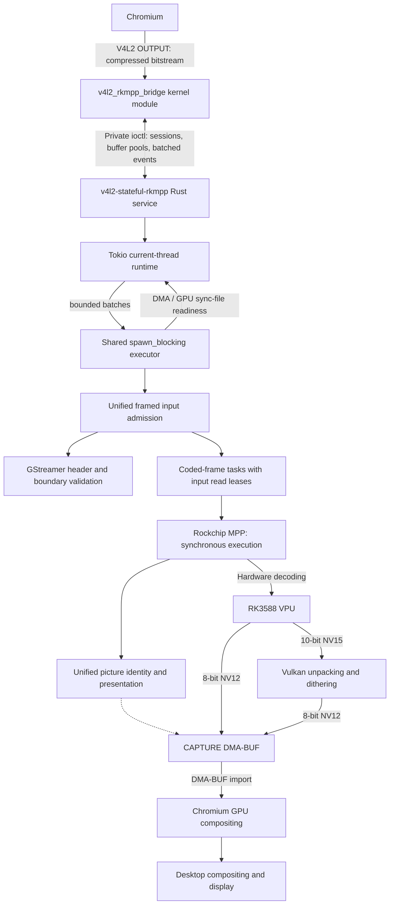

# v4l2-stateful-rkmpp

[简体中文](README.md) | [English](README.en.md)

## Introduction

Provides a V4L2 stateful decoder device for the RK3588 vendor kernel. A Rust service calls Rockchip MPP to enable hardware decoding in Chromium without modifying Chromium, Mesa, or MPP.

Supports H.264, HEVC, VP8, VP9, and AV1. Vulkan converts 10-bit video to 8-bit NV12 using dithering and quantization.

## Architecture



The service uses one Tokio orchestration thread for admission, session scheduling, diagnostics and shutdown. One shared `spawn_blocking` executor owns all MPP/Vulkan contexts and executes command batches with bounded decode progress. DMA dependencies and Vulkan completion are awaited asynchronously through sync-files; frame and CAPTURE leases remain held until conversion completes. Sessions do not create native threads. Shutdown stops admission, waits for session operations, then destroys hardware contexts on their execution thread. Vendor libraries may still create their own internal threads.

8-bit decoding uses registered CAPTURE buffers and waits for their return when the pool is exhausted. The service does not allocate temporary decode surfaces. It negotiates 18–32 CAPTURE buffers according to the stream’s reference/display storage budget. Vulkan handles images from retired pools or repeated presentations whose original buffer is still held by the client. The 10-bit conversion writes directly to the final CAPTURE buffers. The bridge performs no full-frame CPU copies.

## Build, install, and use

Building requires Rust, a C toolchain, matching vendor kernel headers, pahole, glslang, libclang, GStreamer codecparsers development headers and library, pkg-config, rockchip-mpp, and vulkan-icd-loader. Run from the project root:

```sh
make -C kernel
cargo build --release
```

Install the build outputs and load the module:

```sh
sudo install -Dm644 kernel/v4l2_rkmpp_bridge.ko "/usr/lib/modules/$(uname -r)/extra/v4l2_rkmpp_bridge.ko"
sudo depmod -a
sudo modprobe v4l2_rkmpp_bridge
sudo install -Dm755 target/release/v4l2-stateful-rkmpp /usr/bin/v4l2-stateful-rkmpp
sudo install -d -o root -g video -m 2770 /run/v4l2-stateful-rkmpp
```

The user running the service must belong to the video group. Use udev to set the bridge control/video devices, MPP devices, DMA heaps, and Panthor render devices to `root:video 0660`. Mesa PanVK is required at runtime. Start the service and keep it running:

```sh
v4l2-stateful-rkmpp serve /dev/v4l2-rkmpp-control /run/v4l2-stateful-rkmpp/status.sock
```

Launch Chromium:

```sh
chromium \
  --enable-features=AcceleratedVideoDecoder,AcceleratedVideoDecodeLinuxGL,AcceleratedVideoDecodeLinuxZeroCopyGL \
  --disable-features=ResolutionBasedDecoderPriority
```

Chromium uses its default choices for GTK, the display backend, ANGLE, and the compositing backend. The flags only enable hardware decoding and disable the preference for software decoding at low resolutions. Integration tests still require actual hardware decoding; software decoding does not satisfy the acceptance criteria.

After starting video playback, open `chrome://media-internals` and confirm that `kVideoDecoderName` is `V4L2VideoDecoder`.

Example FFmpeg command for V4L2 M2M decoding:

```sh
ffmpeg -c:v h264_v4l2m2m -i input.mp4 -an -fps_mode passthrough -f null -
```

For HEVC, VP8, and VP9, use `hevc_v4l2m2m`, `vp8_v4l2m2m`, and `vp9_v4l2m2m`, respectively, placing the decoder option before `-i`.

## Tested versions and known limitations

- Chromium **153.0.8010.36** (Arch Linux ARM): its stateful backend does not support HEVC. H.264, VP8, VP9, and AV1 have passed browser validation.
- FFmpeg **n9.0.2**: this tested build has no AV1 V4L2 M2M decoder. V4L2 M2M output may include storage padding in its height; crop exported images to their visible dimensions. This version compares only width and height when deciding whether to reallocate CAPTURE buffers, ignoring increases in `sizeimage`. It may reuse undersized buffers and end decoding early. Single-frame and other short streams may also trigger an internal assertion if the initial resolution change occurs during draining. Complete decoding with this FFmpeg version is therefore not guaranteed; the bridge retains strict buffer capacity checks.

These limitations apply to the listed tested versions and builds.

## Test commands

Tests require an RK3588 machine, Python 3.14+, uv, Rust nightly, FFmpeg, Chromium, and an available graphical desktop session. Run from the project root as a regular user in the video group. Kernel integration tests require an idle control device. Kernel and browser integration tests require the module to be loaded and any existing bridge service to be stopped manually before running.

Browser integration tests reject an already running service and ask you to stop it. Run `cargo build` first: browser tests only check and use `target/debug/v4l2-stateful-rkmpp` in the current checkout. They start and stop the service but do not build it, and fail if the binary is missing. Rebuild the service yourself after changing its source. Tests do not check whether the loaded module matches the source; update the module yourself. A passing result applies only to the module actually loaded. The running kernel identity is recorded under `kernel-runtime*/` in the pytest temporary directory, and the service identity used by each browser test is recorded in its `service-identity.json`.

The test interception library uses Rust's `c_variadic` feature to implement C variadic interfaces, so its Clippy checks, build, and tests require nightly. The main service uses stable Rust.

```sh
cargo +nightly fmt
cargo +nightly fmt --check
cargo clippy --all-targets -- -D warnings
cargo build
cargo test

cargo +nightly fmt --manifest-path tests/support/preload/Cargo.toml
cargo +nightly fmt --manifest-path tests/support/preload/Cargo.toml --check
cargo +nightly clippy --manifest-path tests/support/preload/Cargo.toml --target-dir target/kernel-mock --all-targets -- -D warnings
cargo +nightly build --manifest-path tests/support/preload/Cargo.toml --target-dir target/kernel-mock
cargo +nightly test --manifest-path tests/support/preload/Cargo.toml --target-dir target/kernel-mock

uv run ruff format
uv run ruff format --check
uv run ruff check
uv run basedpyright
uv run pytest
```

Run individual integration test groups or performance measurements:

```sh
uv run pytest tests/kernel
uv run pytest tests/service
uv run pytest tests/browser
uv run python -m tests.tools.performance
```

The performance tool measures CPU/GPU/MPP utilization and dropped frames for H.264, VP9, and AV1 at 4K30. Reports are saved to `target/benchmarks/`. The video group needs write permission on `/proc/mpp_service/load_interval`.

Compositor CPU usage is not collected by default; specify `--compositor-pid PID` to include it. GPU, MPP, and compositor load figures in the report reflect shared resource usage.
