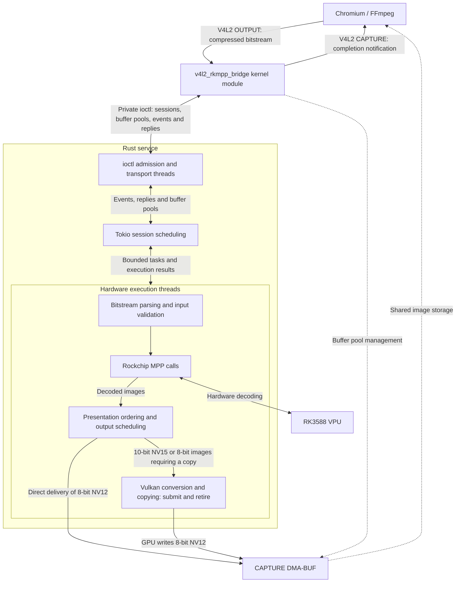

# v4l2-stateful-rkmpp

[简体中文](README.md) | [English](README.en.md)

## Introduction

Provides a V4L2 stateful decoder device for the RK3588 vendor kernel. A Rust service calls Rockchip MPP to enable hardware decoding in clients such as Chromium without modifying Chromium, Mesa, or MPP.

Supports H.264, HEVC, VP8, VP9, and AV1. Because Chromium has compatibility issues with 10-bit output, Vulkan unpacks, dithers, and quantizes 10-bit video to 8-bit NV12. 8-bit video outputs NV12 directly.

## Architecture



The kernel module provides V4L2 devices and manages sessions and buffers. The Rust service handles bitstream parsing, MPP decoding, presentation ordering, and GPU conversion. Blocking ioctls and hardware operations run on dedicated threads. Images are shared through DMA-BUF without full-frame CPU copies in the bridge. 8-bit images are usually delivered directly; Vulkan copies images from retired pools or repeated presentations whose original buffer is still held by the client. Frame completion replies return through the scheduler and transport threads to the kernel, which notifies the client to dequeue the frame.

## Build, install, and use

Requires an RK3588, matching vendor kernel headers, Rust, Python 3.14+, a C toolchain, pahole, glslang, libclang, pkg-config, GStreamer codecparsers development headers and library, rockchip-mpp, and vulkan-icd-loader. Mesa PanVK is required at runtime.

Build from the project root:

```sh
make -C kernel
cargo build --release
```

Install the kernel module and service, and load the module:

```sh
sudo install -Dm644 kernel/v4l2_rkmpp_bridge.ko "/usr/lib/modules/$(uname -r)/extra/v4l2_rkmpp_bridge.ko"
sudo depmod -a
sudo modprobe v4l2_rkmpp_bridge
sudo install -Dm755 target/release/v4l2-stateful-rkmpp /usr/bin/v4l2-stateful-rkmpp
sudo install -d -o root -g video -m 2770 /run/v4l2-stateful-rkmpp
```

The user running the service must belong to the `video` group. Use udev to set the bridge control/video devices, MPP devices, DMA heaps, and Panthor render devices to `root:video 0660`. The kernel module and service must use the same version.

Start the service and keep it running:

```sh
v4l2-stateful-rkmpp serve /dev/v4l2-rkmpp-control /run/v4l2-stateful-rkmpp/status.sock
```

Launch Chromium:

```sh
chromium \
  --enable-features=AcceleratedVideoDecoder,AcceleratedVideoDecodeLinuxGL,AcceleratedVideoDecodeLinuxZeroCopyGL \
  --disable-features=ResolutionBasedDecoderPriority
```

After starting video playback, open `chrome://media-internals` and confirm that `kVideoDecoderName` is `V4L2VideoDecoder`.

Example FFmpeg command:

```sh
ffmpeg -c:v h264_v4l2m2m -i input.mp4 -an -fps_mode passthrough -f null -
```

For HEVC, VP8, and VP9, use `hevc_v4l2m2m`, `vp8_v4l2m2m`, and `vp9_v4l2m2m`, respectively. Place the decoder option before `-i`.

## Known issues

- Chromium 153.0.8010.36 (Arch Linux ARM): the stateful backend does not support HEVC. H.264, VP8, VP9, and AV1 have passed browser validation.
- FFmpeg n9.0.2: provides AV1 decoders such as `av1` and `libdav1d`, but no `av1_v4l2m2m`. It cannot use this project's AV1 hardware decoding through that backend.
- This FFmpeg version's V4L2 M2M backend does not implement a flush callback. Seeking or looping cannot rely on `avcodec_flush_buffers()` to clear and reset hardware decoder state.

## Test commands

Requires an RK3588 machine, Python 3.14+, uv, Rust (with nightly installed separately for formatting), FFmpeg, Chromium, and an available graphical desktop session. Run from the project root as a regular user in the `video` group.

Before running kernel or browser integration tests, load the current version of the kernel module and stop any existing bridge service. Kernel integration tests require an idle control device and no other video clients creating sessions during the run. Browser integration tests start and stop the service using the prebuilt `target/debug/v4l2-stateful-rkmpp`; rebuild it after source changes.

```sh
cargo +nightly fmt --all
cargo +nightly fmt --all --check
cargo clippy --workspace --all-targets -- -D warnings
cargo build
cargo test --workspace --no-fail-fast

uv run ruff format
uv run ruff format --check
uv run ruff check
uv run basedpyright
uv run pytest
```

Run individual integration test groups:

```sh
uv run pytest tests/kernel
uv run pytest tests/service
uv run pytest tests/browser
```
