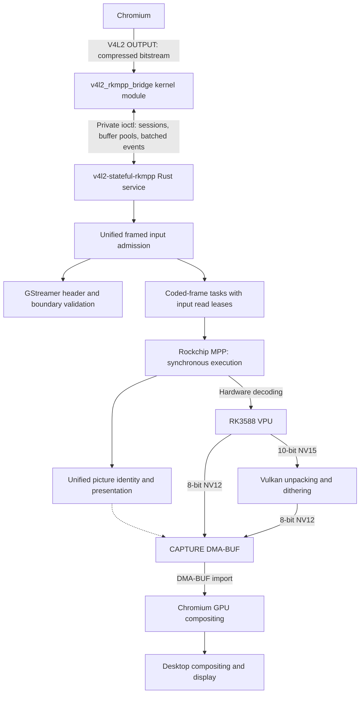

# v4l2-stateful-rkmpp

[简体中文](README.md) | [English](README.en.md)

## Introduction

Provides a V4L2 stateful decoder device for the RK3588 vendor kernel. A Rust service calls Rockchip MPP to enable hardware decoding in Chromium without modifying Chromium, Mesa, or MPP.

Supports H.264, HEVC, VP8, VP9, and AV1. Vulkan converts 10-bit video to 8-bit NV12 using dithering and quantization. The stateful backend in Chromium 153 tested on this machine does not support HEVC; the other codecs have passed browser validation.

## Architecture



8-bit decoding normally writes directly to CAPTURE buffers. Vulkan copies a frame into a reserved CAPTURE buffer when its source belongs to a retired pool, remains held by the client, or uses a temporary decode surface because decoding and presentation retain too many pictures simultaneously. Temporary surfaces are allocated on demand within a total limit of 32 decode surfaces; the V4L2 minimum buffer count stays unchanged. The 10-bit conversion writes directly to the final CAPTURE buffers. The bridge performs no full-frame CPU copies.

## Build, install, and use

Building requires Rust, a C toolchain, matching vendor kernel headers, pahole, glslang, libclang, GStreamer codecparsers development headers and library, pkg-config, rockchip-mpp, and vulkan-icd-loader. The service does not depend on libavcodec. Clients frame input: complete AUs or separate metadata for H.264/HEVC, frames for VP8/VP9, and temporal units for AV1; the module does not advertise continuous bytestream support. The service validates headers and boundaries, splits coded frames within AV1 TUs and VP9 superframes into separate tasks, and uses synchronous MPP execution for all five codecs. Normative H.264/HEVC POC and reference state drive the shared presentation scheduler. Ordinary STOP/START preserves reference pictures. AV1 uses MPP’s reference-preserving drain at each task completion to publish delayed displays; other codecs do not receive MPP EOS. Interlaced images retain their field order without implicit deinterlacing. Run from the project root:

```sh
make -C kernel
cargo build --release
```

Install the build outputs and load the module:

```sh
sudo install -Dm644 kernel/v4l2_rkmpp_bridge.ko "/usr/lib/modules/$(uname -r)/extra/v4l2_rkmpp_bridge.ko"
sudo depmod -a
sudo modprobe v4l2_rkmpp_bridge
sudo install -Dm755 target/release/v4l2-stateful-rkmpp /usr/bin/v4l2-stateful-rkmpp
sudo install -d -o root -g video -m 2770 /run/v4l2-stateful-rkmpp
```

The user running the service must belong to the video group. Use udev to set the bridge control/video devices, MPP devices, DMA heaps, and Panthor render devices to `root:video 0660`. Mesa PanVK is required at runtime. Start the service and keep it running:

```sh
v4l2-stateful-rkmpp serve /dev/v4l2-rkmpp-control /run/v4l2-stateful-rkmpp/status.sock
```

Launch Chromium:

```sh
chromium \
  --enable-features=AcceleratedVideoDecoder,AcceleratedVideoDecodeLinuxGL,AcceleratedVideoDecodeLinuxZeroCopyGL \
  --disable-features=ResolutionBasedDecoderPriority
```

Chromium uses its default choices for GTK, the display backend, ANGLE, and the compositing backend. The flags only enable hardware decoding and disable the preference for software decoding at low resolutions. Integration tests still require actual hardware decoding; software decoding does not satisfy the acceptance criteria.

After starting video playback, open `chrome://media-internals` and confirm that `kVideoDecoderName` is `V4L2VideoDecoder`.

FFmpeg exposes the following V4L2 M2M decoding entry point, but the locally installed version has the compatibility limitations described below:

```sh
ffmpeg -c:v h264_v4l2m2m -i input.mp4 -an -fps_mode passthrough -f null -
```

For HEVC, VP8, and VP9, use `hevc_v4l2m2m`, `vp8_v4l2m2m`, and `vp9_v4l2m2m`, respectively, placing the decoder option before `-i`. The locally installed FFmpeg has no AV1 V4L2 M2M decoder. FFmpeg may expose storage padding as part of the output height; crop exported images to their visible dimensions. The locally installed FFmpeg compares only width and height when deciding whether to reallocate CAPTURE buffers. It ignores increases in `sizeimage`, potentially reusing undersized buffers and ending decoding early. Single-frame and other short streams may also trigger an internal assertion if the initial resolution change occurs during draining. Complete FFmpeg decoding is therefore not guaranteed; the bridge retains its buffer capacity checks.

## Test commands

Tests require an RK3588 machine, Python 3.14+, uv, Rust nightly, FFmpeg, Chromium, and an available graphical desktop session. Run from the project root as a regular user in the video group. Kernel integration tests require an idle control device. Kernel and browser integration tests require the module to be loaded and any existing bridge service to be stopped manually before running.

Browser integration tests reject an already running service and ask you to stop it. Run `cargo build` first: browser tests only check and use `target/debug/v4l2-stateful-rkmpp` in the current checkout. They start and stop the service but do not build it, and fail if the binary is missing. Rebuild the service yourself after changing its source. Tests do not check whether the loaded module matches the source; update the module yourself. A passing result applies only to the module actually loaded. The running kernel identity is recorded under `kernel-runtime*/` in the pytest temporary directory, and the service identity used by each browser test is recorded in its `service-identity.json`.

The test interception library uses Rust's `c_variadic` feature to implement C variadic interfaces, so its Clippy checks, build, and tests require nightly. The main service uses stable Rust.

```sh
cargo +nightly fmt
cargo +nightly fmt --check
cargo clippy --all-targets -- -D warnings
cargo build
cargo test

cargo +nightly fmt --manifest-path tests/support/preload/Cargo.toml
cargo +nightly fmt --manifest-path tests/support/preload/Cargo.toml --check
cargo +nightly clippy --manifest-path tests/support/preload/Cargo.toml --target-dir target/kernel-mock --all-targets -- -D warnings
cargo +nightly build --manifest-path tests/support/preload/Cargo.toml --target-dir target/kernel-mock
cargo +nightly test --manifest-path tests/support/preload/Cargo.toml --target-dir target/kernel-mock

uv run ruff format
uv run ruff format --check
uv run ruff check
uv run basedpyright
uv run pytest
```

Run individual integration test groups or performance measurements:

```sh
uv run pytest tests/kernel
uv run pytest tests/service
uv run pytest tests/browser
uv run python -m tests.tools.performance
```

The performance tool measures CPU/GPU/MPP utilization and dropped frames for H.264, VP9, and AV1 at 4K30. Reports are saved to `target/benchmarks/`. The video group needs write permission on `/proc/mpp_service/load_interval`.

Compositor CPU usage is not collected by default; specify `--compositor-pid PID` to include it. GPU, MPP, and compositor load figures in the report reflect shared resource usage.
