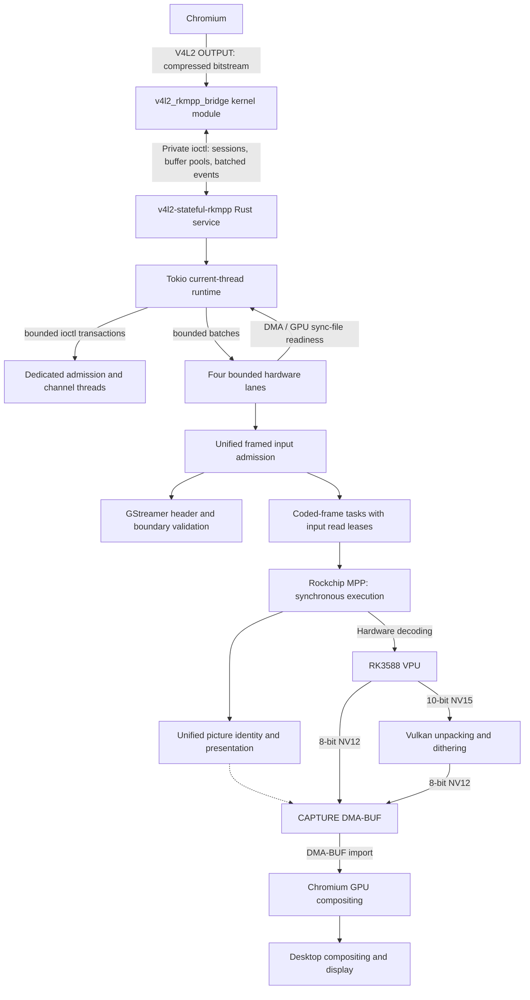

# v4l2-stateful-rkmpp

[简体中文](README.md) | [English](README.en.md)

## Introduction

Provides a V4L2 stateful decoder device for the RK3588 vendor kernel. A Rust service calls Rockchip MPP to enable hardware decoding in Chromium without modifying Chromium, Mesa, or MPP.

Supports H.264, HEVC, VP8, VP9, and AV1. Vulkan converts 10-bit video to 8-bit NV12 using dithering and quantization.

## Architecture



The service uses one Tokio orchestration thread for admission, session scheduling, diagnostics and shutdown. Startup creates one admission lane, four ioctl transport lanes and four hardware lanes, each with a queue capacity of 64. Admission is limited to 64 live sessions, including their entire lifetime while awaiting executor capacity. Further offers remain in the kernel until a session closes. New sessions select the lane with the fewest live session assignments, rotating ties; the assignment remains counted until all clients and their accepted transactions are released. Each session retains its transport and hardware affinity. Blocking ioctls run outside the orchestration thread, and cancellation retains submitted transactions. Hardware lanes own per-session MPP contexts and share one lazily created Vulkan device and compute pipeline. Command and submission resources remain independent; shared GPU queue submission is synchronized. DMA dependencies and completion are awaited through sync-files. Conversion retains source and destination leases while decoding may produce one pending picture. Sessions create no bridge native threads. Shutdown stops admission, collects session operations, then destroys hardware contexts on their owning threads. Vendor libraries may still create internal threads.

Diagnostics use one additional native lane with capacity for one queued operation. Procfs inventory and serialization run there, so a slow snapshot does not block decode scheduling. Accepted operations retain their client socket through cancellation; endpoint shutdown joins the lane before releasing its resources.

8-bit decoding uses registered CAPTURE buffers and waits for their return when the pool is exhausted. The service does not allocate temporary decode surfaces. It negotiates 18–32 CAPTURE buffers according to the stream’s reference/display storage budget. Vulkan handles images from retired pools or repeated presentations whose original buffer is still held by the client. 10-bit output negotiates a minimum of two CAPTURE buffers. Conversion writes directly to the final CAPTURE buffers. The bridge performs no full-frame CPU copies.

Before parsing the stream, provisional CAPTURE capacity reserves `aligned stride × rows × 2` for the pixel data and additional information in MPP's generic YUV420 allocation. This avoids undersized initial buffers caused by reserving only the NV12 pixel payload. The NV12 stride and UV offset remain unchanged; actual decoded capacity and minimum buffer counts are still strictly checked.

`kernel/bridge_uapi.h` is the sole private UAPI source. `crates/rkmpp-bridge-uapi/` provides Rust wire types and the `rkmpp_bridge_uapi` Python module in one crate. PyO3 bindings always compile, without an optional binding feature. `rkmpp-bridge-uapi/Cargo.toml` unconditionally enables the PyO3 `extension-module` feature to fix extension-module linkage: the importing interpreter supplies Python APIs, and the service has no runtime dependency on libpython. Bindgen derives the raw ABI; exhaustive field initialization and event/reply matches make incompatible protocol field or enum changes compile errors. Service validation and Python mock behavior remain independent. The packaged `.pyi` supplies static types, with tests comparing its public fields, constructor parameters and enum members against the actual extension. `uv run pytest` builds and installs this local package through maturin; wheels are local installation/cache artifacts and are not published. Cargo and uv both track header changes; build scripts, the workspace lockfile, sources and stubs also invalidate their respective caches. Protocol version 12 requires updating the service and kernel together. The kernel endpoint encapsulates ABI copies and descriptor rollback behind transitions on an opaque session. The service validates typed commands before registering pools. Admission owns immutable normalized H.264/HEVC sequence snapshots; presentation ordering reads those snapshots.

The main service stays in root `src/`. The root Cargo manifest manages the workspace and builds and checks every member by default. `crates/rkmpp/` owns MPP objects, buffer groups and nonblocking decode; `crates/codec-parser/` owns the GStreamer codecparser ABI and independent syntax parsing. Neither depends on the service or private UAPI. `crates/dma-buf/` supplies shared DMA-BUF ownership, CPU access and image views to MPP and GPU clients. The service translates V4L2 timestamps and field order. The UAPI Rust/Python interfaces compile together as part of the service dependency graph. The independent preload mock lives in `crates/v4l2-rkmpp-kernel-mock/` outside that graph. All packages share the root lockfile and output directory; every member uses stable Rust.

CPU maps and GPU conversions share process-local exclusion by storage identity. An opaque conversion reservation retains both image imports and access ownership from preparation until retirement or cancellation. Sync-files and Vulkan barriers provide device synchronization.

## Build, install, and use

An in-band end marker and a client STOP that delimit the same input prefix drain only once, so START continues the next sequence. Boundaries separated by new input remain distinct and drain in input order.

OUTPUT seeks preserve the independent streaming CAPTURE queue. After the stop
acknowledgement, the kernel republishes its registration and queued slots in the
new epoch, excluding images still held by the client. CAPTURE QBUF notifications
also work while OUTPUT is stopped.

An empty EOS LAST also refreshes CAPTURE permissions. The service pins retained
storage and restores write access only for slots actually queued by the kernel.
Clients can return LAST before START, while decoder reference state survives.

`crates/rkmpp/build.rs` derives private MPP functions, structures and control
constants from the selected SDK headers. `crates/native-sdk/` supplies shared
pkg-config discovery, compiler arguments, library selection and cache tracking
for MPP and GStreamer. Incompatible SDK declarations fail during compilation.

Building requires Rust, Python 3.14+, a C toolchain, matching vendor kernel headers, pahole, glslang, libclang, GStreamer codecparsers development headers and library, pkg-config, rockchip-mpp, and vulkan-icd-loader. Run from the project root:

```sh
make -C kernel
cargo build --release
```

Install the build outputs and load the module:

```sh
sudo install -Dm644 kernel/v4l2_rkmpp_bridge.ko "/usr/lib/modules/$(uname -r)/extra/v4l2_rkmpp_bridge.ko"
sudo depmod -a
sudo modprobe v4l2_rkmpp_bridge
sudo install -Dm755 target/release/v4l2-stateful-rkmpp /usr/bin/v4l2-stateful-rkmpp
sudo install -d -o root -g video -m 2770 /run/v4l2-stateful-rkmpp
```

The user running the service must belong to the video group. Use udev to set the bridge control/video devices, MPP devices, DMA heaps, and Panthor render devices to `root:video 0660`. Mesa PanVK is required at runtime. Start the service and keep it running:

```sh
v4l2-stateful-rkmpp serve /dev/v4l2-rkmpp-control /run/v4l2-stateful-rkmpp/status.sock
```

Launch Chromium:

```sh
chromium \
  --enable-features=AcceleratedVideoDecoder,AcceleratedVideoDecodeLinuxGL,AcceleratedVideoDecodeLinuxZeroCopyGL \
  --disable-features=ResolutionBasedDecoderPriority
```

Chromium uses its default choices for GTK, the display backend, ANGLE, and the compositing backend. The flags only enable hardware decoding and disable the preference for software decoding at low resolutions. Integration tests still require actual hardware decoding; software decoding does not satisfy the acceptance criteria.

After starting video playback, open `chrome://media-internals` and confirm that `kVideoDecoderName` is `V4L2VideoDecoder`.

Example FFmpeg command for V4L2 M2M decoding:

```sh
ffmpeg -c:v h264_v4l2m2m -i input.mp4 -an -fps_mode passthrough -f null -
```

For HEVC, VP8, and VP9, use `hevc_v4l2m2m`, `vp8_v4l2m2m`, and `vp9_v4l2m2m`, respectively, placing the decoder option before `-i`.

## Tested versions and known limitations

- Chromium **153.0.8010.36** (Arch Linux ARM): its stateful backend does not support HEVC. H.264, VP8, VP9, and AV1 have passed browser validation.
- FFmpeg **n9.0.2**: this tested build has no AV1 V4L2 M2M decoder. V4L2 M2M output may include storage padding in its height; crop exported images to their visible dimensions. This version compares only width and height when deciding whether to reallocate CAPTURE buffers, ignoring increases in `sizeimage`. It may reuse undersized buffers and end decoding early. Single-frame and other short streams may also trigger an internal assertion if the initial resolution change occurs during draining. Complete decoding with this FFmpeg version is therefore not guaranteed; the bridge retains strict buffer capacity checks.

These limitations apply to the listed tested versions and builds.

## Test commands

Tests require an RK3588 machine, Python 3.14+, uv, Rust nightly, FFmpeg, Chromium, and an available graphical desktop session. Run from the project root as a regular user in the video group. Kernel integration tests require an idle control device and no other video clients creating sessions during the run. Kernel and browser integration tests require the module to be loaded and any existing bridge service to be stopped manually before running.

Browser integration tests reject an already running service and ask you to stop it. Run `cargo build` first: browser tests only check and use `target/debug/v4l2-stateful-rkmpp` in the current checkout. They start and stop the service but do not build it, and fail if the binary is missing. Rebuild the service yourself after changing its source. Tests do not check whether the loaded module matches the source; update the module yourself. A passing result applies only to the module actually loaded. The running kernel identity is recorded under `kernel-runtime*/` in the pytest temporary directory, and the service identity used by each browser test is recorded in its `service-identity.json`.

On aarch64 and x86_64, stable naked ABI entrypoints preserve C variadic argument registers; only system calls requiring an argument consume it. The default workspace commands build and check the service, bindings and interception library together. Nightly is used only for formatting.

```sh
cargo +nightly fmt --all
cargo +nightly fmt --all --check
cargo clippy --workspace --all-targets -- -D warnings
cargo build
cargo test --workspace --no-fail-fast

uv run ruff format
uv run ruff format --check
uv run ruff check
uv run basedpyright
uv run pytest
```

Run individual integration test groups or performance measurements:

```sh
uv run pytest tests/kernel
uv run pytest tests/service
uv run pytest tests/browser
uv run python -m tests.tools.performance
```

`tests/tools/` contains only tool directories, currently just `performance/`, run with `python -m tests.tools.performance`. Its entry point, implementation and corresponding tests live together. The UAPI Python interface and Rust wire types live together in `crates/rkmpp-bridge-uapi/`; uv builds that same crate as a local Python dependency. All packages share a Cargo workspace, dev profile and root `target/` directory for development builds. Video expansion shared by browser tests and performance measurement lives in `tests/support/video_expansion.py`.

The performance tool measures CPU/GPU/MPP utilization and dropped frames for H.264, VP9, and AV1 at 4K30. Reports are saved to `target/benchmarks/`. The video group needs write permission on `/proc/mpp_service/load_interval`.

Compositor CPU usage is not collected by default; specify `--compositor-pid PID` to include it. GPU, MPP, and compositor load figures in the report reflect shared resource usage.

Performance reports use schema v7. CPU samples retain each counter's `interval_start`, `elapsed`, and `percent`; each source uses its own acquisition interval and excludes intervals crossing warmup. Visible process births, exits, PID reuse, or role changes make Chromium CPU `percent` null for that interval. Sampling resumes from the next snapshot. Summaries exclude missing rates and publish `missing_seconds` and `missing_samples` alongside observed coverage. A process born and exited entirely between snapshots is unobservable through procfs snapshots; tree measurements cover snapshot-visible processes. Service CPU counters remain independent of tree coverage.

Playback counters, CPU and hardware samples share one host monotonic origin, including initialization time. Browser presentation callbacks retain their relative `performance.now()` times. `origin_earliest_seconds` and `origin_latest_seconds` bound that renderer origin relative to the host origin. Presentation summaries include only intervals that are wholly after warmup even at the earliest possible origin; slow CDP communication excludes uncertain intervals from the steady summary.

Dropped-frame rates use counter differences over a complete post-warmup observation window and include its start/end times. Lifetime playback counters are retained separately. Insufficient post-warmup frame observations report missing data instead of a zero dropped-frame rate.
