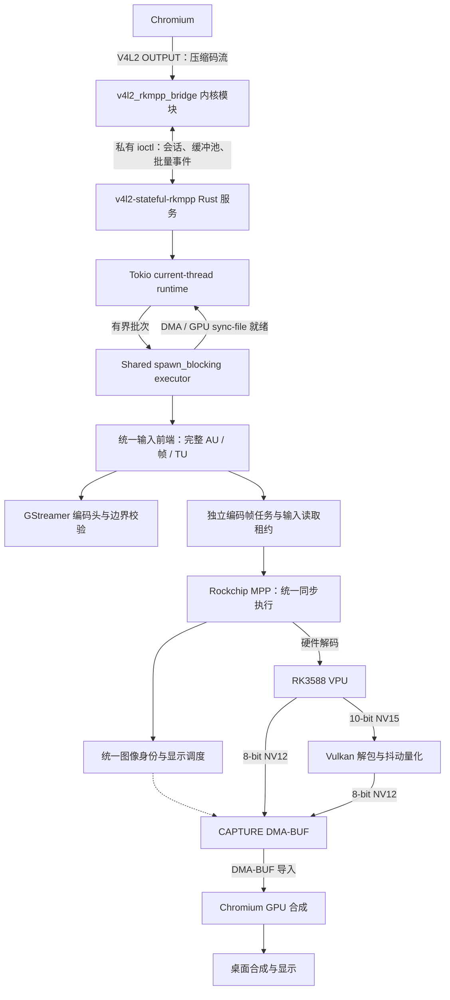

# v4l2-stateful-rkmpp

[简体中文](README.md) | [English](README.en.md)

## 简介

为 RK3588 vendor 内核提供 V4L2 stateful 解码设备，通过 Rust 服务调用 Rockchip MPP，使 Chromium 使用硬件解码，无需修改 Chromium、Mesa 或 MPP。

支持 H.264、HEVC、VP8、VP9、AV1。10-bit 视频经 Vulkan 抖动量化为 8-bit NV12 输出。

## 架构



服务用一个 Tokio 调度线程处理接入、会话调度、诊断和退出；一个共享的 `spawn_blocking` 执行器持有全部 MPP／Vulkan 上下文，按批处理命令和有界解码推进。DMA 依赖和 Vulkan 完成通过 sync-file 交给 async 调度等待；帧和 CAPTURE 租约保留到转换完成。新增会话不创建原生线程。退出时停止接入，等待会话操作完成，再在执行线程上销毁硬件上下文。第三方库仍可能创建内部线程。

8-bit 解码使用注册的 CAPTURE 缓冲区，池耗尽时等待缓冲区归还，不分配临时解码表面。最小 CAPTURE 数按流的参考/显示存储预算在 18–32 之间协商。来自旧缓冲池的图像、原缓冲区仍由客户端持有的重复显示由 Vulkan 处理。10-bit 转换直接写入最终 CAPTURE 缓冲区，桥接过程没有 CPU 整帧复制。

## 编译/安装/使用方式

源码编译需要 Rust、C 工具链、匹配的 vendor 内核 headers、pahole、glslang、libclang、GStreamer codecparsers 开发头文件及库、pkg-config、rockchip-mpp 和 vulkan-icd-loader。在项目根目录执行：

```sh
make -C kernel
cargo build --release
```

安装编译产物并加载模块：

```sh
sudo install -Dm644 kernel/v4l2_rkmpp_bridge.ko "/usr/lib/modules/$(uname -r)/extra/v4l2_rkmpp_bridge.ko"
sudo depmod -a
sudo modprobe v4l2_rkmpp_bridge
sudo install -Dm755 target/release/v4l2-stateful-rkmpp /usr/bin/v4l2-stateful-rkmpp
sudo install -d -o root -g video -m 2770 /run/v4l2-stateful-rkmpp
```

运行用户需属于 video 组，通过 udev 将桥接控制/视频设备、MPP、DMA heaps 和 Panthor render 设备设为 `root:video 0660`。运行环境需要 Mesa PanVK。启动服务并保持运行：

```sh
v4l2-stateful-rkmpp serve /dev/v4l2-rkmpp-control /run/v4l2-stateful-rkmpp/status.sock
```

启动 Chromium：

```sh
chromium \
  --enable-features=AcceleratedVideoDecoder,AcceleratedVideoDecodeLinuxGL,AcceleratedVideoDecodeLinuxZeroCopyGL \
  --disable-features=ResolutionBasedDecoderPriority
```

Chromium 的 GTK、显示后端、ANGLE 和合成后端均使用其默认选择。只保留硬解功能开关及禁用小分辨率优先软解的开关；集测仍要求实际使用硬解，不以软解通过验收。

播放视频后，在 `chrome://media-internals` 确认 `kVideoDecoderName` 为 `V4L2VideoDecoder`。

FFmpeg 的 V4L2 M2M 解码命令示例：

```sh
ffmpeg -c:v h264_v4l2m2m -i input.mp4 -an -fps_mode passthrough -f null -
```

HEVC、VP8、VP9 分别使用 `hevc_v4l2m2m`、`vp8_v4l2m2m`、`vp9_v4l2m2m`，解码器参数放在 `-i` 前。

## 测试版本及已知限制

- Chromium **153.0.8010.36**（Arch Linux ARM）：stateful 后端不支持 HEVC；H.264、VP8、VP9、AV1 已通过浏览器验证。
- FFmpeg **n9.0.2**：该测试构建没有 AV1 V4L2 M2M 解码器。V4L2 M2M 输出可能将存储对齐行计入高度，导出图像时需按可见尺寸裁剪。该版本仅比较宽高来决定是否重建 CAPTURE，忽略 `sizeimage` 增大，可能复用过小的缓冲区并提前结束解码；单帧等短流在排空期间遇到首次分辨率变化时，还可能触发内部断言。因此该版本的 FFmpeg 尚不能保证完整解码，桥接仍严格检查缓冲区容量。

以上限制对应所列测试版本及构建。

## 测试命令

需要 RK3588 实机、Python 3.14+、uv、Rust nightly、FFmpeg、Chromium 及可用的桌面图形会话。使用 video 组普通用户，在项目根目录执行。内核集测要求控制设备空闲；内核/浏览器集测要求模块已加载，且运行前手动停止现有桥接服务。浏览器集测发现已有服务会报错提示停止；请先运行 `cargo build`，浏览器集测只检查并使用当前目录的 `target/debug/v4l2-stateful-rkmpp`，负责启停但不自动编译，未构建时直接报错。修改源码后需自行重新构建服务。测试不检查已加载模块是否与源码一致，请自行更新模块；通过只代表实际加载的模块通过验收。实际内核身份和浏览器使用的服务身份分别记录在 pytest 临时目录的 `kernel-runtime*/` 和各浏览器 case 的 `service-identity.json`。

测试拦截库使用 Rust 的 `c_variadic` 特性实现 C 可变参数接口，因此其 Clippy、编译和测试需要 nightly；主服务使用 stable。

```sh
cargo +nightly fmt
cargo +nightly fmt --check
cargo clippy --all-targets -- -D warnings
cargo build
cargo test

cargo +nightly fmt --manifest-path tests/support/preload/Cargo.toml
cargo +nightly fmt --manifest-path tests/support/preload/Cargo.toml --check
cargo +nightly clippy --manifest-path tests/support/preload/Cargo.toml --target-dir target/kernel-mock --all-targets -- -D warnings
cargo +nightly build --manifest-path tests/support/preload/Cargo.toml --target-dir target/kernel-mock
cargo +nightly test --manifest-path tests/support/preload/Cargo.toml --target-dir target/kernel-mock

uv run ruff format
uv run ruff format --check
uv run ruff check
uv run basedpyright
uv run pytest
```

单独执行集测或性能测量：

```sh
uv run pytest tests/kernel
uv run pytest tests/service
uv run pytest tests/browser
uv run python -m tests.tools.performance
```

性能工具测量 H.264、VP9、AV1 4K30 的 CPU/GPU/MPP 占用与丢帧，报告保存到 `target/benchmarks/`；需对 `/proc/mpp_service/load_interval` 配置 video 组写权限。

性能工具默认不采集合成器 CPU，可用 `--compositor-pid PID` 显式指定；报告中的 GPU、MPP 和合成器负载是共享负载。
