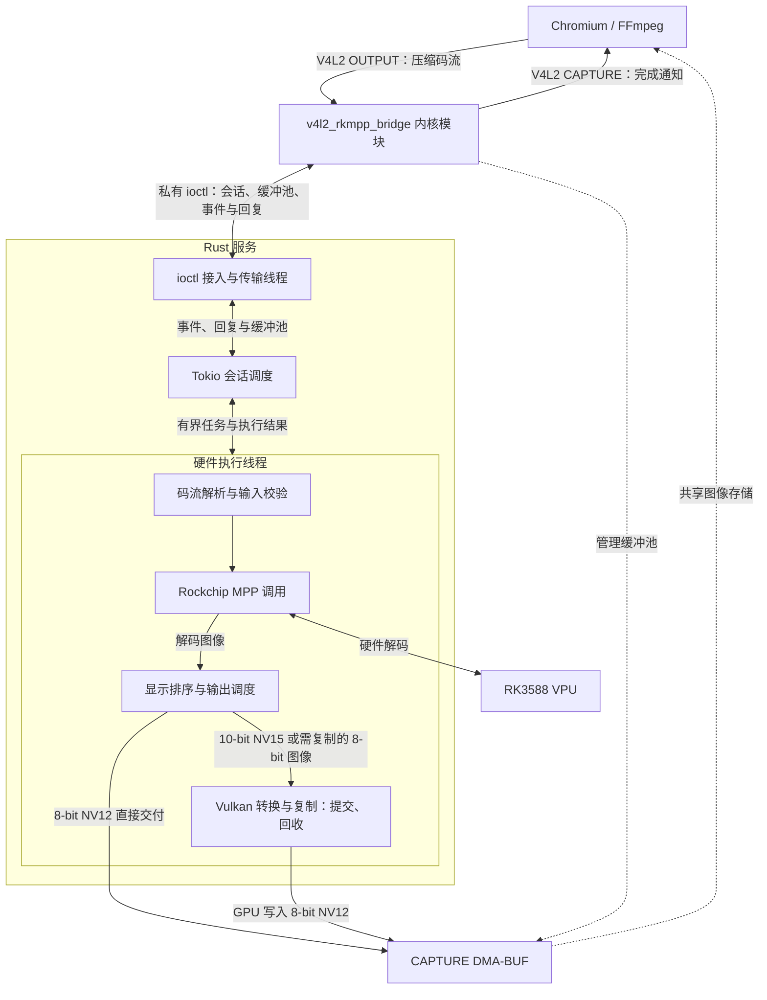

# v4l2-stateful-rkmpp

[简体中文](README.md) | [English](README.en.md)

## 简介

为 RK3588 vendor 内核提供 V4L2 stateful 解码设备，通过 Rust 服务调用 Rockchip MPP，让 Chromium 等客户端使用硬件解码，无需修改 Chromium、Mesa 或 MPP。

支持 H.264、HEVC、VP8、VP9、AV1。由于 Chromium 的 10-bit 输出存在兼容性问题，10-bit 视频通过 Vulkan 解包、抖动量化为 8-bit NV12；8-bit 视频直接输出 NV12。

## 架构



内核模块提供 V4L2 设备并管理会话和缓冲区；Rust 服务负责码流解析、MPP 解码、显示排序和 GPU 转换。阻塞 ioctl 与硬件操作在独立线程执行，图像通过 DMA-BUF 共享，桥接过程没有 CPU 整帧复制。8-bit 图像通常直接交付；旧缓冲池图像或原缓冲区仍由客户端持有的重复显示通过 Vulkan 复制。帧完成回复经调度、传输线程返回内核，再通知客户端取帧。

## 编译/安装/使用方式

需要 RK3588、匹配的 vendor 内核 headers、Rust、Python 3.14+、C 工具链、pahole、glslang、libclang、pkg-config、GStreamer codecparsers 开发头文件及库、rockchip-mpp 和 vulkan-icd-loader。运行环境需要 Mesa PanVK。

在项目根目录编译：

```sh
make -C kernel
cargo build --release
```

安装并加载内核模块及服务：

```sh
sudo install -Dm644 kernel/v4l2_rkmpp_bridge.ko "/usr/lib/modules/$(uname -r)/extra/v4l2_rkmpp_bridge.ko"
sudo depmod -a
sudo modprobe v4l2_rkmpp_bridge
sudo install -Dm755 target/release/v4l2-stateful-rkmpp /usr/bin/v4l2-stateful-rkmpp
sudo install -d -o root -g video -m 2770 /run/v4l2-stateful-rkmpp
```

运行用户需属于 `video` 组，通过 udev 将桥接控制/视频设备、MPP、DMA heaps 和 Panthor render 设备设为 `root:video 0660`。内核模块与服务需使用同一版本。

启动服务并保持运行：

```sh
v4l2-stateful-rkmpp serve /dev/v4l2-rkmpp-control /run/v4l2-stateful-rkmpp/status.sock
```

启动 Chromium：

```sh
chromium \
  --enable-features=AcceleratedVideoDecoder,AcceleratedVideoDecodeLinuxGL,AcceleratedVideoDecodeLinuxZeroCopyGL \
  --disable-features=ResolutionBasedDecoderPriority
```

播放视频后，在 `chrome://media-internals` 确认 `kVideoDecoderName` 为 `V4L2VideoDecoder`。

FFmpeg 使用示例：

```sh
ffmpeg -c:v h264_v4l2m2m -i input.mp4 -an -fps_mode passthrough -f null -
```

HEVC、VP8、VP9 分别使用 `hevc_v4l2m2m`、`vp8_v4l2m2m`、`vp9_v4l2m2m`，解码器参数放在 `-i` 前。

## 已知问题

- Chromium 153.0.8010.36（Arch Linux ARM）的 stateful 后端不支持 HEVC；H.264、VP8、VP9、AV1 已通过浏览器验证。
- FFmpeg n9.0.2 提供 `av1`、`libdav1d` 等 AV1 解码器，但没有 `av1_v4l2m2m`，无法通过该后端调用本项目进行 AV1 硬解。
- 该 FFmpeg 版本的 V4L2 M2M 后端未实现 flush 回调，seek 或循环播放时不能依赖 `avcodec_flush_buffers()` 清空并重置硬件解码状态。

## 测试命令

需要 RK3588 实机、Python 3.14+、uv、Rust（另装 nightly 用于格式化）、FFmpeg、Chromium 和可用的桌面图形会话。使用 `video` 组普通用户，在项目根目录执行。

内核和浏览器集测前需加载当前版本的内核模块，并停止已有桥接服务。内核集测期间控制设备需空闲，不能有其他视频客户端创建会话。浏览器集测负责启停服务，使用预先构建的 `target/debug/v4l2-stateful-rkmpp`，源码变更后需重新构建。

```sh
cargo +nightly fmt --all
cargo +nightly fmt --all --check
cargo clippy --workspace --all-targets -- -D warnings
cargo build
cargo test --workspace --no-fail-fast

uv run ruff format
uv run ruff format --check
uv run ruff check
uv run basedpyright
uv run pytest
```

分别运行集测：

```sh
uv run pytest tests/kernel
uv run pytest tests/service
uv run pytest tests/browser
```
