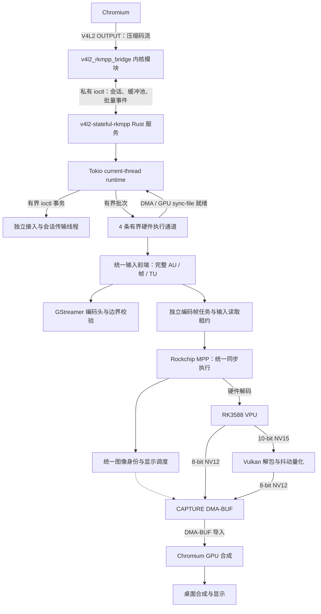

# v4l2-stateful-rkmpp

[简体中文](README.md) | [English](README.en.md)

## 简介

为 RK3588 vendor 内核提供 V4L2 stateful 解码设备，通过 Rust 服务调用 Rockchip MPP，使 Chromium 使用硬件解码，无需修改 Chromium、Mesa 或 MPP。

支持 H.264、HEVC、VP8、VP9、AV1。10-bit 视频经 Vulkan 抖动量化为 8-bit NV12 输出，因为 chromium 的10-bit输出有问题。

## 架构



服务用一个 Tokio 调度线程处理接入、会话调度、诊断和退出。启动时创建 1 条接入、4 条 ioctl 传输和 4 条硬件执行通道，队列容量均为 64；最多同时接入 64 个会话，名额覆盖整个会话生命周期；满额时后续 offer 保留在内核中，关闭会话后继续接入。新会话优先分配到存活会话较少的通道，数量相同时轮询；计数持续到所有客户端及其已提交事务全部释放。会话固定归属一条传输通道和一条硬件通道。阻塞 ioctl 不占用调度线程；取消等待不丢失已提交的事务。硬件通道持有各会话的 MPP 上下文，共享一个延迟创建的 Vulkan 设备和计算管线，独立持有命令与提交资源；共享 GPU 队列的提交受锁保护。DMA 依赖和 Vulkan 完成通过 sync-file 交给异步调度等待。转换期间保留源、目标租约，允许解码推进到一个待输出图片。新增会话不创建桥接原生线程。退出先停止接入并收齐会话操作，再在所属线程上销毁硬件上下文。第三方库仍可能创建内部线程。

诊断另有 1 条原生执行通道，最多排队 1 个操作。procfs 清单扫描和序列化在该通道执行，慢快照不会阻塞解码调度。已接收的操作在取消等待后仍保留客户端 socket；诊断端点退出时会等待通道结束，再释放资源。

8-bit 解码使用注册的 CAPTURE 缓冲区，池耗尽时等待缓冲区归还，不分配临时解码表面。最小 CAPTURE 数按流的参考/显示存储预算在 18–32 之间协商。来自旧缓冲池的图像、原缓冲区仍由客户端持有的重复显示由 Vulkan 处理。10-bit 输出只需协商至少 2 个 CAPTURE 缓冲区，转换直接写入最终 CAPTURE 缓冲区，桥接过程没有 CPU 整帧复制。

私有 UAPI 以 `kernel/bridge_uapi.h` 为唯一来源。`crates/rkmpp-bridge-uapi/` 在同一 crate 中提供 Rust wire 类型和 Python 模块 `rkmpp_bridge_uapi`，PyO3 绑定始终编译，没有可选绑定 feature。`rkmpp-bridge-uapi/Cargo.toml` 无条件启用 PyO3 的 `extension-module` feature，固定使用扩展模块链接模式，Python API 由加载扩展的解释器提供，主服务的运行时不依赖 libpython。bindgen 生成原始 ABI；Python 字段使用穷尽初始化，事件和回复使用穷尽匹配，协议字段或枚举发生不兼容变化时会直接产生编译错误。Rust 服务校验和 Python mock 行为分别实现。随扩展发布的 `.pyi` 用于类型检查，测试核对存根与实际公开字段、构造参数和枚举成员。`uv run pytest` 通过 maturin 在本地构建、安装该包，wheel 仅作为本地安装缓存，不对外发布。Cargo 和 uv 都跟踪头文件变化，构建脚本、workspace 锁文件、源码或存根变化也会使相应缓存失效。协议版本为 12，服务与内核需一起更新。内核端点封装 ABI 拷贝和 fd 回滚，通过状态迁移接口访问不透明会话；服务先将事件转换为强类型命令，再注册缓冲池。H.264/HEVC 的序列配置由接纳层保存为不可变快照，显示排序只读取归一化结果。

主服务保留在根目录 `src/`；根 `Cargo.toml` 同时管理整个 workspace，默认构建并验证全部成员。`crates/rkmpp/` 封装 MPP 对象、缓冲组和非阻塞解码；`crates/codec-parser/` 封装 GStreamer codecparser ABI 和独立的语法解析；两者不依赖主服务或私有 UAPI。`crates/dma-buf/` 为 MPP 和 GPU 提供共享的 DMA-BUF 所有权、CPU 访问与图像视图。服务负责 V4L2 时间戳和场序转换。UAPI 的 Rust/Python 接口共同进入服务构建；内核 preload mock 位于独立的 `crates/v4l2-rkmpp-kernel-mock/`，不进入服务依赖链。所有包共用根锁文件和构建目录；全部成员使用 stable 编译器。

本进程的 CPU 映射与 GPU 转换共享按存储身份建立的互斥状态。转换预留同时持有图像导入对象和访问权，从准备提交持续至完成回收或取消。设备同步继续使用 sync-file 与 Vulkan 屏障。

码流结束标记与客户端 STOP 指向同一输入边界时只排空一次，START 后继续下一段；中间有新输入的独立边界仍按顺序排空。

OUTPUT seek 独立于 CAPTURE 队列：OUTPUT 停流确认后，内核在新 epoch 重发仍在流送的 CAPTURE 注册和实际已排队槽位；客户端持有的图片不会重新授权写入。CAPTURE 已启动时的 QBUF 不依赖 OUTPUT 是否启动。

内核完成空 EOS LAST 时也会重发 CAPTURE 写入权限快照；服务先保留所有未再次排队的槽位，再按内核实际队列恢复写入权限。客户端可在 START 前合法归还 LAST，恢复解码仍保留编码参考状态。

MPP 的函数、结构和控制码由 `crates/rkmpp/build.rs` 从选中的 SDK 头文件生成，私有 ABI 不再由服务手写。`crates/native-sdk/` 统一提供 MPP 和 GStreamer 的 pkg-config 发现、头文件参数、链接选择及构建缓存失效跟踪；SDK 不兼容在编译阶段暴露。

## 编译/安装/使用方式

源码编译需要 Rust、Python 3.14+、C 工具链、匹配的 vendor 内核 headers、pahole、glslang、libclang、GStreamer codecparsers 开发头文件及库、pkg-config、rockchip-mpp 和 vulkan-icd-loader。在项目根目录执行：

```sh
make -C kernel
cargo build --release
```

安装编译产物并加载模块：

```sh
sudo install -Dm644 kernel/v4l2_rkmpp_bridge.ko "/usr/lib/modules/$(uname -r)/extra/v4l2_rkmpp_bridge.ko"
sudo depmod -a
sudo modprobe v4l2_rkmpp_bridge
sudo install -Dm755 target/release/v4l2-stateful-rkmpp /usr/bin/v4l2-stateful-rkmpp
sudo install -d -o root -g video -m 2770 /run/v4l2-stateful-rkmpp
```

运行用户需属于 video 组，通过 udev 将桥接控制/视频设备、MPP、DMA heaps 和 Panthor render 设备设为 `root:video 0660`。运行环境需要 Mesa PanVK。启动服务并保持运行：

```sh
v4l2-stateful-rkmpp serve /dev/v4l2-rkmpp-control /run/v4l2-stateful-rkmpp/status.sock
```

启动 Chromium：

```sh
chromium \
  --enable-features=AcceleratedVideoDecoder,AcceleratedVideoDecodeLinuxGL,AcceleratedVideoDecodeLinuxZeroCopyGL \
  --disable-features=ResolutionBasedDecoderPriority
```

Chromium 的 GTK、显示后端、ANGLE 和合成后端均使用其默认选择。只保留硬解功能开关及禁用小分辨率优先软解的开关；集测仍要求实际使用硬解，不以软解通过验收。

播放视频后，在 `chrome://media-internals` 确认 `kVideoDecoderName` 为 `V4L2VideoDecoder`。

FFmpeg 的 V4L2 M2M 解码命令示例：

```sh
ffmpeg -c:v h264_v4l2m2m -i input.mp4 -an -fps_mode passthrough -f null -
```

HEVC、VP8、VP9 分别使用 `hevc_v4l2m2m`、`vp8_v4l2m2m`、`vp9_v4l2m2m`，解码器参数放在 `-i` 前。

## 测试版本及已知限制

- Chromium **153.0.8010.36**（Arch Linux ARM）：stateful 后端不支持 HEVC；H.264、VP8、VP9、AV1 已通过浏览器验证。
- FFmpeg **n9.0.2**：该测试构建没有 AV1 V4L2 M2M 解码器。V4L2 M2M 输出可能将存储对齐行计入高度，导出图像时需按可见尺寸裁剪。该版本仅比较宽高来决定是否重建 CAPTURE，忽略 `sizeimage` 增大，可能复用过小的缓冲区并提前结束解码；单帧等短流在排空期间遇到首次分辨率变化时，还可能触发内部断言。因此该版本的 FFmpeg 尚不能保证完整解码，桥接仍严格检查缓冲区容量。

以上限制对应所列测试版本及构建。

## 测试命令

需要 RK3588 实机、Python 3.14+、uv、Rust nightly、FFmpeg、Chromium 及可用的桌面图形会话。使用 video 组普通用户，在项目根目录执行。内核集测要求控制设备空闲，且运行期间没有其他视频客户端创建会话；内核/浏览器集测要求模块已加载，且运行前手动停止现有桥接服务。浏览器集测发现已有服务会报错提示停止；请先运行 `cargo build`，浏览器集测只检查并使用当前目录的 `target/debug/v4l2-stateful-rkmpp`，负责启停但不自动编译，未构建时直接报错。修改源码后需自行重新构建服务。测试不检查已加载模块是否与源码一致，请自行更新模块；通过只代表实际加载的模块通过验收。实际内核身份和浏览器使用的服务身份分别记录在 pytest 临时目录的 `kernel-runtime*/` 和各浏览器 case 的 `service-identity.json`。

测试拦截库在 aarch64 和 x86_64 上通过稳定的裸函数 ABI 入口保留 C 可变参数寄存器；只有需要参数的系统调用才读取它。主服务、绑定与拦截库均由默认工作区命令构建和验证；nightly 仅用于格式化。

```sh
cargo +nightly fmt --all
cargo +nightly fmt --all --check
cargo clippy --workspace --all-targets -- -D warnings
cargo build
cargo test --workspace --no-fail-fast

uv run ruff format
uv run ruff format --check
uv run ruff check
uv run basedpyright
uv run pytest
```

单独执行集测或性能测量：

```sh
uv run pytest tests/kernel
uv run pytest tests/service
uv run pytest tests/browser
uv run python -m tests.tools.performance
```

`tests/tools/` 根目录只包含工具目录，目前仅有 `performance/`，通过 `python -m tests.tools.performance` 运行，目录内集中放置入口、实现和对应测试。

性能工具测量 H.264、VP9、AV1 4K30 的 CPU/GPU/MPP 占用与丢帧，报告保存到 `target/benchmarks/`；需对 `/proc/mpp_service/load_interval` 配置 video 组写权限。

性能工具默认不采集合成器 CPU，可用 `--compositor-pid PID` 显式指定；报告中的 GPU、MPP 和合成器负载是共享负载。

CPU 原始样本按计数器保存 `interval_start`、`elapsed` 和 `percent`。进程树和服务诊断分别以采集完成时刻标记观测，分别排除跨越预热边界的区间，并按各自实际观测时长计算平均值；采集不是原子快照。硬件样本的 `elapsed` 表示本轮采集完成时间，不替代 CPU 计数器的区间。

播放计数、CPU 和硬件采样共用同一个主机单调时钟起点，初始化耗时也计入测量时长。浏览器呈现回调保留其 `performance.now()` 相对时间；报告的 `origin_earliest_seconds` 和 `origin_latest_seconds` 给出该起点相对于主机起点的范围。呈现汇总只接纳在最早可能的起点下仍完整越过预热边界的间隔；慢 CDP 通信产生的不确定区间不计入稳定段。

性能报告使用 schema v7。进程树发生可见的新建、退出、PID 复用或角色变化时，该区间的 Chromium CPU `percent` 为 `null`；后续稳定区间继续采样。汇总仅使用有完整计数差值的区间，并记录 `missing_seconds` 和 `missing_samples`，不会把缺失计数当成空闲。两次快照之间完成整个生命周期的短命进程无法由 procfs 快照观测，进程树指标的范围明确限定为快照可见进程。服务自身的 CPU 计数不受该进程树缺失影响。

丢帧率使用完整预热后观察窗口的帧计数差值，并记录窗口起止时间；原始整段播放累计计数另行保留。没有足够的预热后观察帧时报告缺少数据，不生成零丢帧率。
