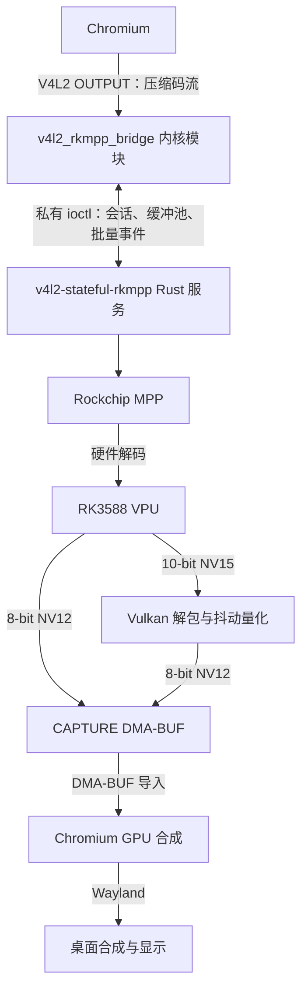

# v4l2-stateful-rkmpp

## 简介

为 RK3588 vendor 内核提供 V4L2 stateful 解码设备，通过 Rust 服务调用 Rockchip MPP，使 Chromium 使用硬件解码，无需修改 Chromium、Mesa 或 MPP。

支持 H.264、HEVC、VP8、VP9、AV1。10-bit 视频经 Vulkan 抖动量化为 8-bit NV12 输出。本机 Chromium 153 的 stateful 后端不支持 HEVC，其余编码已通过浏览器验证。

## 架构



8-bit 解码直接写入 CAPTURE 缓冲区；10-bit 转换直接写入最终 CAPTURE 缓冲区，桥接过程没有 CPU 整帧复制。

## 编译/安装/使用方式

源码编译需要 Rust、C 工具链、匹配的 vendor 内核 headers、pahole、glslang、rockchip-mpp 和 vulkan-icd-loader。在项目根目录执行：

```sh
make -C kernel
cargo build --release
```

安装编译产物并加载模块：

```sh
sudo install -Dm644 kernel/v4l2_rkmpp_bridge.ko "/usr/lib/modules/$(uname -r)/extra/v4l2_rkmpp_bridge.ko"
sudo depmod -a
sudo modprobe v4l2_rkmpp_bridge
sudo install -Dm755 target/release/v4l2-stateful-rkmpp /usr/bin/v4l2-stateful-rkmpp
sudo install -d -o root -g video -m 2770 /run/v4l2-stateful-rkmpp
```

运行用户需属于 video 组，通过 udev 将桥接控制/视频设备、MPP、DMA heaps 和 Panthor render 设备设为 `root:video 0660`。运行环境需要 Mesa PanVK。启动服务并保持运行：

```sh
v4l2-stateful-rkmpp serve /dev/v4l2-rkmpp-control /run/v4l2-stateful-rkmpp/status.sock
```

启动 Chromium：

```sh
chromium --ozone-platform=wayland \
  --ignore-gpu-blocklist \
  --use-gl=angle --use-angle=gl \
  --enable-features=AcceleratedVideoDecoder,AcceleratedVideoDecodeLinuxGL,AcceleratedVideoDecodeLinuxZeroCopyGL,Vulkan \
  --disable-features=SkiaGraphite,ResolutionBasedDecoderPriority
```

播放视频后，在 `chrome://media-internals` 确认 `kVideoDecoderName` 为 `V4L2VideoDecoder`。

## 测试命令

需要 RK3588 实机、Python 3.14+、uv、Rust nightly、FFmpeg、Chromium、GTK3 和现有 GNOME Wayland 会话。使用 video 组普通用户，在项目根目录执行。内核集测要求控制设备空闲；内核/浏览器集测要求模块已加载，且运行前手动停止现有桥接服务。浏览器集测发现已有服务会报错提示停止；服务由集测从当前源码构建并负责启停。测试不检查已加载模块是否与源码一致，请自行更新模块；通过只代表实际加载的模块通过验收。实际内核身份和浏览器使用的服务身份分别记录在 pytest 临时目录的 `kernel-runtime*/` 和各浏览器 case 的 `service-identity.json`。

测试拦截库使用 Rust 的 `c_variadic` 特性实现 C 可变参数接口，因此其 Clippy、编译和测试需要 nightly；主服务使用 stable。

```sh
cargo +nightly fmt
cargo +nightly fmt --check
cargo clippy --all-targets -- -D warnings
cargo build
cargo test

cargo +nightly fmt --manifest-path tests/support/preload/Cargo.toml
cargo +nightly fmt --manifest-path tests/support/preload/Cargo.toml --check
cargo +nightly clippy --manifest-path tests/support/preload/Cargo.toml --target-dir target/kernel-mock --all-targets -- -D warnings
cargo +nightly build --manifest-path tests/support/preload/Cargo.toml --target-dir target/kernel-mock
cargo +nightly test --manifest-path tests/support/preload/Cargo.toml --target-dir target/kernel-mock

uv run ruff format
uv run ruff format --check
uv run ruff check
uv run basedpyright
uv run pytest
```

单独执行集测或性能测量：

```sh
uv run pytest tests/kernel
uv run pytest tests/service
uv run pytest tests/browser
uv run python -m tests.tools.performance
```

性能工具测量 H.264、VP9、AV1 4K30 的 CPU/GPU/MPP 占用与丢帧，报告保存到 `target/benchmarks/`；需对 `/proc/mpp_service/load_interval` 配置 video 组写权限。
