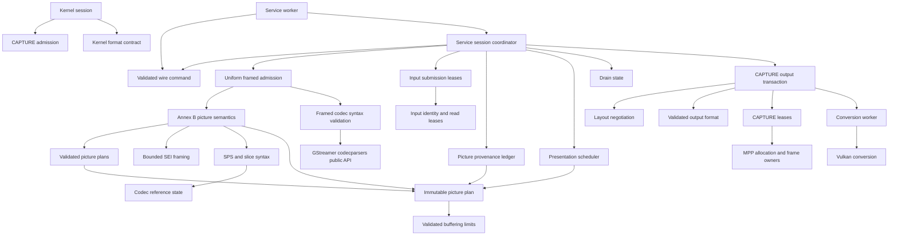

# Conformance contract

This matrix defines the supported stateful decoder contract. A passing sample is
not evidence for another transition or codec rule. Tests use module public APIs,
the service process protocol, V4L2 ioctls, or Chromium. No test may accept a wrong
pixel hash, skip a supported case, or substitute software decoding for MPP.

## Authorities

- [V4L2 stateful decoder](https://docs.kernel.org/userspace-api/media/v4l/dev-decoder.html): initialization, decoding, dynamic resolution change, drain, seek.
- [V4L2 buffers](https://docs.kernel.org/userspace-api/media/v4l/buffer.html): capacity, ownership, timestamps, sequence and field metadata.
- [H.264](https://www.itu.int/rec/T-REC-H.264): 3.36–3.37 complementary fields; 7.3/7.4 syntax; 8.2.5 reference marking; C.4 output order; E.2 buffering restrictions.
- [H.265](https://www.itu.int/rec/T-REC-H.265): 7.3/7.4 syntax and temporal limits; 8.3 reference derivation; C.5 decoded picture buffering.
- [VP8 (RFC 6386)](https://www.rfc-editor.org/rfc/rfc6386.html): uncompressed frame tag, compressed header and coefficient partitions.
- [VP9 bitstream specification](https://www.webmproject.org/vp9/#draft-vp9-bitstream-and-decoding-process-specification): uncompressed/compressed headers, tiles and superframe index.
- [AV1 specification](https://aomediacodec.github.io/av1-spec/av1-spec.pdf): frame/header/tile-group OBUs and tile group semantics (FRAME requires an implicit complete group).
- Linux DMA-BUF CPU access and reservation fences; Vulkan external-memory ownership and synchronization.
- `kernel/bridge_uapi.h`: the sole bridge wire contract; no older protocol is accepted.

## Normative behavior and verification matrix

| ID | Contract / invariant | Required partitions | Verification owner |
|---|---|---|---|
| K01 | Format negotiation does not invalidate allocated queues | TRY/SET/GET, supported/unknown codec, empty/allocated queue, extent limits | kernel/test_formats.py |
| K02 | QBUF storage covers the committed layout | initial/changed layout, equal/larger/smaller pool, before/after CAPTURE STREAMOFF | kernel/test_buffers.py, kernel/test_reconfigure.py |
| K03 | Each queued slot completes at most once | valid/stale/duplicate/error frame, index and payload boundaries | kernel/test_frame_reply.py |
| K04 | OUTPUT completion preserves enqueue order and has a monotonic sequence | reversed indices, recycling, deferred input, OUTPUT restart | kernel/test_input_order.py, kernel/test_metadata.py |
| K05 | Frame metadata preserves field, timestamp, source, crop and color | frames/fields, odd crop, same-size metadata change, allocation-size change | kernel/test_metadata.py, kernel/test_layout_reply.py, service/test_metadata.py, src/backend/output/format_tests.rs (all field-arrangement transitions, including TOP/BOTTOM parity) |
| K06 | Source change separates old output from new-layout admission | LAST, blocked DQBUF, sufficient pool reuse, undersized pool rejection, replacement | kernel/test_reconfigure.py, service/test_reconfigure.py |
| K07 | Drain completes preceding input only; START preserves decoder references | explicit/natural EOS, deferred input, repeated START/STOP, empty stream; EOS requires drain, exactly one completion, no frames until resume, same/later batch | src/backend/flow_tests.rs, kernel/test_commands.py, service/test_continuation.py, service/test_bitstream.py |
| K08 | CAPTURE stop preserves OUTPUT; OUTPUT stop invalidates its epoch | running/draining/reconfiguring, acknowledgement/disconnect/timeout | kernel/test_lifecycle.py, kernel/test_stop_serialization.py, service/test_lifecycle.py |
| K09 | Blocking calls do not prevent progress or mutate each other's transaction | event wait, DQBUF wait, concurrent stop and mutations | kernel/test_blocking_events.py, kernel/test_stop_serialization.py |
| K10 | Failure ends one decoding incarnation; complete teardown permits same-fd initialization | close/disconnect, fd exhaustion, fatal reply; every reply after FAILED in the same/later batch rejects mutation; START/STOP/S_FMT/STREAMON reject before both queues are stopped and freed; replacement service endpoint cannot share ownership with the failed incarnation | kernel/test_sessions.py, kernel/test_reinitialize.py, service/test_concurrency.py, service/test_recovery.py |
| P01 | Wire validation precedes resource transfer or state mutation | version, batch/message reserved, every event including CLOSE, validation before pool registration/state mutation, clean FAILED reply, count, epoch, generation, pool, slot, unsupported message | kernel/test_batch.py, kernel/test_pool.py, service/test_protocol.py, service/test_registration.py |
| P02 | Failed copyout/registration releases all transferred descriptors | partial export, bad destination, repeated failure | kernel/test_copyout_faults.py, service/test_registration.py |
| P03 | Bounded queues apply backpressure without losing ownership | full batch, many framed inputs, multi-frame AV1 TU/VP9 superframe, retained CAPTURE | service/test_output_semantics.py, service/test_resources.py |
| C01 | Exp-Golomb parsing covers its declared integer domain | zero, 30/31/32 leading zeros, legal maximum, overflow, truncation, signed limits | src/bitstream/bits_tests.rs |
| C02 | One H.264 SPS parse supplies geometry and reference semantics | profiles, POC modes, field/frame, gaps, scaling lists, buffering limits | src/bitstream/h264/sequence_tests.rs, src/bitstream/h264/order_tests.rs |
| C03 | Exactly one authority decides complementary picture identity | reference/non-reference, same/opposite parity, frame number, IDR, MMCO5 on first/second field, inferred frame_num=0, DPB occupancy, intervening picture | src/bitstream/h264/reference_tests.rs, src/backend/layout_tests.rs |
| C04 | MMCO operates on picture identity, not parity alone | operations 1–6, frame/paired/unpaired field, same/different pair, reused long index | src/bitstream/h264/reference_tests.rs |
| C05 | Allowed frame-number gaps execute non-existing reference marking | no gap, multiple gaps, wrap, reference/non-reference, IDR/MMCO5 reset, forbidden gap | src/bitstream/h264/reference_tests.rs, src/bitstream/h264/order_tests.rs |
| C06 | Presentation follows reference occupancy, output order and discard boundaries | capacity/reorder bounds, direct output, IDR/MMCO5, discard across DRC, hidden picture | src/backend/presentation_tests.rs, service/test_output_semantics.py, service/test_picture_order.py |
| C07 | HEVC temporal operating point, RPS and output latency are retained | sublayers, highest temporal ID, short/long refs, hidden picture, IRAP/RASL, latency extremes | src/bitstream/hevc_tests.rs, src/bitstream/hevc/sequence_tests.rs, service/test_output_semantics.py |
| C08 | Input framing does not change pictures or provenance | client-framed H.264/HEVC AU or metadata, VP8/VP9 frames, AV1 TU; independent task identities within multi-frame submissions, natural EOS continuation | service/test_bitstream.py, service/test_decode.py, service/test_output_semantics.py |
| C09 | Damaged input reports an error and permits defined recovery | initial damage, established stream, reference loss, recovery point after reserved SEI 128/383, extended headers, truncated payload/trailer, parameter reuse; H.264/HEVC unknown PPS in complete submissions, explicit/natural drain, slot reuse without error misattribution, exact recovered pixels | src/bitstream_tests.rs, src/backend/input_tests.rs, service/test_input_errors.py, service/test_framed_errors.py, service/test_framed_boundaries.py, service/test_bitstream.py, service/test_picture_order.py |
| C10 | POC is derived from normative syntax without a software decoder | H.264 types 0/1/2, LSB and frame number wrap, nonreference pictures, field deltas, MMCO5, overflow without state commit; HEVC prevTid0 selection, IRAP reset, excluded leading pictures | src/bitstream/h264/poc_tests.rs, src/bitstream/hevc/poc_tests.rs |
| C11 | Metadata and picture ownership remain bounded and distinct | separate H.264/HEVC configuration and SEI, AV1 sequence restoration, combined packet limit, recovery after rejection, shared read lease surviving original owner | src/frontend_tests.rs, src/bitstream_tests.rs, src/mpp/packet_tests.rs, service/test_metadata.py |
| R01 | A returned CAPTURE slot cannot be written until QBUF | decoder frame, GPU copy, bufferless error, reuse including unqueued empty LAST, retained reference read | src/backend/capture_tests.rs, src/mpp/reservation_tests.rs, src/mpp/group_tests.rs, service/test_resources.py |
| R02 | Decoder and display leases jointly bound memory pressure | registered/unqueued slots, private spill, 18/32 capacity, reset and source change | src/mpp/group_tests.rs, service/test_picture_order.py |
| R03 | DMA storage outlives every user and mappings remain coherent | MMAP/export, release/fork, CPU/device ownership, fd reuse | kernel/test_buffers.py, src/dma_tests.rs, service/test_resources.py |
| R04 | GPU completion precedes release and publication | success/error/timeout, import eviction, source/destination alias, short allocation, first write to untouched oversized DMA storage | src/quantize_tests.rs, src/converter_tests.rs, src/quantize/context_tests.rs |
| R05 | Conversion preserves visible samples and signaled color | NV12 exact copy, NV15 dither, odd sizes, crop, 8/10-bit, HDR metadata | src/quantize_tests.rs, service/test_bitstream.py, browser/test_playback.py |
| B01 | Browser uses hardware decoding and displays the actual result | H.264/VP8/VP9/AV1, 8/10-bit, replay/pause/seek, source change, concurrent players | browser/test_playback.py, browser/test_sessions.py |
| B02 | Tests inherit the desktop without forcing a graphics backend | background window, default compositor, WebGL, cancellation | browser/test_graphics.py, browser/test_sessions.py |
| O01 | Process lifecycle and diagnostics are observable without privileges | startup failure, signals, identity, socket ownership, resource cleanup | service/test_cli.py, service/test_diagnostics.py, service/test_recovery.py |

Paths beginning `src/` are relative to the repository; other test paths are
relative to `tests/`. Each owner must test normal, rejected and boundary behavior
through its public interface. A row is not complete merely because a file exists.

## Queue transition matrix

| State | Input QBUF | CAPTURE QBUF | STOP / EOS | CAPTURE STREAMOFF | OUTPUT STREAMOFF |
|---|---|---|---|---|---|
| Awaiting headers | submit in order | provisional allocation only | drain accepted input | preserve input | invalidate epoch and all input leases |
| Running | submit in order | validate active layout and transfer write ownership | stop submission at boundary | stop output, preserve references | reset codec and input provenance |
| Source change draining | preserve ordering | old allocation remains valid for old output | serialize with boundary | commit new required layout, retain allocation only if it fits | reset whole stream |
| Source change stopped | defer incompatible output | reject capacity below new requirement | retain boundary | idempotent stopped state | reset whole stream |
| Draining | defer after boundary | recycle to finish preceding pictures | repeated STOP cannot create another drain | abort drain, retain references for resume | reset whole stream |
| Drained | defer until START | LAST exactly once | START resumes without resetting references | allow restart | reset whole stream |
| Failed incarnation | reject | reject | reject | release safely | release safely |
| Failed, both queues stopped and freed | reinitialize first | reinitialize first | new incarnation only | already stopped | already stopped |
| Closed | reject | reject | reject | release safely | release safely |

Every applicable transition is crossed with stale epoch/generation, empty/full
queues, retained user buffers, and service failure. Old-generation DRC recycling
must not be confused with new-layout admission after STREAMOFF.

### Service transaction partitions

| Owner / initial state | Operation | Required observable result | Unit contract |
|---|---|---|---|
| Flow / running | explicit STOP or natural EOS | exactly one waiting drain; overlapping drain rejected | src/backend/flow_tests.rs |
| Flow / waiting | completion | exactly one notification; resume resets only natural sequence state | src/backend/flow_tests.rs |
| Flow / waiting | CAPTURE stop, then completion | no stale notification; explicit references survive, natural sequence resets | src/backend/flow_tests.rs |
| Flow / complete | stop or resume | return to running; no duplicate completion | src/backend/flow_tests.rs |
| Negotiation / active | changed layout with old pool | wait; old pool cannot acknowledge the new format | src/backend/output/negotiation_tests.rs |
| Negotiation / waiting | stop, register, start | pending MPP acknowledgement survives; activation requires enough registered slots | src/backend/output/negotiation_tests.rs |
| Negotiation / waiting | reuse | activate only after the explicit reuse transaction | src/backend/output/negotiation_tests.rs |
| CAPTURE / idle | prepare write | no writable target until QBUF | src/backend/capture_tests.rs |
| CAPTURE / queued | prepare, abort | ownership stays queued; no display completion | src/backend/capture_tests.rs |
| CAPTURE / queued | prepare, commit | owned display lease survives until recycle | src/backend/capture_tests.rs |
| CAPTURE / imported | reuse | pin every imported slot before dropping old leases; release pins individually on QBUF | src/backend/capture_tests.rs, src/mpp/group_tests.rs |
| Input / owned submission | damaged framed input | mark matching live origins; completion reports ERROR without attributing it to a reused slot or timestamp | src/backend/input_tests.rs, service/test_input_errors.py |
| Input / split into tasks | lease release | no writer until every task releases its read lease; no whole-payload copy for ordinary framed input | src/mpp/packet_tests.rs, src/backend/input_tests.rs |
| Frontend / framed submission | admission | validate before submitting tasks; metadata-only input completes without borrowing the next picture timestamp; preserve configuration and SEI for MPP | src/frontend_tests.rs, src/bitstream_tests.rs, service/test_input_errors.py, service/test_metadata.py |

## Architecture contracts

The boundaries below hide decisions, not just functions. The worker admits every
wire event through protocol/command before registration, CLOSE or backend dispatch;
the backend accepts only Command. FAILED is constructed from routing metadata,
never by copying an invalid message. MMCO5 derives one stored frame number for
unpaired identity, reference entries and previous-reference tracking. No codec parser or
presentation scheduler decides CAPTURE allocation ownership, and no buffer ledger
infers codec reference identities.

| Module | Owns / hides | Public contract | Verification |
|---|---|---|---|
| kernel/session | V4L2 queue transactions, epochs and ordered completion | V4L2 ioctls and bridge UAPI | kernel integration group |
| kernel/session/capture | old draining capacity versus committed required capacity | update, stop, prepare, activate | K02, K06 |
| protocol/command | wire event admission before resource transfer or mutation | TryFrom<Message> → Command, typed kind and immutable wire view | src/protocol/command_tests.rs, service/test_protocol.py |
| bitstream/report | Annex B semantic results | validated geometry, picture plan, borrowed/owned payload and natural boundary | src/bitstream_tests.rs |
| frontend | codec-specific admission behind one task interface | admit, seek; all codecs return tasks and a boundary | src/frontend_tests.rs |
| submission | compressed input identity and storage lifetime | Origin and input-range/owned Payload | src/backend/input_tests.rs, src/mpp/packet_tests.rs |
| packet_syntax | all five codecs’ header state and framed packet bounds | new, validate; rejected input never reaches MPP; recover at keyframe | packet_syntax codec unit tests, service/test_framed_errors.py, service/test_framed_boundaries.py |
| backend/input | registered input leases and submission identity | prepare → Origin, damage → live match, complete → error status | src/backend/input_tests.rs, service/test_input_errors.py |
| bitstream/sei | SEI framing and RBSP termination independently of payload meaning | next → bounded message or end/error | src/bitstream/sei_tests.rs, service/test_picture_order.py |
| bitstream/h264/sequence | SPS syntax shared by geometry and reference interpretation | parse → Sequence | C02 |
| bitstream/h264/reference | complementary identity, MMCO, missing references, sliding window | apply(Picture) → State | C03–C05 |
| picture/limits | decoded-picture storage/reorder/latency bounds | new, capacity, reorder, latency | src/picture/limits_tests.rs |
| picture/plan | immutable semantic handoff | Plan construction, observation, checked pair completion | src/picture/plan_tests.rs |
| backend/layout | serial-to-picture provenance and explicit continuation association | push, peek, complete, finish, take | src/backend/layout_tests.rs |
| backend/presentation | reference occupancy and output scheduling | prepare, picture, take, drain, discard | C06–C07 |
| backend/flow | explicit versus natural drain semantics | begin, complete, abort, resume | K07–K08 |
| backend/output | entire CAPTURE transaction, converter lifetime and reply publication | register, start, stop, recycle, push, take, typed status | src/backend/output_tests.rs, service group |
| backend/output/format | validated decoded-to-CAPTURE format and change detection | new, changed, message | K05, R05 |
| backend/output/negotiation | layout acknowledgement and pool activation | announce, start, stop, commit | K06, K08 |
| backend/capture | per-slot state and display/write leases | prepare_write → borrowing Target, commit/drop, recycle | R01–R02 |
| mpp/decoder | synchronous execution and staged-input progress | packet → Blocked / Progress / Consumed; frame, idle, reset | src/mpp/decoder_tests.rs, browser/test_playback.py |
| mpp/group and mpp/reservation | SDK group retention and buffer refcounts | import, pin, reserve; RAII release | R01–R03 |
| converter and quantize | asynchronous conversion and GPU visibility | owned Job → completed source/result | R04–R05 |

Tests observe each boundary through its public API. The service group replaces
the kernel with LD_PRELOAD but uses real MPP, DMA-BUF and Vulkan. The kernel group
replaces the service with a protocol peer. The browser group covers both together.
The distinction matters: a unit contract cannot substitute for hardware pixel
acceptance, and a passing playback cannot substitute for invalid-state testing.

## Resource invariants

1. Every input has one provenance record and one ordered completion.
2. Every picture identity is allocated by the codec semantic state machine.
   A field continuation names that identity explicitly; the metadata ledger never
   derives pairing from frame number or parity.
3. Non-existing H.264 references occupy the logical DPB but have no display image.
4. A CAPTURE slot is writable only while queued and while the corresponding MPP
   or GPU write lease is held. DQBUF may leave codec read references alive.
5. Every imported descriptor and image remains owned until all asynchronous work
   and display leases have completed, including error paths.
6. Format generation, allocation capacity and activation state are distinct.
   Every transition to active CAPTURE performs the same admission check.
7. No error handler silently converts an unsupported legal syntax value into
   successful end-of-stream. Damaged-input recovery must remain observable.
8. A submission identity is independent of timestamp and slot index. Parser
   reports retain all overlapping origins even after those inputs are completed.
   Delayed damage uses an empty ERROR CAPTURE when no matching input is still
   owned. Its backlog is bounded; exhaustion or drain without a usable error
   CAPTURE queue fails the session instead of silently dropping errors.
9. Failure invalidates outstanding kernel reply ownership before poisoning both
   queues. No later reply may publish a layout, frame, completion or EOS, even
   in the batch containing FAILED. Only stopping both queues and releasing all buffers permits a new incarnation. Its endpoint, format and ownership are fresh; stale endpoints cannot read, write, register or poison it.

Service test observations retain INPUT_DONE flags and empty ERROR CAPTURE
notifications separately from pixel-bearing frames. Recoverable parser errors
must be asserted through these replies, not inferred from stderr messages.

## Validation and known external failure

Run formatting, static checks, Rust tests, preload tests, kernel build, the full
Python integration suite and v4l2-compliance. Do not filter out failed cases.
The existing `h264-mmco5.h264` pixel assertion remains strict: direct MPP also
reproduces its nine mismatching frames. It is an unresolved external-path result,
not permission to weaken any row or mark the full suite as passing.

One AV1 10-bit pool-reuse run also returned an all-zero first visible frame.
The changed-layout test retains exact per-frame hashes and now reports the
indices, dimensions and both hashes on failure. Subsequent full-suite runs and
20 fresh-process repetitions passed; the untouched-DMA first-write GPU test
passed across 16 fresh Vulkan contexts. This transient has no established root
cause. Repeated passes do not close R04/R05's hardware acceptance risk.

The installed FFmpeg V4L2 client is not an acceptance substitute. An ioctl trace
of `h264-yuv420p.h264` shows it allocating 49152-byte CAPTURE storage, then reading
a 65536-byte `sizeimage` at unchanged 256x128 dimensions. It sends START without
reallocation, ignores EINVAL and consumes the empty LAST as an image before EPIPE.
Its `v4l2_resolution_changed` compares only width/height; `v4l2_handle_event` ignores
the return from `v4l2_start_decode` on that path. V4L2 Capture Setup explicitly
requires the new `sizeimage` to fit the allocated buffers before immediate reuse.
K02/K06's `size_only` cases require rejection followed by proper reallocation;
they must not be relaxed to accommodate this client. FFmpeg also reproduces its
`ffmpeg_dec.c:753` packet assertion with the short Main10/VP9 resize samples.
These client failures remain visible alongside the MPP pixel failure.

## Regression evidence obligations

### Unified execution: retained external failures

All five codecs use the synchronous no-thread MPP interface. A decoder call that
advances an internally staged task without consuming the offered input reports
Progress, distinct from Blocked (waiting for output/resources); the scheduler must
continue without requiring another client event. The original bool conflated
these states and stalled browser AV1 8-bit playback after two frames. Explicit STOP
waits for scheduled work and presentation output. AV1 publishes each completed task through a verified reference-preserving MPP EOS operation, whose empty internal notification is not exposed as V4L2 EOS; H.264, HEVC, VP8 and VP9 do not receive MPP EOS. Completion additionally requires an empty picture-obligation ledger.
All inputs are client-framed; there is no libavcodec runtime dependency or
continuous-bytestream service path. AV1 temporal units and VP9 superframes
produce independently identified coded-frame tasks over checked borrowed input
ranges. A task retains the CPU read lease; a consumed input, completed task,
retained codec reference and pending presentation are distinct lifetimes.
Hidden tasks can release metadata after completion; expected presentations
retain metadata even when the public MPP output queue is empty. Configuration-only
and SEI submissions are preserved for the next picture without transferring their
timestamp to it. The combined metadata and picture must fit the shared compressed
task limit; oversize admission reports a damaged input and retains a valid recovery
configuration, without terminating the service. Explicit STOP divides presentation into drain segments; each
segment is checked against independent software display order and exact pixels.

VP9 repeated presentation remains a known failed acceptance case. A valid keyframe followed by three
`show_existing_frame` packets must yield four identical images with four current
presentation timestamps. `service/test_repeated_picture.py` checks exact software
reference pixels, timestamps, input completion and EOS, including STOP/START
boundaries. The candidate and the previously installed asynchronous service both
return only one image in the no-intermediate-STOP case. The Rust public-interface
regression `test_packet_repeated_reference_publishes_each_presentation` bypasses
the bridge and reproduces timestamps `[0]` instead of `[0, 1, 2, 3]` using the
installed Rockchip MPP 1.1.0 library. Teardown also reports pending display-slot
ownership and a leaked frame buffer. These remain strict failures, not skips or
expected failures.

In the matching MPP source, `mpp/codec/dec/vp9/vp9d_parser.c` enqueues an existing
reference into `QUEUE_DISPLAY` without producing a hardware decode task.
`mpp/codec/mpp_dec_no_thread.c` returns from the invalid/no-output-task path
without publishing that queue unless EOS is set; ordinary hardware-task
completion does publish it. This explains the synchronous reproduction; the
asynchronous baseline failure must not be assigned the same mechanism without
further evidence. An asynchronous replacement also lacks a demonstrated public
completion fence for no-output inputs that preserves H.264 references across
STOP/START. Input release, an empty input queue, EAGAIN and a timeout are not such
a fence.

MPP must remain unmodified by explicit user instruction. The two external failures remain strict
regressions while other implementation work proceeds by explicit user instruction.
No compatibility branch, software decoder or expected-failure marker is added. Reproduction and validation logs are
retained locally under `target/unified-execution/evidence/`, including
`rkmpp-direct-repeat.log`, `rkmpp-unified-repeat.log`,
`rkmpp-baseline-repeat.log` and `rkmpp-unified-continuation-fixed.log`.
The source snapshot used for diagnosis is `target/mpp-review/mpp-1.1.0/`.
Neither ignored directory is a portable test dependency: the regression constructs
the four-packet stream from the committed VP9 fixture.

Validation on 2026-10-17 is recorded in
`target/unified-execution/evidence/current/`: Rust formatting, Clippy
(`--all-targets -- -D warnings`), debug/release builds, Python formatting,
linting/type checking, and preload formatting/Clippy/build passed. Rust tests:
270 passed, 1 failed (direct VP9 repeated display); preload: 10 passed.
Full pytest: 782 passed, 4 failed, zero skipped; all browser and kernel cases
passed. The four failures are MMCO5 pixels and VP9 repeated display at drain
boundaries 0/1/2. Updated v4l2-compliance: 48/48 passed, with two warnings for
optional CREATE_BUFS support. The retained MMCO5 and VP9
failures are not acceptance passes. Kernel make reports the host GCC version
differing from the compiler used to build the running kernel and omits BTF
because the headers do not provide vmlinux. These environment diagnostics are
retained in the build log. The candidate is tested by temporarily loading the
local module; neither the installed service executable nor installed module is
overwritten. After testing, the original installed module (srcversion
6138D01972A5AECBC616655) and system service were restored successfully.

Release performance evidence is in `target/unified-execution/performance-final/`.
Each preset completed 900 frames at 4K30 with V4L2VideoDecoder, using the desktop's
default graphics policy and no requested GPU frequency floor. CPU is percent of
one logical CPU; GPU/MPP counters cover the whole device, not just this process.

| Codec | Chromium CPU mean | Service CPU mean | GPU mean | MPP mean by decoder core | Dropped / total |
|---|---:|---:|---:|---|---:|
| H.264 8-bit | 12.44% | 6.76% | 8.00% | rkvdec0 14.70%, rkvdec1 17.94% | 0 / 900 |
| VP9 10-bit | 22.30% | 3.89% | 32.76% | rkvdec0 13.74%, rkvdec1 12.97% | 3 / 900 |
| AV1 10-bit | 44.16% | 3.74% | 23.92% | av1d 41.17% | 15 / 900 |

These are one-round measurements, not a controlled baseline comparison or a
zero-drop guarantee. H.264 presentation intervals were unavailable because the
background window was covered; the report retains that limitation. Sampling
controls and the tool-owned service were released successfully.

For each contract correction, first run a public-interface regression against
its previous implementation and retain the failing assertion. Tests must assert
both the rejection and absence of side effects, then the legal continuation.
Malformed framed packets cover invalid envelopes and valid envelopes with damaged
codec headers, before and after valid pictures; every reused input is checked for
error attribution. Header validation does not claim to detect every entropy-coded
pixel corruption: hardware-reported errors also remain observable through CAPTURE.
A field's TOP/BOTTOM parity is buffer metadata; ALTERNATE is its format arrangement.

### Reply admission and failed-incarnation cleanup

| Reply / transition | Running | Draining | Drained / restartable | Failed incarnation |
|---|---|---|---|---|
| LAYOUT, FRAME | validate identity and ownership | validate identity and ownership | EBUSY, no side effects | EPIPE |
| DRAINING | establish natural boundary | refine explicit boundary | EBUSY | EPIPE |
| EOS | EBUSY | complete once | EBUSY | EPIPE |
| INPUT_DONE | complete owned submission | complete owned submission | complete owned submission | EPIPE |
| STOPPED | only during unacknowledged RESET | same | same | EPIPE |
| FAILED | poison incarnation | poison incarnation | poison incarnation | EPIPE |
| Partial queue cleanup | ordinary teardown | ordinary teardown | ordinary teardown | mutations still EIO |
| Both queues stopped and freed | ordinary initialization | ordinary initialization | ordinary initialization | fresh endpoint, geometry, events and buffer ownership |

CAPTURE STREAMOFF preserves OUTPUT. Until RESET is acknowledged, replies already
in flight can still complete owned buffers; they must not cause a spurious
service failure. OUTPUT STREAMOFF invalidates its epoch. Tests cover same-batch
and later-batch EOS duplication, rejection without buffer completion, subsequent
START, partial cleanup in either queue order, disconnect versus FAILED, repeated
same-fd initialization, stale endpoint registration/reply/close, and stale events.

Framed-header validation has independent boundaries beyond the library return
code: VP8 sync/version/dimensions and header bits within the declared first
partition; VP9 superframe extents and coded tile data after the compressed header;
AV1 OBU sizes, complete frame header/tile grouping, tile extents and FRAME OBU's
implicit full-group rule. The 1,085-byte `av1-two-tiles.ivf` fixture is one 256x128
8-bit keyframe re-encoded from the existing AV1 sample with aomenc (two tile
columns, cpu-used=8, cq-level=40); tests also compare its decoded pixels with the
independent software reference. These checks do not decode entropy-coded pixels.

### Drain obligations and complete access-unit termination

| Contract | Required observation | Regression |
|---|---|---|
| Each STOP owns its preceding displays | Record frame count at each EOS, before START; later input cannot satisfy an earlier drain | service/test_continuation.py |
| AV1 repeated display at end of input | 1/3/5/6 complete input packets produce 1/3/5/6 matching images, for both 8-bit and 10-bit | service/test_continuation.py |
| AV1 task completion preserves references | Each input produces its expected displays through the public MPP adapter, without future input or STOP | mpp/decoder_tests.rs |
| No false successful EOS | An unresolved displayed frame or first field rejects drain completion; completed hidden work is retired | backend/layout_tests.rs |
| Ordered AU termination | H.264 EOS then end_of_stream; HEVC EOS then EOB; reject duplicates, reverse order and payload after termination | bitstream_tests.rs, packet_syntax/unit_tests.rs |
| Complete AU retains its picture | A picture plus both termination markers yields the picture before natural EOS | service/test_framed_boundaries.py |
| Complementary field POC | Completed pair uses the minimum field POC (H.264 8.2.1), preserving the first field's preceding boundary | picture/plan_tests.rs |

Termination extent and terminal meaning come from the same validated syntax
result. The semantic parser no longer independently scans for the first marker.
The test client preserves complete access units and every input byte. Leading
EOS/EOB from ffprobe packet boundaries are assigned to the preceding AU, never
split out of a valid picture-plus-termination unit. Independent framing tests
cover consecutive markers and the HEVC conformance sequence boundary. Tests
requiring a particular grouping also construct complete submissions explicitly.

MPP AV1 publication was verified through direct calls, process tests and Chromium.
Every task completes its own displays before later input is required, including
continued decoding with references and pixel checks. Hardware idle alone would
otherwise allow a bounded client to stall waiting for a retained display. An empty codec flush function
alone is insufficient evidence: experimental VP9 EOS insertion corrupted pixels
after some STOP boundaries, so that unverified policy is not used. The known VP9
repeated-display blocker remains a strict failure; the service now refuses to
report successful EOS while its presentation obligations remain unresolved.

Final drain-contract validation (2026-10-17): Rust formatting, all-target
Clippy with warnings denied, debug build, Python formatting/lint/type checks,
and preload formatting/Clippy/build passed. Rust: 275 passed, 1 retained direct
VP9 failure; preload: 10 passed. Full pytest: 795 passed, 4 retained failures,
zero skipped. Every browser and kernel case passed. The four process failures
remain H.264 MMCO5 pixels and VP9 repeated display at boundaries 0/1/2; the latter
now fails the session on unresolved obligations instead of falsely reporting EOS.
The 67 targeted framing/drain/pixel regressions also passed.

Logs are retained under `target/drain-contract-review/`, including the failing
AV1 per-input publication and browser reproductions followed by passing runs.
The candidate module was loaded only for validation. The installed module
(srcversion 6138D01972A5AECBC616655) and system service were restored afterward;
installed executables were not overwritten. No MPP, Chromium or Mesa sources
were changed. The existing two MPP/vendor blocker families remain strict failures,
not skips, expected failures, or accepted incorrect output.

### Picture consistency and DMA storage identity

| Contract | Required observation | Regression |
|---|---|---|
| HEVC picture-wide syntax (7.4.7.1) | Independent segments agree on output/POC/RPS/temporal-MVP fields; dependent segments inherit absent fields but still match PPS, NAL identity and no-prior-output | packet_syntax/hevc/picture_tests.rs |
| Reject contradictory multi-slice AU | Flip only the second slice's no-prior-output bit; reject that input, then accept the intact AU | packet_syntax/hevc_tests.rs |
| Submission-local error and recovery | Before/after established decoding, with 1/8 input slots, reject the contradictory AU and preserve subsequent pixels and EOS | service/test_input_errors.py |
| CPU lease belongs to storage | Duplicate fd imports, different declared lengths, concurrent imports and original-owner drop cannot bypass an active lease | dma_tests.rs |
| Pool slots have disjoint storage | Reject clones and independently imported aliases in both queue directions; allow distinct allocations | pool_tests.rs |
| Process rejects aliased registration | Two distinct SCM_RIGHTS descriptors for one allocation fail registration and all transferred owners are released | service/test_registration.py |

The `hevc-two-slices.hevc` fixture is one 256x256 8-bit IDR generated with
`ffmpeg -f lavfi -i testsrc2=size=256x256:rate=1 -frames:v 1 -c:v libx265
-x265-params slices=2:wpp=1:pools=1:log-level=error`. It contains two independent
slices. Tests mutate bit 6 at byte 5721 in memory; no malformed copy is stored.
The service pixel oracle is software decoding of the intact fixture.

DMA CPU exclusion is process-wide for each live storage identity, rather than
per wrapper or descriptor number. The registry stores weak lease references;
live mappings retain their allocation, and import removes expired entries.
Pool construction independently enforces disjoint slots before ownership can
reach the backend. No compatibility path accepts aliased slots.

Storage/picture validation (2026-10-17): both original public-interface
reproductions failed before the fixes and passed afterward. Formatting,
all-target Clippy with warnings denied, Rust build, Python formatting/lint/types
passed. Rust: 283 passed, 1 retained direct-MPP VP9 failure. Preload: 10 passed.
Targeted process regressions: 27 passed. Full pytest: 800 passed, 4 retained
failures, zero skipped; every browser and kernel case passed. The four failures
remain the H.264 MMCO5 pixel case and VP9 repeated displays at boundaries 0/1/2.
No fallback, xfail or relaxed assertion was introduced. Logs are under
`target/storage-picture-review/`.

Kernel `make -C kernel` succeeded; it reports the existing GCC version mismatch
between Armbian's kernel compiler (14.2) and the installed compiler (16.1).
The candidate module was used for full integration validation, then the installed
module (srcversion 6138D01972A5AECBC616655) and system service were restored.
Installed service binaries were not replaced.

### H.264 decoded-reference marking consistency

| Contract | Required observation | Regression |
|---|---|---|
| H.264 7.4.3.3 IDR marking | Both no-output-of-prior-pictures and long-term-reference flags agree across slices of a coded picture | packet_syntax/h264_tests.rs, service/test_input_errors.py |
| Adaptive reference marking | Compare mode, MMCO order/count, every active operand, and MMCO5; ignore inactive C fields and array tail | packet_syntax/h264/marking_tests.rs |
| Redundant coded pictures | Compare within each redundant_pic_cnt group without overwriting the primary group's marking | packet_syntax/h264/marking_tests.rs |
| Failed admission is local | Conflicting headers do not replace the previously admitted group; a subsequent valid AU still works | packet_syntax/h264_tests.rs, packet_syntax/h264/marking_tests.rs |
| Real MMCO input | Alter only the second slice's MMCO1 operand from 3 to 4; reject that input and recover at the following IDR with exact pixels | service/test_input_errors.py |
| Legitimate multi-slice MMCO | Decode the entire eight-picture sample and compare every output against independent software decoding | service/test_input_errors.py |

The per-AU marking module owns equality and grouping. It converts only present
syntax into typed IDR/sliding/adaptive/disposable variants and typed MMCO
operations. It does not compare raw C structures, padding or absent operands.
The syntax validator invokes admission for every VCL slice before returning a
validated access unit to semantic interpretation.

`h264-two-slices.h264` is one 128x128 testsrc2 IDR generated with libx264,
`slices=2:threads=1`. `h264-two-slices-mmco.h264` contains eight 128x128 testsrc2
pictures at 4 fps, generated with
`slices=2:threads=1:ref=2:bframes=2:keyint=60`. The fixtures contain 3,991 and
13,619 bytes respectively; malformed variants are constructed by the cases,
not stored as extra binaries. FFmpeg trace_headers independently confirmed
that the MMCO mutation changes the operand's equal-length Exp-Golomb code
from 00100 to 00101 without shifting subsequent syntax or pixel data.

H.264 marking validation (2026-10-17): the IDR contradiction regression failed
before implementation. Final formatting, all-target Clippy with warnings denied,
Rust build, Python formatting/lint/types passed. Rust: 291 passed and the retained
VP9 direct-MPP failure. Preload: 10 passed. Targeted service suite: 23 passed.
Full pytest: 810 passed, 5 failed, zero skipped. Four failures are the unchanged
H.264 MMCO5 pixel case and VP9 repeated display cases at boundaries 0/1/2.
The fifth was browser H.264 B-frame playback: at timeout it had decoded all 60
frames, error=None, paused=True and visible=False. The exact case passed an
unchanged isolated rerun in 5.14 seconds. The failed full-run record and successful
rerun are both retained; the full run is not reported as entirely passing.
Every kernel case passed, as did all 11 new process regression cases.

Logs: `target/h264-marking-review/`. Kernel build succeeded with the existing
GCC 14.2/16.1 compiler-version mismatch warning. The candidate module was used
for integration validation, then the installed module (srcversion
6138D01972A5AECBC616655) and system service were restored. Installed binaries,
MPP, Chromium and Mesa were not changed. No skips, xfails, fallback paths or
weakened assertions were introduced.

### Session admission allocation failures

An offer consumed by `RB_ACCEPT` must end with either an owned service endpoint
or a terminal client error. There is no live-but-undiscoverable intermediate
state. Endpoint allocation and anonymous-fd allocation share the same failure
exit under the session lock; only the latter has acquired an endpoint reference
that must be released. A failed admission must not affect subsequent sessions.

| Transition / invariant | Observable acceptance | Coverage |
| --- | --- | --- |
| Pending -> rejected admission | An already queued OUTPUT reports POLLERR and DQBUF/START/QBUF report EIO | kernel/test_sessions.py::test_accept_fd_exhaustion_poisoning_releases_failed_session_reference |
| Rejected offer is consumed | Further nonblocking ACCEPT returns EAGAIN | same case |
| Broker remains usable | A subsequent video session is accepted and can allocate buffers | same case |
| Endpoint allocation ENOMEM -> terminal error | Same locked failure exit as fd allocation, without dropping an unacquired reference | Source review; direct allocation fault injection unavailable on this kernel |

The running vendor kernel configuration has CONFIG_FAULT_INJECTION disabled.
The EMFILE regression exercises the shared failure exit through public ioctls;
it does not claim to inject the preceding kmalloc failure. No production fault
injection ioctl, test-only ABI or kernel implementation-source test was added.

Admission failure validation (2026-10-17): Python formatting, lint and types,
Rust formatting, all-target Clippy with warnings denied and build passed.
Rust tests: 291 passed, one retained direct-MPP VP9 repeated-display failure.
Preload tests: 10 passed. Focused kernel session tests: 18 passed. Full pytest:
811 passed, four retained MPP failures (H.264 MMCO5 pixels and VP9 repeated
display at boundaries 0/1/2), zero skips, 341.34 seconds. All browser and kernel
cases passed. Kernel build succeeded with the existing compiler-version warning
and unavailable-vmlinux BTF notice. Logs: `target/accept-failure-review/`.
The installed module (srcversion 6138D01972A5AECBC616655) and active system
service were restored after validation. Installed binaries were not replaced.

### Daemon admission fault isolation

Broker admission now returns a typed outcome: accepted session, idle/interrupted
poll, rejected session (EPIPE), or resource pressure (ENOMEM/EMFILE/ENFILE).
Other control errors remain fatal. Session-local failure never requests global
shutdown. Resource pressure reaps completed workers and waits 100 ms before
another accept; the wait observes termination signals and explicit shutdown.
Failed worker creation drops the new channel and backs off without stopping
existing workers. The dependency direction remains service -> transport fault
contract, and service -> shutdown; transport does not depend on service policy.

| Invariant / transition | Acceptance |
| --- | --- |
| A rejected offer does not kill an existing worker | service/test_admission.py: inject each classified errno, wake the original worker, accept another session |
| Persistent resource pressure cannot spin | service/test_admission.py: queue 30 failures, bound attempts over 350 ms |
| Backoff does not delay termination | service/test_admission.py: SIGTERM during pressure exits successfully within one second |
| Native worker creation failure is local | service/test_admission.py: inject pthread_create EAGAIN, observe the new channel close with no requests, wake the existing worker and accept another |
| Fatal control errors remain fatal | service/test_protocol.py; transport/admission_tests.rs |
| Timeout and shutdown notification obey the wait contract | shutdown_tests.rs |

The test preload's thread-failure marker is confined to its child process. It
interposes the native pthread_create entrypoint and delegates normally when the
marker is absent; production binaries contain no fault-injection switches.

Admission isolation validation (2026-10-17): Python formatting/lint/types,
Rust formatting, all-target Clippy with warnings denied, production and preload
builds passed. Rust tests: 294 passed, one retained direct-MPP VP9 repeated-display
failure. Preload tests: 10 passed. Targeted process suite: 47 passed. Full pytest:
817 passed, four retained MPP failures (H.264 MMCO5 pixels and VP9 repeated display
at boundaries 0/1/2), zero skips, 349.37 seconds. All browser and kernel cases
passed. The initial bootstrap run used the rebuilt service but the not-yet-rebuilt
preload, so the thread-failure case correctly could not inject a failure; that
log is not claimed as a pre-fix production regression. The prior review separately
reproduced ENOMEM/EMFILE/EPIPE terminating the daemon and its existing session.
Logs: `target/admission-isolation-review/`. Installed module srcversion
6138D01972A5AECBC616655 and the active system service were restored. No installed
binary was replaced, and no MPP, Chromium or Mesa source was modified.

### Observable thread termination

The owned task module publishes a terminal flag before signalling its exit
notification, on both normal completion and unwinding. Conversion and session
supervision use this contract; task owners join rather than detach threads.
Converter `take` now distinguishes an empty live queue from a terminated worker.
Both `take` and `submit` observe termination and propagate the original panic;
a caller that catches that panic cannot submit further work to the dead worker.

The broker polls session-exit notifications and explicit shutdown alongside the
control descriptor and termination signals. The supervisor reaps before waiting
for new clients. On unwind it requests shutdown and joins all surviving workers.
A programming panic is never converted into a successful/empty completion or a
recoverable decoding error. Additional panics during an existing unwind are
reported while cleanup preserves the original panic.

| Invariant | Public-interface acceptance |
| --- | --- |
| Every thread exit is observable | task_tests: normal exit and panic publish state and notification; panic payload preserved |
| Conversion failure cannot masquerade as pending work | converter_tests: wait for panic notification, observe panic via take or submit without dropping the converter |
| Dead converter rejects subsequent work | converter_tests: caught panic leaves terminal take error and non-full submit rejection |
| Idle admission wakes for worker exit | transport_tests: empty pipe broker wakes on worker notification without ioctl or another client |
| Supervisor observes panic before another admission | supervisor_tests: exit notification followed by reap propagates panic |
| Unwind joins surviving workers | supervisor_tests: a surviving worker observes shutdown and releases its resources before the panic reaches the caller |

No production fault-injection switch, compatibility API, periodic polling or
panic-to-success fallback was introduced. Cleanup-only recovery of a poisoned
conversion queue permits stop/join; normal operations still expose the panic.

Thread-exit validation (2026-10-18): Rust formatting, all-target Clippy with
warnings denied and build passed. Rust tests: 300 passed, one retained direct-MPP
VP9 repeated-display failure; no ignored tests. Preload tests: 10 passed.
Python formatting, lint and types passed. Full pytest: 817 passed, four retained
MPP failures (H.264 MMCO5 pixels and VP9 repeated display at boundaries 0/1/2),
zero skips, 338.71 seconds. All browser and kernel cases passed. Kernel build
completed. Logs: `target/worker-exit-fix/`. Installed module srcversion
6138D01972A5AECBC616655 and the active system service were restored; installed
binaries were not replaced. The original public-interface reproduction remains
in `target/thread-exit-review/converter.log`; regression tests now observe exit
without relying on converter destruction or a new client admission.
