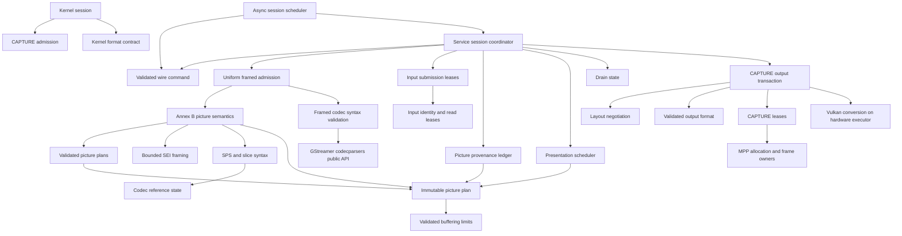

# Conformance contract

This matrix defines the supported stateful decoder contract. A passing sample is
not evidence for another transition or codec rule. Tests use module public APIs,
the service process protocol, V4L2 ioctls, or Chromium. No test may accept a wrong
pixel hash, skip a supported case, or substitute software decoding for MPP.

## Authorities

- [V4L2 stateful decoder](https://docs.kernel.org/userspace-api/media/v4l/dev-decoder.html): initialization, decoding, dynamic resolution change, drain, seek.
- [V4L2 buffers](https://docs.kernel.org/userspace-api/media/v4l/buffer.html): capacity, ownership, timestamps, sequence and field metadata.
- [H.264](https://www.itu.int/rec/T-REC-H.264): 3.36–3.37 complementary fields; 7.3/7.4 syntax; 8.2.5 reference marking; C.4 output order; E.2 buffering restrictions.
- [H.265](https://www.itu.int/rec/T-REC-H.265): 7.3/7.4 syntax and temporal limits; 8.3 reference derivation; C.5 decoded picture buffering.
- [VP8 (RFC 6386)](https://www.rfc-editor.org/rfc/rfc6386.html): uncompressed frame tag, compressed header and coefficient partitions.
- [VP9 bitstream specification](https://www.webmproject.org/vp9/#draft-vp9-bitstream-and-decoding-process-specification): uncompressed/compressed headers, tiles and superframe index.
- [AV1 specification](https://aomediacodec.github.io/av1-spec/av1-spec.pdf): frame/header/tile-group OBUs and tile group semantics (FRAME requires an implicit complete group).
- Linux DMA-BUF CPU access and reservation fences; Vulkan external-memory ownership and synchronization.
- `kernel/bridge_uapi.h`: the sole bridge wire contract; no older protocol is accepted.

Annex B metadata extraction follows H.264 B.1 and H.265 B.2: start-code
framing (`zero_byte`, `trailing_zero_8bits`) is separate from a retained
parameter NAL. A seek must not convert that framing into growing configuration
payload. Original coded submissions retain their complete bytes for MPP.

## Normative behavior and verification matrix

| ID | Contract / invariant | Required partitions | Verification owner |
|---|---|---|---|
| K01 | Format negotiation does not invalidate allocated queues | TRY/SET/GET, supported/unknown codec, empty/allocated queue, extent limits | kernel/test_formats.py |
| K02 | QBUF storage covers the committed layout | initial/changed layout, equal/larger/smaller pool, before/after CAPTURE STREAMOFF | kernel/test_buffers.py, kernel/test_reconfigure.py |
| K03 | Each queue submission completes at most once; storage reuse cannot authorize an older completion | OUTPUT and CAPTURE slot reuse, replay before/after requeue, zero/wrong token, valid/stale/duplicate/error frame, index and payload boundaries | kernel/test_input_order.py, kernel/test_frame_reply.py, src/backend/capture_tests.rs, src/backend_tests.rs, service/test_decode.py |
| K04 | OUTPUT completion preserves enqueue order and has a monotonic sequence | reversed indices, recycling, deferred input, OUTPUT restart | kernel/test_input_order.py, kernel/test_metadata.py |
| K05 | Frame metadata preserves field, timestamp, source, crop and color | frames/fields, odd crop, same-size metadata change, allocation-size change | kernel/test_metadata.py, kernel/test_layout_reply.py, service/test_metadata.py, src/backend/output/format_tests.rs (all field-arrangement transitions, including TOP/BOTTOM parity) |
| K06 | Source change separates old output from new-layout admission | LAST, blocked DQBUF, sufficient pool reuse, undersized pool rejection, replacement | kernel/test_reconfigure.py, service/test_reconfigure.py |
| K07 | Drain completes preceding input only; START preserves decoder references | explicit/natural EOS, deferred input, repeated START/STOP, empty stream; EOS requires drain, exactly one completion, no frames until resume, same/later batch | src/backend/flow_tests.rs, kernel/test_commands.py, service/test_continuation.py, service/test_bitstream.py |
| K08 | CAPTURE stop preserves OUTPUT; OUTPUT stop invalidates its epoch | running/draining/reconfiguring, acknowledgement/disconnect/timeout | kernel/test_lifecycle.py, kernel/test_stop_serialization.py, service/test_lifecycle.py |
| K09 | Blocking calls do not prevent progress or mutate each other's transaction | event wait, DQBUF wait, concurrent stop and mutations | kernel/test_blocking_events.py, kernel/test_stop_serialization.py |
| K10 | Failure ends one decoding incarnation; complete teardown permits same-fd initialization | close/disconnect, fd exhaustion, fatal reply; every reply after FAILED in the same/later batch rejects mutation; START/STOP/S_FMT/STREAMON reject before both queues are stopped and freed; replacement service endpoint cannot share ownership with the failed incarnation | kernel/test_sessions.py, kernel/test_reinitialize.py, service/test_concurrency.py, service/test_recovery.py |
| P01 | Wire validation precedes resource transfer or state mutation | version, batch/message reserved, every event including CLOSE, validation before pool registration/state mutation, clean FAILED reply, count, epoch, generation, pool, slot, unsupported message | kernel/test_batch.py, kernel/test_pool.py, service/test_protocol.py, service/test_registration.py |
| P02 | Failed copyout/registration releases all transferred descriptors | partial export, bad destination, repeated failure | kernel/test_copyout_faults.py, service/test_registration.py |
| P03 | Bounded queues apply backpressure without losing ownership | full batch, many framed inputs, multi-frame AV1 TU/VP9 superframe, retained CAPTURE | service/test_output_semantics.py, service/test_resources.py |
| C01 | Exp-Golomb parsing covers its declared integer domain | zero, 30/31/32 leading zeros, legal maximum, overflow, truncation, signed limits | src/bitstream/bits_tests.rs |
| C02 | One H.264 SPS parse supplies geometry and reference semantics | profiles, POC modes, field/frame, gaps, scaling lists, buffering limits | src/bitstream/h264/sequence_tests.rs, src/bitstream/h264/order_tests.rs |
| C03 | Exactly one authority decides complementary picture identity | reference/non-reference, same/opposite parity, frame number, IDR, MMCO5 on first/second field, inferred frame_num=0, DPB occupancy, intervening picture | src/bitstream/h264/reference_tests.rs, src/backend/layout_tests.rs |
| C04 | MMCO operates on picture identity, not parity alone | operations 1–6, frame/paired/unpaired field, same/different pair, reused long index | src/bitstream/h264/reference_tests.rs |
| C05 | Allowed frame-number gaps execute non-existing reference marking | no gap, multiple gaps, wrap, reference/non-reference, IDR/MMCO5 reset, forbidden gap | src/bitstream/h264/reference_tests.rs, src/bitstream/h264/order_tests.rs |
| C06 | Presentation follows reference occupancy, output order and discard boundaries | capacity/reorder bounds, direct output, IDR/MMCO5, discard across DRC, hidden picture | src/backend/presentation_tests.rs, service/test_output_semantics.py, service/test_picture_order.py |
| C07 | HEVC temporal operating point, RPS and output latency are retained | sublayers, highest temporal ID, short/long refs, hidden picture, IRAP/RASL, latency extremes | src/bitstream/hevc_tests.rs, src/bitstream/hevc/sequence_tests.rs, service/test_output_semantics.py |
| C08 | Input framing does not change pictures or provenance | client-framed H.264/HEVC AU or metadata, VP8/VP9 frames, AV1 TU; independent task identities within multi-frame submissions, natural EOS continuation | service/test_bitstream.py, service/test_decode.py, service/test_output_semantics.py |
| C09 | Damaged input reports an error and permits defined recovery | initial damage, established stream, reference loss, recovery point after reserved SEI 128/383, extended headers, truncated payload/trailer, parameter reuse; H.264/HEVC unknown PPS in complete submissions, explicit/natural drain, slot reuse without error misattribution, exact recovered pixels | src/bitstream_tests.rs, src/backend/input_tests.rs, service/test_input_errors.py, service/test_framed_errors.py, service/test_framed_boundaries.py, service/test_bitstream.py, service/test_picture_order.py |
| C10 | POC is derived from normative syntax without a software decoder | H.264 types 0/1/2, LSB and frame number wrap, nonreference pictures, field deltas, MMCO5, overflow without state commit; HEVC prevTid0 selection, IRAP reset, excluded leading pictures | src/bitstream/h264/poc_tests.rs, src/bitstream/hevc/poc_tests.rs |
| C11 | Metadata and picture ownership remain bounded and distinct | separate H.264/HEVC configuration and SEI, AV1 sequence restoration, combined packet limit, recovery after rejection, shared read lease surviving original owner | src/frontend_tests.rs, src/bitstream_tests.rs, src/mpp/packet_tests.rs, service/test_metadata.py |
| C12 | Restoring Annex B configuration is byte-idempotent | three/four-byte start codes, trailing framing zeros, 0/1/2/64/4096 padding bytes, 64 H.264/HEVC seeks, all five codecs across 2/8 process-level decode epochs | src/bitstream/codec_tests.rs, src/bitstream_tests.rs, service/test_lifecycle.py |
| R01 | A returned CAPTURE slot cannot be written until QBUF | decoder frame, GPU copy, bufferless error, reuse including unqueued empty LAST, retained reference read | src/backend/capture_tests.rs, src/mpp/reservation_tests.rs, src/mpp/group_tests.rs, service/test_resources.py |
| R02 | Decoder and display leases jointly bound memory pressure | registered/unqueued slots, exhaustion/requeue, 18/32 capacity, reset and source change | src/mpp/group_tests.rs, service/test_picture_order.py |
| R03 | DMA storage outlives every user and mappings remain coherent | MMAP/export, release/fork, CPU/device ownership, fd reuse | kernel/test_buffers.py, src/dma_tests.rs, service/test_resources.py |
| R04 | GPU completion precedes release and publication | success/error/timeout, import eviction, source/destination alias, short allocation, first write to untouched oversized DMA storage | src/quantize_tests.rs, src/hardware_tests.rs, src/quantize/context_tests.rs |
| R05 | Conversion preserves visible samples and signaled color | NV12 exact copy, NV15 dither, odd sizes, crop, 8/10-bit, HDR metadata | src/quantize_tests.rs, service/test_bitstream.py, browser/test_playback.py |
| B01 | Browser uses hardware decoding and displays the actual result | H.264/VP8/VP9/AV1, 8/10-bit, replay/pause/seek, source change, concurrent players | browser/test_playback.py, browser/test_sessions.py |
| B02 | Tests inherit the desktop without forcing a graphics backend | background window, default compositor, WebGL, cancellation | browser/test_graphics.py, browser/test_sessions.py |
| O01 | Process lifecycle and diagnostics are observable without privileges | startup failure, signals, identity, socket ownership, resource cleanup | service/test_cli.py, service/test_diagnostics.py, service/test_recovery.py |
| T01 | CPU averages preserve accounting intervals and exclude warmup without inventing subinterval load | unequal durations, crossing warmup, gaps, overlap, nonfinite/empty/reversed intervals; CPU sample distribution distinct from elapsed-time average | tools/report_tests.py, tools/telemetry_sampler_tests.py |

Paths beginning `src/` are relative to the repository; other test paths are
relative to `tests/`. Each owner must test normal, rejected and boundary behavior
through its public interface. A row is not complete merely because a file exists.

## Queue transition matrix

| State | Input QBUF | CAPTURE QBUF | STOP / EOS | CAPTURE STREAMOFF | OUTPUT STREAMOFF |
|---|---|---|---|---|---|
| Awaiting headers | submit in order | provisional allocation only | drain accepted input | preserve input | invalidate epoch and all input leases |
| Running | submit in order | validate active layout and transfer write ownership | stop submission at boundary | stop output, preserve references | reset codec and input provenance |
| Source change draining | preserve ordering | old allocation remains valid for old output | serialize with boundary | commit new required layout, retain allocation only if it fits | reset whole stream |
| Source change stopped | defer incompatible output | reject capacity below new requirement | retain boundary | idempotent stopped state | reset whole stream |
| Draining | defer after boundary | recycle to finish preceding pictures | repeated STOP cannot create another drain | abort drain, retain references for resume | reset whole stream |
| Drained | defer until START | LAST exactly once | START resumes without resetting references | allow restart | reset whole stream |
| Failed incarnation | reject | reject | reject | release safely | release safely |
| Failed, both queues stopped and freed | reinitialize first | reinitialize first | new incarnation only | already stopped | already stopped |
| Closed | reject | reject | reject | release safely | release safely |

Every applicable transition is crossed with stale epoch/generation, empty/full
queues, retained user buffers, and service failure. Old-generation DRC recycling
must not be confused with new-layout admission after STREAMOFF.

### Service transaction partitions

| Owner / initial state | Operation | Required observable result | Unit contract |
|---|---|---|---|
| Flow / running | explicit STOP or natural EOS | exactly one waiting drain; overlapping drain rejected | src/backend/flow_tests.rs |
| Flow / waiting | completion | exactly one notification; resume resets only natural sequence state | src/backend/flow_tests.rs |
| Flow / waiting | CAPTURE stop, then completion | no stale notification; explicit references survive, natural sequence resets | src/backend/flow_tests.rs |
| Flow / complete | stop or resume | return to running; no duplicate completion | src/backend/flow_tests.rs |
| Negotiation / active | changed layout with old pool | wait; old pool cannot acknowledge the new format | src/backend/output/negotiation_tests.rs |
| Negotiation / waiting | stop, register, start | pending MPP acknowledgement survives; activation requires enough registered slots | src/backend/output/negotiation_tests.rs |
| Negotiation / waiting | reuse | activate only after the explicit reuse transaction | src/backend/output/negotiation_tests.rs |
| CAPTURE / idle | prepare write | no writable target until QBUF | src/backend/capture_tests.rs |
| CAPTURE / queued | prepare, abort | ownership stays queued; no display completion | src/backend/capture_tests.rs |
| CAPTURE / queued | prepare, commit | owned display lease and the exact queue token survive until completion; recycle creates a new ownership instance | src/backend/capture_tests.rs |
| CAPTURE / imported | reuse | pin every imported slot before dropping old leases; release pins individually on QBUF | src/backend/capture_tests.rs, src/mpp/group_tests.rs |
| Input / owned submission | damaged framed input | mark matching live origins; completion reports ERROR without attributing it to a reused slot or timestamp | src/backend/input_tests.rs, service/test_input_errors.py |
| Input / split into tasks | lease release | no writer until every task releases its read lease; no whole-payload copy for ordinary framed input | src/mpp/packet_tests.rs, src/backend/input_tests.rs |
| Frontend / framed submission | admission | validate before submitting tasks; metadata-only input completes without borrowing the next picture timestamp; preserve configuration and SEI for MPP | src/frontend_tests.rs, src/bitstream_tests.rs, service/test_input_errors.py, service/test_metadata.py |

## Architecture contracts

The boundaries below hide decisions, not just functions. The worker admits every
wire event through protocol/command before registration, CLOSE or backend dispatch;
the backend accepts only Command. FAILED is constructed from routing metadata,
never by copying an invalid message. MMCO5 derives one stored frame number for
unpaired identity, reference entries and previous-reference tracking. No codec parser or
presentation scheduler decides CAPTURE allocation ownership, and no buffer ledger
infers codec reference identities.

| Module | Owns / hides | Public contract | Verification |
|---|---|---|---|
| kernel/session | V4L2 queue transactions, epochs and ordered completion | V4L2 ioctls and bridge UAPI | kernel integration group |
| kernel/session/capture | old draining capacity versus committed required capacity | update, stop, prepare, activate | K02, K06 |
| protocol/command | wire event admission before resource transfer or mutation | TryFrom<Message> → Command, typed kind and immutable wire view | src/protocol/command_tests.rs, service/test_protocol.py |
| bitstream/report | Annex B semantic results | validated geometry, picture plan, borrowed/owned payload and natural boundary | src/bitstream_tests.rs |
| frontend | codec-specific admission behind one task interface | admit, seek; all codecs return tasks and a boundary | src/frontend_tests.rs |
| submission | compressed input identity and storage lifetime | Origin and input-range/prefixed Payload | src/backend/input_tests.rs, src/mpp/packet_tests.rs |
| packet_syntax | all five codecs’ header state and framed packet bounds | new, validate; rejected input never reaches MPP; recover at keyframe | packet_syntax codec unit tests, service/test_framed_errors.py, service/test_framed_boundaries.py |
| backend/input | registered input leases and submission identity | prepare → Origin, damage → live match, complete → error status | src/backend/input_tests.rs, service/test_input_errors.py |
| bitstream/sei | SEI framing and RBSP termination independently of payload meaning | next → bounded message or end/error | src/bitstream/sei_tests.rs, service/test_picture_order.py |
| bitstream/h264/sequence | SPS syntax shared by geometry and reference interpretation | parse → Sequence | C02 |
| bitstream/h264/reference | complementary identity, MMCO, missing references, sliding window | apply(Picture) → State | C03–C05 |
| picture/limits | decoded-picture storage/reorder/latency bounds | new, capacity, reorder, latency | src/picture/limits_tests.rs |
| picture/plan | immutable semantic handoff | Plan construction, observation, checked pair completion | src/picture/plan_tests.rs |
| backend/layout | serial-to-picture provenance and explicit continuation association | push, peek, complete, finish, take | src/backend/layout_tests.rs |
| backend/presentation | reference occupancy and output scheduling | prepare, picture, take, drain, discard | C06–C07 |
| backend/flow | explicit versus natural drain semantics | begin, complete, abort, resume | K07–K08 |
| backend/output | entire CAPTURE transaction, fenced GPU completion and reply publication | register, start, stop, recycle, push, typed status | src/backend/output_tests.rs, service group |
| backend/output/format | validated decoded-to-CAPTURE format and change detection | new, changed, message | K05, R05 |
| backend/output/negotiation | layout acknowledgement and pool activation | announce, start, stop, commit | K06, K08 |
| backend/capture | per-slot state and display/write leases | prepare_write → borrowing Target, commit/drop, recycle | R01–R02 |
| mpp/decoder | synchronous execution and staged-input progress | packet → Blocked / Progress / Consumed; frame, idle, reset | src/mpp/decoder_tests.rs, browser/test_playback.py |
| mpp/group and mpp/reservation | SDK group retention and buffer refcounts | import, pin, reserve; RAII release | R01–R03 |
| hardware and quantize | owned hardware execution and GPU visibility | bounded async requests → completed hardware operation | R04–R05 |

Tests observe each boundary through its public API. The service group replaces
the kernel with LD_PRELOAD but uses real MPP, DMA-BUF and Vulkan. The kernel group
replaces the service with a protocol peer. The browser group covers both together.
The distinction matters: a unit contract cannot substitute for hardware pixel
acceptance, and a passing playback cannot substitute for invalid-state testing.

## Resource invariants

1. Every input has one provenance record and one ordered completion.
2. Every picture identity is allocated by the codec semantic state machine.
   A field continuation names that identity explicitly; the metadata ledger never
   derives pairing from frame number or parity.
3. Non-existing H.264 references occupy the logical DPB but have no display image.
4. A CAPTURE slot is writable only while queued and while the corresponding MPP
   or GPU write lease is held. DQBUF may leave codec read references alive.
5. Every imported descriptor and image remains owned until all asynchronous work
   and display leases have completed, including error paths.
6. Format generation, allocation capacity and activation state are distinct.
   Every transition to active CAPTURE performs the same admission check.
7. No error handler silently converts an unsupported legal syntax value into
   successful end-of-stream. Damaged-input recovery must remain observable.
8. A submission identity is independent of timestamp and slot index. Parser
   reports retain all overlapping origins even after those inputs are completed.
   Delayed damage uses an empty ERROR CAPTURE when no matching input is still
   owned. Its backlog is bounded; exhaustion or drain without a usable error
   CAPTURE queue fails the session instead of silently dropping errors.
9. Failure invalidates outstanding kernel reply ownership before poisoning both
   queues. No later reply may publish a layout, frame, completion or EOS, even
   in the batch containing FAILED. Only stopping both queues and releasing all buffers permits a new incarnation. Its endpoint, format and ownership are fresh; stale endpoints cannot read, write, register or poison it.

Service test observations retain INPUT_DONE flags and empty ERROR CAPTURE
notifications separately from pixel-bearing frames. Recoverable parser errors
must be asserted through these replies, not inferred from stderr messages.

## Validation and known external failure

Run formatting, static checks, Rust tests, preload tests, kernel build, the full
Python integration suite and v4l2-compliance. Do not filter out failed cases.
The existing `h264-mmco5.h264` pixel assertion remains strict: direct MPP also
reproduces its nine mismatching frames. It is an unresolved external-path result,
not permission to weaken any row or mark the full suite as passing.

One AV1 10-bit pool-reuse run also returned an all-zero first visible frame.
The changed-layout test retains exact per-frame hashes and now reports the
indices, dimensions and both hashes on failure. Subsequent full-suite runs and
20 fresh-process repetitions passed; the untouched-DMA first-write GPU test
passed across 16 fresh Vulkan contexts. This transient has no established root
cause. Repeated passes do not close R04/R05's hardware acceptance risk.

The installed FFmpeg V4L2 client is not an acceptance substitute. An ioctl trace
of `h264-yuv420p.h264` shows it allocating 49152-byte CAPTURE storage, then reading
a 65536-byte `sizeimage` at unchanged 256x128 dimensions. It sends START without
reallocation, ignores EINVAL and consumes the empty LAST as an image before EPIPE.
Its `v4l2_resolution_changed` compares only width/height; `v4l2_handle_event` ignores
the return from `v4l2_start_decode` on that path. V4L2 Capture Setup explicitly
requires the new `sizeimage` to fit the allocated buffers before immediate reuse.
K02/K06's `size_only` cases require rejection followed by proper reallocation;
they must not be relaxed to accommodate this client. FFmpeg also reproduces its
`ffmpeg_dec.c:753` packet assertion with the short Main10/VP9 resize samples.
These client failures remain visible alongside the MPP pixel failure.

## Regression evidence obligations

### Unified execution: retained external failures

All five codecs use the synchronous no-thread MPP interface. A decoder call that
advances an internally staged task without consuming the offered input reports
Progress, distinct from Blocked (waiting for output/resources); the scheduler must
continue without requiring another client event. The original bool conflated
these states and stalled browser AV1 8-bit playback after two frames. Explicit STOP
waits for scheduled work and presentation output. AV1 publishes each completed task through a verified reference-preserving MPP EOS operation, whose empty internal notification is not exposed as V4L2 EOS; H.264, HEVC, VP8 and VP9 do not receive MPP EOS. Completion additionally requires an empty picture-obligation ledger.
All inputs are client-framed; there is no libavcodec runtime dependency or
continuous-bytestream service path. AV1 temporal units and VP9 superframes
produce independently identified coded-frame tasks over checked borrowed input
ranges. A task retains the CPU read lease; a consumed input, completed task,
retained codec reference and pending presentation are distinct lifetimes.
Hidden tasks can release metadata after completion; expected presentations
retain metadata even when the public MPP output queue is empty. Configuration-only
and SEI submissions are preserved for the next picture without transferring their
timestamp to it. The combined metadata and picture must fit the shared compressed
task limit; oversize admission reports a damaged input and retains a valid recovery
configuration, without terminating the service. Explicit STOP divides presentation into drain segments; each
segment is checked against independent software display order and exact pixels.

VP9 repeated presentation remains a known failed acceptance case. A valid keyframe followed by three
`show_existing_frame` packets must yield four identical images with four current
presentation timestamps. `service/test_repeated_picture.py` checks exact software
reference pixels, timestamps, input completion and EOS, including STOP/START
boundaries. The candidate and the previously installed asynchronous service both
return only one image in the no-intermediate-STOP case. The Rust public-interface
regression `test_packet_repeated_reference_publishes_each_presentation` bypasses
the bridge and reproduces timestamps `[0]` instead of `[0, 1, 2, 3]` using the
installed Rockchip MPP 1.1.0 library. Teardown also reports pending display-slot
ownership and a leaked frame buffer. These remain strict failures, not skips or
expected failures.

In the matching MPP source, `mpp/codec/dec/vp9/vp9d_parser.c` enqueues an existing
reference into `QUEUE_DISPLAY` without producing a hardware decode task.
`mpp/codec/mpp_dec_no_thread.c` returns from the invalid/no-output-task path
without publishing that queue unless EOS is set; ordinary hardware-task
completion does publish it. This explains the synchronous reproduction; the
asynchronous baseline failure must not be assigned the same mechanism without
further evidence. An asynchronous replacement also lacks a demonstrated public
completion fence for no-output inputs that preserves H.264 references across
STOP/START. Input release, an empty input queue, EAGAIN and a timeout are not such
a fence.

MPP must remain unmodified by explicit user instruction. The two external failures remain strict
regressions while other implementation work proceeds by explicit user instruction.
No compatibility branch, software decoder or expected-failure marker is added. Reproduction and validation logs are
retained locally under `target/unified-execution/evidence/`, including
`rkmpp-direct-repeat.log`, `rkmpp-unified-repeat.log`,
`rkmpp-baseline-repeat.log` and `rkmpp-unified-continuation-fixed.log`.
The source snapshot used for diagnosis is `target/mpp-review/mpp-1.1.0/`.
Neither ignored directory is a portable test dependency: the regression constructs
the four-packet stream from the committed VP9 fixture.

Validation on 2026-10-17 is recorded in
`target/unified-execution/evidence/current/`: Rust formatting, Clippy
(`--all-targets -- -D warnings`), debug/release builds, Python formatting,
linting/type checking, and preload formatting/Clippy/build passed. Rust tests:
270 passed, 1 failed (direct VP9 repeated display); preload: 10 passed.
Full pytest: 782 passed, 4 failed, zero skipped; all browser and kernel cases
passed. The four failures are MMCO5 pixels and VP9 repeated display at drain
boundaries 0/1/2. Updated v4l2-compliance: 48/48 passed, with two warnings for
optional CREATE_BUFS support. The retained MMCO5 and VP9
failures are not acceptance passes. Kernel make reports the host GCC version
differing from the compiler used to build the running kernel and omits BTF
because the headers do not provide vmlinux. These environment diagnostics are
retained in the build log. The candidate is tested by temporarily loading the
local module; neither the installed service executable nor installed module is
overwritten. After testing, the original installed module (srcversion
6138D01972A5AECBC616655) and system service were restored successfully.

Release performance evidence is in `target/unified-execution/performance-final/`.
Each preset completed 900 frames at 4K30 with V4L2VideoDecoder, using the desktop's
default graphics policy and no requested GPU frequency floor. CPU is percent of
one logical CPU; GPU/MPP counters cover the whole device, not just this process.

| Codec | Chromium CPU mean | Service CPU mean | GPU mean | MPP mean by decoder core | Dropped / total |
|---|---:|---:|---:|---|---:|
| H.264 8-bit | 12.44% | 6.76% | 8.00% | rkvdec0 14.70%, rkvdec1 17.94% | 0 / 900 |
| VP9 10-bit | 22.30% | 3.89% | 32.76% | rkvdec0 13.74%, rkvdec1 12.97% | 3 / 900 |
| AV1 10-bit | 44.16% | 3.74% | 23.92% | av1d 41.17% | 15 / 900 |

These are one-round measurements, not a controlled baseline comparison or a
zero-drop guarantee. H.264 presentation intervals were unavailable because the
background window was covered; the report retains that limitation. Sampling
controls and the tool-owned service were released successfully.

For each contract correction, first run a public-interface regression against
its previous implementation and retain the failing assertion. Tests must assert
both the rejection and absence of side effects, then the legal continuation.
Malformed framed packets cover invalid envelopes and valid envelopes with damaged
codec headers, before and after valid pictures; every reused input is checked for
error attribution. Header validation does not claim to detect every entropy-coded
pixel corruption: hardware-reported errors also remain observable through CAPTURE.
A field's TOP/BOTTOM parity is buffer metadata; ALTERNATE is its format arrangement.

### Reply admission and failed-incarnation cleanup

| Reply / transition | Running | Draining | Drained / restartable | Failed incarnation |
|---|---|---|---|---|
| LAYOUT, FRAME | validate identity and ownership | validate identity and ownership | EBUSY, no side effects | EPIPE |
| DRAINING | establish natural boundary | refine explicit boundary | EBUSY | EPIPE |
| EOS | EBUSY | complete once | EBUSY | EPIPE |
| INPUT_DONE | complete owned submission | complete owned submission | complete owned submission | EPIPE |
| STOPPED | only during unacknowledged RESET | same | same | EPIPE |
| FAILED | poison incarnation | poison incarnation | poison incarnation | EPIPE |
| Partial queue cleanup | ordinary teardown | ordinary teardown | ordinary teardown | mutations still EIO |
| Both queues stopped and freed | ordinary initialization | ordinary initialization | ordinary initialization | fresh endpoint, geometry, events and buffer ownership |

CAPTURE STREAMOFF preserves OUTPUT. Until RESET is acknowledged, replies already
in flight can still complete owned buffers; they must not cause a spurious
service failure. OUTPUT STREAMOFF invalidates its epoch. Tests cover same-batch
and later-batch EOS duplication, rejection without buffer completion, subsequent
START, partial cleanup in either queue order, disconnect versus FAILED, repeated
same-fd initialization, stale endpoint registration/reply/close, and stale events.

Framed-header validation has independent boundaries beyond the library return
code: VP8 sync/version/dimensions and header bits within the declared first
partition; VP9 superframe extents and coded tile data after the compressed header;
AV1 OBU sizes, complete frame header/tile grouping, tile extents and FRAME OBU's
implicit full-group rule. The 1,085-byte `av1-two-tiles.ivf` fixture is one 256x128
8-bit keyframe re-encoded from the existing AV1 sample with aomenc (two tile
columns, cpu-used=8, cq-level=40); tests also compare its decoded pixels with the
independent software reference. These checks do not decode entropy-coded pixels.

### Drain obligations and complete access-unit termination

| Contract | Required observation | Regression |
|---|---|---|
| Each STOP owns its preceding displays | Record frame count at each EOS, before START; later input cannot satisfy an earlier drain | service/test_continuation.py |
| AV1 repeated display at end of input | 1/3/5/6 complete input packets produce 1/3/5/6 matching images, for both 8-bit and 10-bit | service/test_continuation.py |
| AV1 task completion preserves references | Each input produces its expected displays through the public MPP adapter, without future input or STOP | mpp/decoder_tests.rs |
| No false successful EOS | An unresolved displayed frame or first field rejects drain completion; completed hidden work is retired | backend/layout_tests.rs |
| Ordered AU termination | H.264 EOS then end_of_stream; HEVC EOS then EOB; reject duplicates, reverse order and payload after termination | bitstream_tests.rs, packet_syntax/unit_tests.rs |
| Complete AU retains its picture | A picture plus both termination markers yields the picture before natural EOS | service/test_framed_boundaries.py |
| Complementary field POC | Completed pair uses the minimum field POC (H.264 8.2.1), preserving the first field's preceding boundary | picture/plan_tests.rs |

Termination extent and terminal meaning come from the same validated syntax
result. The semantic parser no longer independently scans for the first marker.
The test client preserves complete access units and every input byte. Leading
EOS/EOB from ffprobe packet boundaries are assigned to the preceding AU, never
split out of a valid picture-plus-termination unit. Independent framing tests
cover consecutive markers and the HEVC conformance sequence boundary. Tests
requiring a particular grouping also construct complete submissions explicitly.

MPP AV1 publication was verified through direct calls, process tests and Chromium.
Every task completes its own displays before later input is required, including
continued decoding with references and pixel checks. Hardware idle alone would
otherwise allow a bounded client to stall waiting for a retained display. An empty codec flush function
alone is insufficient evidence: experimental VP9 EOS insertion corrupted pixels
after some STOP boundaries, so that unverified policy is not used. The known VP9
repeated-display blocker remains a strict failure; the service now refuses to
report successful EOS while its presentation obligations remain unresolved.

Final drain-contract validation (2026-10-17): Rust formatting, all-target
Clippy with warnings denied, debug build, Python formatting/lint/type checks,
and preload formatting/Clippy/build passed. Rust: 275 passed, 1 retained direct
VP9 failure; preload: 10 passed. Full pytest: 795 passed, 4 retained failures,
zero skipped. Every browser and kernel case passed. The four process failures
remain H.264 MMCO5 pixels and VP9 repeated display at boundaries 0/1/2; the latter
now fails the session on unresolved obligations instead of falsely reporting EOS.
The 67 targeted framing/drain/pixel regressions also passed.

Logs are retained under `target/drain-contract-review/`, including the failing
AV1 per-input publication and browser reproductions followed by passing runs.
The candidate module was loaded only for validation. The installed module
(srcversion 6138D01972A5AECBC616655) and system service were restored afterward;
installed executables were not overwritten. No MPP, Chromium or Mesa sources
were changed. The existing two MPP/vendor blocker families remain strict failures,
not skips, expected failures, or accepted incorrect output.

### Picture consistency and DMA storage identity

| Contract | Required observation | Regression |
|---|---|---|
| HEVC picture-wide syntax (7.4.7.1) | Independent segments agree on output/POC/RPS/temporal-MVP fields; dependent segments inherit absent fields but still match PPS, NAL identity and no-prior-output | packet_syntax/hevc/picture_tests.rs |
| Reject contradictory multi-slice AU | Flip only the second slice's no-prior-output bit; reject that input, then accept the intact AU | packet_syntax/hevc_tests.rs |
| Submission-local error and recovery | Before/after established decoding, with 1/8 input slots, reject the contradictory AU and preserve subsequent pixels and EOS | service/test_input_errors.py |
| CPU lease belongs to storage | Duplicate fd imports, different declared lengths, concurrent imports and original-owner drop cannot bypass an active lease | dma_tests.rs |
| Pool slots have disjoint storage | Reject clones and independently imported aliases in both queue directions; allow distinct allocations | pool_tests.rs |
| Process rejects aliased registration | Two distinct SCM_RIGHTS descriptors for one allocation fail registration and all transferred owners are released | service/test_registration.py |

The `hevc-two-slices.hevc` fixture is one 256x256 8-bit IDR generated with
`ffmpeg -f lavfi -i testsrc2=size=256x256:rate=1 -frames:v 1 -c:v libx265
-x265-params slices=2:wpp=1:pools=1:log-level=error`. It contains two independent
slices. Tests mutate bit 6 at byte 5721 in memory; no malformed copy is stored.
The service pixel oracle is software decoding of the intact fixture.

DMA CPU exclusion is process-wide for each live storage identity, rather than
per wrapper or descriptor number. The registry stores weak lease references;
live mappings retain their allocation, and import removes expired entries.
Pool construction independently enforces disjoint slots before ownership can
reach the backend. No compatibility path accepts aliased slots.

Storage/picture validation (2026-10-17): both original public-interface
reproductions failed before the fixes and passed afterward. Formatting,
all-target Clippy with warnings denied, Rust build, Python formatting/lint/types
passed. Rust: 283 passed, 1 retained direct-MPP VP9 failure. Preload: 10 passed.
Targeted process regressions: 27 passed. Full pytest: 800 passed, 4 retained
failures, zero skipped; every browser and kernel case passed. The four failures
remain the H.264 MMCO5 pixel case and VP9 repeated displays at boundaries 0/1/2.
No fallback, xfail or relaxed assertion was introduced. Logs are under
`target/storage-picture-review/`.

Kernel `make -C kernel` succeeded; it reports the existing GCC version mismatch
between Armbian's kernel compiler (14.2) and the installed compiler (16.1).
The candidate module was used for full integration validation, then the installed
module (srcversion 6138D01972A5AECBC616655) and system service were restored.
Installed service binaries were not replaced.

### H.264 decoded-reference marking consistency

| Contract | Required observation | Regression |
|---|---|---|
| H.264 7.4.3.3 IDR marking | Both no-output-of-prior-pictures and long-term-reference flags agree across slices of a coded picture | packet_syntax/h264_tests.rs, service/test_input_errors.py |
| Adaptive reference marking | Compare mode, MMCO order/count, every active operand, and MMCO5; ignore inactive C fields and array tail | packet_syntax/h264/marking_tests.rs |
| Redundant coded pictures | Compare within each redundant_pic_cnt group without overwriting the primary group's marking | packet_syntax/h264/marking_tests.rs |
| Failed admission is local | Conflicting headers do not replace the previously admitted group; a subsequent valid AU still works | packet_syntax/h264_tests.rs, packet_syntax/h264/marking_tests.rs |
| Real MMCO input | Alter only the second slice's MMCO1 operand from 3 to 4; reject that input and recover at the following IDR with exact pixels | service/test_input_errors.py |
| Legitimate multi-slice MMCO | Decode the entire eight-picture sample and compare every output against independent software decoding | service/test_input_errors.py |

The per-AU marking module owns equality and grouping. It converts only present
syntax into typed IDR/sliding/adaptive/disposable variants and typed MMCO
operations. It does not compare raw C structures, padding or absent operands.
The syntax validator invokes admission for every VCL slice before returning a
validated access unit to semantic interpretation.

`h264-two-slices.h264` is one 128x128 testsrc2 IDR generated with libx264,
`slices=2:threads=1`. `h264-two-slices-mmco.h264` contains eight 128x128 testsrc2
pictures at 4 fps, generated with
`slices=2:threads=1:ref=2:bframes=2:keyint=60`. The fixtures contain 3,991 and
13,619 bytes respectively; malformed variants are constructed by the cases,
not stored as extra binaries. FFmpeg trace_headers independently confirmed
that the MMCO mutation changes the operand's equal-length Exp-Golomb code
from 00100 to 00101 without shifting subsequent syntax or pixel data.

H.264 marking validation (2026-10-17): the IDR contradiction regression failed
before implementation. Final formatting, all-target Clippy with warnings denied,
Rust build, Python formatting/lint/types passed. Rust: 291 passed and the retained
VP9 direct-MPP failure. Preload: 10 passed. Targeted service suite: 23 passed.
Full pytest: 810 passed, 5 failed, zero skipped. Four failures are the unchanged
H.264 MMCO5 pixel case and VP9 repeated display cases at boundaries 0/1/2.
The fifth was browser H.264 B-frame playback: at timeout it had decoded all 60
frames, error=None, paused=True and visible=False. The exact case passed an
unchanged isolated rerun in 5.14 seconds. The failed full-run record and successful
rerun are both retained; the full run is not reported as entirely passing.
Every kernel case passed, as did all 11 new process regression cases.

Logs: `target/h264-marking-review/`. Kernel build succeeded with the existing
GCC 14.2/16.1 compiler-version mismatch warning. The candidate module was used
for integration validation, then the installed module (srcversion
6138D01972A5AECBC616655) and system service were restored. Installed binaries,
MPP, Chromium and Mesa were not changed. No skips, xfails, fallback paths or
weakened assertions were introduced.

### Session admission allocation failures

An offer consumed by `RB_ACCEPT` must end with either an owned service endpoint
or a terminal client error. There is no live-but-undiscoverable intermediate
state. Endpoint allocation and anonymous-fd allocation share the same failure
exit under the session lock; only the latter has acquired an endpoint reference
that must be released. A failed admission must not affect subsequent sessions.

| Transition / invariant | Observable acceptance | Coverage |
| --- | --- | --- |
| Pending -> rejected admission | An already queued OUTPUT reports POLLERR and DQBUF/START/QBUF report EIO | kernel/test_sessions.py::test_accept_fd_exhaustion_poisoning_releases_failed_session_reference |
| Rejected offer is consumed | Further nonblocking ACCEPT returns EAGAIN | same case |
| Broker remains usable | A subsequent video session is accepted and can allocate buffers | same case |
| Endpoint allocation ENOMEM -> terminal error | Same locked failure exit as fd allocation, without dropping an unacquired reference | Source review; direct allocation fault injection unavailable on this kernel |

The running vendor kernel configuration has CONFIG_FAULT_INJECTION disabled.
The EMFILE regression exercises the shared failure exit through public ioctls;
it does not claim to inject the preceding kmalloc failure. No production fault
injection ioctl, test-only ABI or kernel implementation-source test was added.

Admission failure validation (2026-10-17): Python formatting, lint and types,
Rust formatting, all-target Clippy with warnings denied and build passed.
Rust tests: 291 passed, one retained direct-MPP VP9 repeated-display failure.
Preload tests: 10 passed. Focused kernel session tests: 18 passed. Full pytest:
811 passed, four retained MPP failures (H.264 MMCO5 pixels and VP9 repeated
display at boundaries 0/1/2), zero skips, 341.34 seconds. All browser and kernel
cases passed. Kernel build succeeded with the existing compiler-version warning
and unavailable-vmlinux BTF notice. Logs: `target/accept-failure-review/`.
The installed module (srcversion 6138D01972A5AECBC616655) and active system
service were restored after validation. Installed binaries were not replaced.

### Async service ownership and admission

One current-thread Tokio runtime owns broker admission, all session schedulers,
diagnostics and termination waits. A bounded channel (64 requests) dispatches
synchronous operations to one shared `spawn_blocking` executor. MPP and Vulkan
contexts are created, used and destroyed inside that executor; they are never
marked Send or transferred across threads. There are no per-session native
workers or separate conversion workers. Third-party library threads remain
outside the service's scheduler contract.

The executor serializes synchronous MPP calls and Vulkan submission. DMA
reservation dependencies and exported Vulkan sync-file completion are awaited
by the async session scheduler, outside the execution thread. Batches apply
ordered commands and advance the decoder at most four times before yielding.
NV12 publication and NV15-to-NV12 conversion retain frame/CAPTURE ownership
until hardware completion; throughput is measured rather than inferred.

| State / resource invariant | Public-interface acceptance |
| --- | --- |
| Accepted sessions share the executor; a rejected offer is local | service/test_admission.py |
| Executor thread creation failure exits and cleans its endpoint | service/test_cli.py |
| Creating sessions does not create native threads | service/test_admission.py rejects pthread_create after startup, then admits and wakes multiple sessions |
| Persistent pressure backs off 100 ms; SIGTERM interrupts it | service/test_admission.py; shutdown_tests.rs |
| Descriptor wakeups survive pending data and cancelled waits | readiness_tests.rs; transport_tests.rs |
| Explicit shutdown is sticky and wakes all subscribers | shutdown_tests.rs |
| Independent engines close without stopping other engines | hardware_tests.rs |
| Queued open cancellation cannot orphan an engine | hardware_tests.rs |
| Dropping the executor closes clients even with live engines | hardware_tests.rs |
| Closing the executor invalidates outstanding engines | hardware_tests.rs |
| Backend teardown precedes Failed publication | service/scheduler_tests.rs |
| GPU completion precedes CAPTURE completion reply | quantize_tests.rs; backend/capture_tests.rs; service pixel cases |
| Diagnostics requests remain bounded and cannot mutate service state | diagnostics_tests.rs; service/test_diagnostics.py |
| Repeated session creation returns descriptors and threads to baseline | service/test_resources.py |

Normal shutdown requests session cancellation, waits for each scheduler to close
its engine, then drains the executor's previously accepted operations and joins
it. A dropped engine relinquishes its owner token; dispatch boundaries reclaim
abandoned contexts, including cancellation after open completed but before its result was received. Owner destruction wakes an idle executor. The hardware entry retains a lease on the session descriptor until backend teardown, so cancelling a scheduler cannot close the kernel session while hardware still accesses its buffers.
Dropping the executor requests termination and wakes it without blocking the
async runtime. Started synchronous hardware calls cannot be force-cancelled.

The preload's thread-failure marker is test-process-only. Production code has
no injected failure switch and no fallback threaded scheduler.

Async refactor validation (2026-10-18): Rust formatting, all-target Clippy with
warnings denied, debug/release builds, Python formatting/lint/type checks and
kernel build completed. Rust unit tests: 292 passed, one retained direct-MPP
VP9 repeated-display failure. Preload tests: 10 passed. Final full pytest:
818 passed, four retained MPP failures (H.264 MMCO5 pixels and VP9 repeated display
at boundaries 0/1/2), zero skips, 395.70 seconds. Both known MPP limitations remain
ordinary failing tests; neither was ignored or converted to an expected failure.

The cancelled-open regression was reproduced through public interfaces before
its fix: a completed open whose result was not received retained its channel
lease while the executor was idle. The owner token now wakes collection on every
release, including cancellation before an Engine is returned. Evidence:
`target/async-refactor/cancel-open-before.log`; the same case passes in the final
unit run. Session descriptor leases also keep kernel ownership alive until
hardware teardown. MPP frames and parser objects no longer have unsafe Send
implementations.

Final isolated performance runs used release builds, one round per codec,
3840x2160 at 30 fps, 900 frames, five-second warmup excluded from utilization,
default Chromium graphics policy and no GPU frequency override. No build or
unit-test job ran during these measurements. CPU percentages are relative to
one logical CPU. GPU and MPP counters are system-wide; only each codec's active
engine counters are compared (inactive MPP counters can retain earlier values).
The baseline is commit `c988d6d`, ELF build ID
`fe634468ab56894b2a3e0424d0c8d404251f597c`; async build ID is
`ba6cf7d1088806b9edc128cee65e171079d997f1`.

| Codec / build | Service CPU mean | Chromium CPU mean | GPU mean | Active MPP engine means | Dropped / total |
| --- | --- | --- | --- | --- | --- |
| H.264 baseline | 5.18% | 50.91% | 30.42% | RKVDEC 15.93% / 13.15% | 1 / 900 |
| H.264 async | 7.87% | 52.41% | 24.36% | RKVDEC 15.60% / 13.09% | 1 / 900 |
| VP9 baseline | 3.66% | 54.47% | 36.81% | RKVDEC 11.37% / 11.85% | 0 / 900 |
| VP9 async | 5.86% | 52.78% | 34.00% | RKVDEC 10.59% / 11.34% | 0 / 900 |
| AV1 baseline | 3.86% | 53.93% | 34.72% | AV1D 41.69% | 0 / 900 |
| AV1 async | 5.95% | 52.78% | 36.77% | AV1D 41.21% | 0 / 900 |

This is not evidence of a CPU optimization: measured service CPU increased by
2.09–2.69 percentage points. These single-session runs do not establish maximum
multi-session throughput. Functional concurrent decode acceptance covers
same-codec and mixed-codec pixel preservation, not a throughput budget.

Final evidence is under `target/async-refactor/`: `pytest.log`, `unit.log`,
`clippy.log`, Python check logs, preload logs and
`performance-reference/summary.json` / `performance-async/summary.json` with
per-workload raw reports. Earlier exploratory performance logs overlap some
compilation and unit-test activity and are not used in the table above.
Both final measurements restored their controls and released their service.
The original installed module (srcversion `6138D01972A5AECBC616655`) and active
system service were restored; installed service SHA-256 remains
`62aa800a8302151dcbc45c0fbfddbec46039f8bf15cc2d2fbcf7fc253ecdcb2e`.

### Batched execution and hot-path optimization

| State/resource contract | Acceptance through public interfaces |
| --- | --- |
| Ordered command batches preserve register-before-command and reset boundaries | hardware/dispatch_tests.rs, service/scheduler_tests.rs |
| A quiescent batch sleeps; progress at the turn limit remains runnable | hardware/dispatch_tests.rs, service/scheduler_tests.rs |
| Pending descriptor readiness survives repeated waits until the owner drains it | readiness_tests.rs; service/test_admission.py ENFILE injection |
| Vulkan command storage cannot be reused before explicit successful retirement | quantize/context_tests.rs |
| Readable sync-files are accepted only with successful SYNC_IOC_FILE_INFO status | fence_tests.rs, quantize_tests.rs |
| A DMA dependency or GPU operation retains source and target storage until completion or teardown | fence_tests.rs, quantize_tests.rs, service pixel/reconfiguration cases |
| Descriptor identity metadata belongs to the live allocation or owned MPP frame | dma_tests.rs, quantize/imports_tests.rs |
| Recycled MPP packets reset syntax fields and retain their exact input subrange | mpp/packet_tests.rs and codec pixel acceptance |
| Annex B admission returns owned picture headers; no C parser pointers escape | packet_syntax/header_tests.rs, packet_syntax/hevc/header_tests.rs |
| Ordering consumes admitted slice syntax rather than parsing slices again | bitstream/h264/order_tests.rs; all service picture-order, continuation and recovery cases |
| Parameter/SEI updates are applied once; separately submitted recovery points survive until the next picture | bitstream/h264_tests.rs, bitstream_tests.rs |
| Full legal HEVC latency values remain intact | bitstream/hevc/sequence_tests.rs |
| Empty exchange does not overwrite unused userspace payload arrays | kernel/test_batch.py |
| High-frequency CPU sampling returns authenticated identity and CPU time without resource inventory | diagnostics_tests.rs, service/test_diagnostics.py, tools/telemetry_sampler_tests.py |

The admission parser records the first slice offset. Semantic processing scans
only the metadata prefix, never the compressed slice payload. H.264/HEVC slice
headers are parsed once by codecparsers and their required scalar/reference
fields are copied into owned Rust records. Parameter updates retain a separate
bounded Rust interpretation: the installed GStreamer HEVC public SPS record
stores `max_latency_increase_plus1` in `guint8[8]`, while the normative field and
our acceptance contract allow values through `u32::MAX - 1`. Replacing the
parameter interpretation with that record would silently truncate legal values.
Cached metadata is prepended to the MPP packet without replaying semantic state.

The exchange ioctl reuses per-session batch storage, validates reply count before
copying reply entries, and copies only the response header and populated arrays.
Unused entries are not outputs. Kernel queue notification occurs on empty-to-
nonempty transitions; fatal wakeups are unchanged. Readiness guards preserve
level-triggered pending work; clearing every edge before consumption was
experimentally shown to lose admission progress under descriptor pressure.

Completed transfers are counted once per session as direct NV12, ten-bit
quantization, or eight-bit copies from unregistered, held or foreign-pool
storage. CAPTURE starvation counts failed target reservations, not elapsed time.
No CPU pixel copy was introduced. Packet, batch and decoder scratch storage are
reused; malformed or metadata-bearing MPP packet objects that cannot be fully
reset through the public SDK API are destroyed rather than recycled unsafely.

External decode pools contain only registered CAPTURE storage. Exhaustion is
backpressure: no temporary surface is allocated. The backend publishes ready
pictures before admitting another decode task, and completes the previous task's
hidden-picture ledger before replacing its identity. Completed conversion owns
its target until retirement. Group tests cover exhaustion and requeue; the
five-codec pixel matrix covers 18/32 CAPTURE slots, immediate/delayed client
returns and exact direct/quantized/copy transfer counts.

### Historical optimization validation before backpressure correction (2026-10-18)

Final release ELF build ID: `9d6f45efafe554129adae932113e1dad014c9fac`.
The initial Tokio reference build is
`ba6cf7d1088806b9edc128cee65e171079d997f1`. Both were measured on the same updated
kernel module, srcversion `B18BE186D0AE70BCD5C783D`.

Rust formatting, all-target Clippy with warnings denied, debug/release builds,
Python formatting/lint/type checks and the kernel build completed. Rust tests:
315 passed, one retained direct-MPP VP9 repeated-display failure. Preload tests:
10 passed. Full final pytest: 820 passed, four retained MPP failures, zero skips,
351.43 seconds. The four cases remain H.264 MMCO5 pixels and VP9 repeated display
at boundaries 0/1/2; no failure was ignored or marked expected. Kernel compilation
retains the environment's compiler-version warning and unavailable-vmlinux BTF
notice. Logs: `final-unit.log`, `final-release.log`, `final-pytest.log` and
`optimization-kernel.log` under `target/async-refactor/`.

Measurements used 4K30, 900 frames, two rounds per codec, a five-second warmup,
default Chromium graphics selection and unchanged GPU frequency policy. No
compilation, unit tests or integration tests ran concurrently. The identical
external observer in `target/async-refactor/compare.py` reads process CPU ticks
and verifies PID/start-ticks/UID for both binaries. This excludes high-frequency
diagnostics overhead from both sides; the new lightweight diagnostics command's
saving is therefore not included. Initial readiness/identity verification still
uses the authenticated diagnostics endpoint. GPU/MPP counters are system-wide;
the desktop and other applications are not isolated. Means below are averages
of the two run means, with one CPU core = 100%.

| Codec / build | Service CPU | Chromium CPU | GPU load | Active MPP core loads | Dropped frames in each 900-frame run |
| --- | --- | --- | --- | --- | --- |
| H.264 initial Tokio | 7.79% | 51.74% | 32.66% | RKVDEC 15.63% / 13.14% | 1, 1 |
| H.264 final | 4.26% | 54.11% | 31.67% | RKVDEC 13.37% / 15.89% | 1, 1 |
| VP9 initial Tokio | 5.62% | 52.87% | 36.69% | RKVDEC 10.67% / 11.39% | 0, 0 |
| VP9 final | 5.77% | 57.48% | 33.66% | RKVDEC 12.67% / 11.85% | 5, 7 |
| AV1 initial Tokio | 6.11% | 55.29% | 35.12% | AV1D 41.61% | 5, 0 |
| AV1 final | 5.68% | 55.39% | 31.50% | AV1D 41.57% | 0, 2 |

H.264 shows a repeatable service CPU reduction of approximately 45%. VP9 does
not demonstrate a stable CPU improvement. An immediate additional reference
VP9 control measured 5.51%/5.88% service CPU and 0/7 dropped frames, overlapping
the final build's range. The earlier pre-selection intermediate build had one
43/900 VP9 drop run; later intermediate runs had 1/900 twice. This anomalous run
is retained, was not attributed to a proven cause, and is not silently removed
from the evidence. AV1's reduction is modest. These measurements do not show
that all Tokio overhead has disappeared, nor establish maximum multi-session
throughput. GPU percentages must also be read with their recorded frequencies.

Each final H.264 run completed 586 direct CAPTURE transfers and 314 private-
surface GPU copies, with no held/foreign-pool copies. The intermediate batched
build before CAPTURE preference had approximately 512 private-surface copies
per 900 frames. These counts did not prove that the private copies were necessary. The
subsequent backpressure correction removes automatic private allocation. Every final VP9
and AV1 run completed exactly 900 ten-bit quantizations and no extra eight-bit
copies.

A separate ioctl trace of approximately 20 seconds of H.264 playback recorded
309 GPU group submissions in the initial Tokio build versus 195 in the final
build, at 606/607 browser-accounted frames. The final service recorded 190 GPU
copies during that traced run; group submissions also include setup work.
`strace` names this ioctl `DRM_IOCTL_VIRTGPU_GET_CAPS` because that ioctl and
`DRM_IOCTL_PANTHOR_GROUP_SUBMIT` share value `0xc0186449`; the installed public
UAPI headers confirmed the alias. These trace runs affect scheduling and are
used only to inspect transfer behavior, not for CPU performance claims.

Evidence directories under `target/async-refactor/`:
- `performance-batched-before-1/`, `performance-batched-before-2/`: reference runs.
- `performance-final/`: final-source measurements, raw samples and screenshots.
- `performance-vp9-control/`: additional contemporaneous reference VP9 runs.
- `performance-batched-after-1/`, `performance-batched-after-2/`,
  `performance-selected/`: explicitly intermediate builds, including the drop outlier.
- `copies-all-reference.ioctl`, `copies-all-final.ioctl` and corresponding
  service/performance logs: GPU submission evidence. Earlier `copies-reference`
  and `copies-final` traces filtered the wrong render node and are not used.

After validation, the original installed module
`6138D01972A5AECBC616655` and active system service were restored. The installed
service was not replaced; its SHA-256 remains
`62aa800a8302151dcbc45c0fbfddbec46039f8bf15cc2d2fbcf7fc253ecdcb2e`.

### Registered storage and decode backpressure (2026-10-18)

The external MPP group contains only client CAPTURE buffers. Pool exhaustion
returns blocked admission; private spill allocation and private-surface selection
have been deleted. The backend consumes ready display work before new decode
work, and retires completed hidden-picture obligations before replacing the
active task identity. A pending GPU conversion keeps its source and target leases
until completion.

The previous fixed minimum of 18 was not a sufficient global resource contract:
removing spill alone stalled the H.264 MMCO5 sample after 23 displayed frames.
The negotiated eight-bit budget is max(18, 2 * stream DPB capacity), bounded by
32: vendor decoder retention and normative pending presentation can be different
sets. Ten-bit decode storage is separate from CAPTURE, so its CAPTURE minimum
remains 18. Protocol version 8 requires LAYOUT.count to carry the minimum; the
kernel validates it, publishes it through MIN_BUFFERS_FOR_CAPTURE, uses it for
allocation and rejects reuse of an undersized pool even if byte capacity fits.
The previous protocol is not accepted.

The service pixel matrix covers all five eight-bit codecs and supported ten-bit
fixtures, requested pool counts of 18/32 (raised to the advertised minimum), and
immediate/two-frame-delayed client returns. It asserts exact direct/quantized
counts and zero additional copies. Maximum-DPB restart coverage checks three
40-frame direct transfers without spill. Kernel tests cover minimum publication,
REQBUFS sizing, and count-only source changes that cannot reuse the old pool.

Validation: Rust formatting, Clippy, debug/release builds and Python
format/lint/type checks completed without warnings. Rust: 313 passed, one
retained direct-MPP VP9 repeated-display failure. Preload: 10 passed. Full pytest:
839 passed, the same four retained MPP failures, no skips, 376.99 seconds.
The additionally collected count-only pool-reuse regression passed separately
(1 passed); all 844 current cases were exercised. The known failures remain
H.264 MMCO5 pixels and VP9 repeated display at boundaries 0/1/2, not stalls.
Kernel build succeeded with the existing compiler-version/BTF environment notes.

Measured release build ID: `2a061cd15e1d040fbc95a43e06b400f660253d94`;
module srcversion: `53C7610B65935D80BE048D2`. Logs are
`target/async-refactor/backpressure-{unit,pytest,kernel,release}.log` and
`performance-backpressure/` in that directory. The first trial without capacity
negotiation is retained separately and is not acceptance evidence.

Measurements used the same external CPU observer as the preceding experiment,
4K30/900 frames, two rounds, five-second warmup, default Chromium graphics and
unchanged frequency policy. No compilation or tests overlapped measurement.
The desktop was not isolated; GPU and MPP percentages are system-wide.

| Codec | Service CPU rounds | Chromium CPU rounds | GPU load rounds | GPU MHz rounds | Active MPP core mean rounds | Display drops / 900 |
| --- | --- | --- | --- | --- | --- | --- |
| H.264 8-bit | 3.80%, 3.77% | 54.31%, 50.45% | 29.88%, 27.62% | 296, 235 | RKVDEC 15.90/13.24%, 15.51/13.01% | 1, 1 |
| VP9 10-bit | 5.59%, 5.70% | 54.16%, 54.35% | 42.54%, 38.81% | 685, 565 | RKVDEC 10.69/11.43%, 10.65/11.33% | 2, 1 |
| AV1 10-bit | 5.89%, 6.24% | 54.68%, 56.68% | 29.00%, 31.40% | 562, 580 | AV1D 41.32%, 41.71% | 0, 0 |

Each H.264 run reports direct=900, quantized=0, and all copy counters zero,
versus direct=586 and unregistered_copy=314 before this correction. Each VP9
and AV1 run reports exactly 900 quantizations and no extra eight-bit copies.
This confirms removal of the spill-copy regression, not universal performance
improvement: VP9 GPU load and AV1 service CPU were higher than in the preceding
measurement. The tests do not establish a causal explanation for those shifts.
No claim of zero browser display drops is made.

The installed module (`6138D01972A5AECBC616655`) and installed service were
restored after measurements; the installed binary hash remains
`62aa800a8302151dcbc45c0fbfddbec46039f8bf15cc2d2fbcf7fc253ecdcb2e`.
Protocol 8 requires deploying the new kernel module and service together.

### CAPTURE activation transaction review (2026-10-18)

The review covers queue admission and source-change reuse, registered-storage
ownership, synchronous MPP submission, presentation ordering, asynchronous GPU
completion, batched kernel exchange, executor cancellation and the decoded-pixel
copy paths. A passing corpus is evidence for those scenarios, not a proof that
all possible bitstreams or clients are correct.

| Finding | Root cause and architectural classification | Resolution and observable contract |
| --- | --- | --- |
| Reuse could change the MPP output group before rejecting the CAPTURE activation count. | Transaction ownership defect: output allocation and activation validation were ordered independently. | Validate a candidate negotiation before hardware mutation; publish the candidate only after reuse preparation succeeds. Invalid activation preserves waiting/stopped state and pool identity. |
| Reuse did not independently enforce negotiated minimum buffer count, registration count and allocation size before touching decoder storage. | Contract coupling: the output module relied on the kernel's reuse checks. | Validate registered capacity and every allocation before `Decoder::reuse_output`. Real MPP-backed output tests prove rejected requests leave the decoder group unconfigured. |
| The output submodule accepted zero registration identities and empty/oversized pools. | Local contract hole, already rejected by the production `Pool` admission boundary; this was not an end-to-end registration bypass. | Reject these values before storing any pool. Public-interface tests verify a subsequent valid registration still succeeds. |
| A kernel regression test accessed ctypes array elements with inferred `Any`. | Test typing defect, not a driver defect. | Decode each event with the typed `Message.from_buffer_copy` constructor; no type suppression. |

Copy-path review: registered compressed inputs remain persistently mapped and
coded-frame packets borrow checked ranges. Stable-layout eight-bit pictures use
registered CAPTURE storage directly. Packed ten-bit output uses one fused Vulkan
unpack/dither pass into NV12; no CPU pixel mapping is introduced. Foreign-pool
pictures and repeat presentations whose CAPTURE slot is still held remain
explicitly accounted GPU-copy cases, not silently allocated spill surfaces.
The service codec matrix checks exact direct/quantized counts and zero extra
copies for H.264, HEVC, VP8, VP9 and AV1 with immediate and delayed recycling.

Remaining cost centers are synchronous MPP execution, parser/picture bookkeeping,
executor handoffs and ioctl scheduling, and the required ten-bit conversion.
This review does not claim that their CPU/GPU cost disappeared or infer a speedup
from functional tests. The earlier 4K measurements above remain the measured
performance evidence; no new performance result is fabricated for these
activation-only changes.

The VP9 repeated-display and H.264 MMCO5 third-party regressions remain strict
failures with explanations in their cases. Neither MPP nor any other dependency
is modified, and there is no compatibility path, skip or xfail for them.

Module boundaries were also tightened: CAPTURE reuse now owns import-state
reset as part of that operation, instead of requiring a separate caller-ordered
`forget_imports`. DMA CPU access exclusion and begin/end synchronization moved
into `dma::access`, behind an owner trait defined by that consumer. Allocation
and mapping retain their existing ownership, without extra fd duplication,
heap allocation or atomic reference-count operations on the per-input path.
The new lease tests cover alias exclusion, explicit completion, dropped leases
and failed DMA synchronization releasing the claim. Dependency direction is
`dma -> access -> system`; the access module does not import `Buffer` or mapping
implementation details.

Final validation of this revision: Rust unit tests **319 passed, 1 failed**
(the documented MPP repeated-display regression); preload tests **10 passed**;
full pytest **840 passed, 4 failed**, **0 skipped**, 374.57 seconds. The four
pytest failures are the documented MMCO5 pixel case and three VP9
repeated-display boundaries. Rust formatting, Clippy including all targets with
warnings denied, debug/release builds, Ruff formatting/lint and basedpyright
passed. The kernel build succeeded with the existing host/kernel GCC version
mismatch diagnostic. Logs: `target/review-current-unit.log`,
`target/review-final-pytest.log`, `target/review-current-kernel.log`,
`target/review-final-release.log`. The installed module and service were restored
after validation; this revision was not installed or committed.

### Owned Vulkan submissions and architecture review (2026-10-18)

Review scope: V4L2 queue/decoder commands and source changes; broker/session lock
ordering; DMA allocation, CPU leases and descriptor ownership; framed input and
parser recovery; MPP reference/display ownership; executor cancellation and
readiness; GPU imports, synchronization and teardown; diagnostics and the
functional/performance test boundaries.

| Category | Finding and root cause | Resolution |
| --- | --- | --- |
| Vulkan resource lifetime | `Context::dispatch` accepted copied raw descriptors while their buffers/memory belonged exclusively to an independently evictable cache. Production sequencing avoided eviction while busy, but the module API permitted dangling resources. This was an architectural ownership defect, not a newly observed production crash. | A non-forgeable `Pair` owns both imports. Preparation retains that pair, and dispatch transfers it into the pending submission. Completion releases it; failures retain it until context quiescence and teardown. Cache eviction and destruction cannot invalidate a live pair. |
| Device identity | A valid-looking descriptor from another logical Vulkan device passed the local null/size checks. The executor depended on the caller choosing the matching cache. | The owned pair validates its device before any command or pending-state mutation. A real two-device test rejects the request without poisoning the destination context. |
| Identity/metadata coupling | The import API separately accepted an fd and caller-supplied stat data; their association was a semantic precondition. | Import accepts image planes and obtains their associated metadata itself. Cached production metadata remains cached; no per-frame fd duplication or pixel map was added. Aliased source/destination storage is rejected. |
| Architecture complexity | Adding import ownership to the execution context would create a context/import dependency cycle because device ownership lived inside the context module. | Device lifetime/capability operations moved into `quantize::device`. Dependencies are `context -> imports -> device`, with context also using device. Cache policy, command execution and device ownership now have independent change boundaries. |
| Avoidable hot-path work | `Target::image` cloned an `Image` solely to borrow its plane for conversion, adding an unnecessary atomic reference increment/decrement per conversion. | Return a plane borrowed directly from the exclusively borrowed CAPTURE pool, eliminating both the temporary Image and its Buffer clone. Import leases use `Rc` under the already enforced single hardware-thread execution model, so the new submission ownership does not introduce per-frame atomic reference counts. |

The applicable resource rule is
[VUID-vkDestroyBuffer-buffer-00922](https://docs.vulkan.org/spec/latest/chapters/resources.html#VUID-vkDestroyBuffer-buffer-00922):
submitted commands must complete before their referenced buffer is destroyed.
The implementation now enforces resource retention inside the submission owner,
rather than relying on a parent module's cache/field ordering.

New black-box GPU cases cover cache eviction before submission, cache destruction
before completion, rejection of another device's imports, undersized imports,
and aliased/non-DMA input. Existing pixel, 4K, padding, dither, concurrent-context
and first-GPU-write CPU visibility checks remain in place. All modified modules
remain within the module-design public-operation and entity limits; the new
device module introduces no back edge to imports or context.

No additional production-path full-frame copy was found in the reviewed stable
layout paths. Eight-bit output remains direct CAPTURE; packed ten-bit output
still requires the one fused NV15-to-NV12 GPU pass. Metadata-prefix assembly is a
compressed-input copy when a decoder packet must combine separate metadata and
picture submissions; it is not a decoded-frame copy. Reference/display ownership
and old-pool transitions remain explicitly counted exceptional GPU-copy paths.
Parser bookkeeping, synchronous MPP calls, executor handoffs and ioctl scheduling
remain CPU costs; their presence alone is not evidence of a removable bug.

No third-party dependency was modified. VP9 repeated-display and H.264 MMCO5
failures retain their explanatory case comments and strict assertions.

Performance measurement exposed a further **project reporting defect**: the
vendor `/proc/mpp_service/load` values were labeled as if they were current
occupancy. In [vendor `mpp_dev_load`](https://github.com/armbian/linux-rockchip/blob/rk-6.1-rkr5.1/drivers/video/rockchip/mpp/mpp_common.c),
accounting updates on task completion; idle engines can retain the last completed
window indefinitely. The ABI supplies no freshness timestamp. Consequently,
AV1's last value persisted during subsequent H.264/VP9 runs. The driver is not
modified. Report schema 2 calls this data `mpp_completed_window_load` and carries
`last_completed_driver_window_without_freshness` semantics explicitly; repeated
values are neither guessed to be current nor silently replaced with zero.
The parser also rejects partial/duplicate/non-finite records instead of silently
losing rows, and accepts valid multi-core aggregates above 100 (the driver caps
by core count). Public tests define those behaviors and explain the vendor limit.
No compatibility alias for the old ambiguous report field remains.

ABBA measurement of the owned-submission revision (before the final removal of the target Buffer clone): before1, after1, after2, before2; all three workloads are 4K30,
900 frames each, five-second warmup, 1-second sampling, default frequency policy,
no concurrent build/test process. The GPU and driver counters are system-wide.
The following are means across the two rounds, not confidence intervals.

| Codec | Revision | Service CPU % | Chromium CPU % | GPU load % | GPU MHz | Active decoder's last-window load % | Browser dropped frames, rounds 1/2 |
| --- | --- | --- | --- | --- | --- | --- | --- |
| h264 | before | 3.70 | 52.88 | 26.14 | 261 | 13.20/15.88 | 0, 11 |
| h264 | after | 3.90 | 55.06 | 27.15 | 262 | 13.18/16.09 | 1, 11 |
| vp9 | before | 5.87 | 55.25 | 37.48 | 585 | 11.54/10.60 | 1, 11 |
| vp9 | after | 5.75 | 57.00 | 36.17 | 560 | 11.49/10.55 | 1, 2 |
| av1 | before | 6.10 | 56.15 | 33.80 | 592 | 41.71 | 0, 0 |
| av1 | after | 6.27 | 55.77 | 30.12 | 478 | 41.48 | 3, 1 |

The rkvdec columns list core0/core1; AV1 lists av1d. Other engines' historical
readings are deliberately not summed into an invented instantaneous occupancy.
Service CPU round ranges overlap and changes have mixed signs. These runs do
not demonstrate a consistent speedup or isolate a small regression from desktop,
frequency and scheduling variance. In particular H.264 uses no GPU conversion
in either revision, yet also varies across rounds. Browser drops are reported,
not hidden: all runs still deliver all 900 decoded pictures. One after1 AV1 run
records three CAPTURE waits, without allocating extra surfaces or copying frames.
Every H.264 run has direct=900, quantized=0; every ten-bit VP9/AV1 run has
direct=0, quantized=900; all three extra-copy counters are zero in every run.

Raw pre-schema-correction observations remain unchanged in
`target/review-owned-perf-{before1,after1,after2,before2}/`; their old `mpp` field
must be interpreted using the corrected semantics above. These are retained
measurement evidence, not a compatibility reader for the retired schema.

Final acceptance after removing the remaining target Buffer clone:

- Rust formatting, Clippy with warnings denied, debug/release builds pass;
  unit tests: 324 passed, one existing synchronous-MPP VP9 repeated-display
  failure, zero ignored. Log: `target/review-owned-final-unit.log`.
- Preload crate nightly formatting, Clippy, build and all 10 tests pass.
- Python formatting, Ruff and basedpyright pass without warnings or errors.
  Full pytest: 848 passed, four existing vendor failures (one H.264 MMCO5 pixel
  case, three VP9 repeated-display cases), zero skipped, 365.28 seconds.
  Log: `target/review-owned-acceptance.log`. Assertions remain strict; these are
  failures, not successful acceptance or expected-failure markers.
- Kernel builds; the existing host/kernel GCC version mismatch diagnostic
  remains. No kernel source was changed for this ownership/reporting correction.

The exact final release was measured twice per codec, with the same 4K30/900-frame
inputs and sampling policy. Schema-2 reports and service transfer counters are in
`target/review-owned-perf-final/`. Each row is one round; GPU counters include
other desktop activity and MPP figures retain the last-window semantics above.

| Codec/round | Service CPU % | Chromium CPU % | GPU load % | GPU MHz | Active decoder last-window % | Browser drops |
| --- | --- | --- | --- | --- | --- | --- |
| h264/1 | 2.95 | 39.71 | 45.42 | 919 | 13.37/15.88 | 1 |
| h264/2 | 3.08 | 40.57 | 45.72 | 944 | 13.63/16.19 | 0 |
| vp9/1 | 4.95 | 43.80 | 48.40 | 948 | 11.81/11.17 | 14 |
| vp9/2 | 4.78 | 46.96 | 52.16 | 980 | 12.18/11.06 | 0 |
| av1/1 | 5.09 | 47.28 | 50.73 | 962 | 42.80 | 3 |
| av1/2 | 5.25 | 53.37 | 56.19 | 973 | 42.87 | 0 |

All six runs end normally using V4L2VideoDecoder and deliver 900 decoded pictures.
H.264 has direct=900 and quantized=0; ten-bit VP9/AV1 have direct=0 and
quantized=900. All runs have unregistered_copy=held_copy=foreign_copy=0.
H.264 has zero CAPTURE waits; each VP9/AV1 round has two, with no spill surface
allocation or extra copy. The higher shared GPU load/frequency than the earlier
ABBA run prevents attributing the lower CPU readings solely to the final code.
Browser drops remain an observed limitation, not evidence of decoded-picture
loss or a claim of flawless physical display scanout.

After validation, the originally installed module (srcversion
`6138D01972A5AECBC616655`) and active systemd service were restored. The reviewed
revision was not permanently installed or committed.

### CPU synchronization failure ownership review (2026-10-18)

This pass revisited queue reset/drain admission, pool adoption and alias
ownership, MPP input lifetime, hardware executor cancellation, GPU submission
retirement, parser bounds, and display backpressure. The newly confirmed local
defects concern CPU ownership errors, not a newly reproduced decoded-frame copy.

| Finding | Root cause / architectural classification | Correction and observable contract |
| --- | --- | --- |
| CPU SYNC treated EAGAIN as terminal | Incomplete UAPI restart policy, implemented separately from the ownership transition | The CPU ownership module retries both EINTR and EAGAIN for START and END, preserving direction and phase. A scripted public Owner verifies the exact sequence. |
| Failed CPU END made the storage available again | Architectural: the shared boolean represented only free/busy; it could not represent unsuccessful ownership release | Opaque shared State represents idle, active and failed. A terminal END failure returns its error and permanently rejects new CPU leases through all surviving aliases. Drop follows the same rule instead of silently reopening the storage. |
| Tests could not inject a failed synchronization without replacing global syscalls | Architectural: the lease policy depended directly on Linux fd operations and exposed its raw atomic lock | Consumer-owned Owner specifies synchronization and shared opaque state. Buffer supplies the Linux implementation. Sibling black-box tests inject transient/terminal results through this public contract; they do not inspect atomics. |
| Executor cloned a descriptor lease just to compare its fd | Implementation hot-path overhead, not a pixel copy | Compare through AsFd's borrowed descriptor. Ownership remains retained by Readable and the completion lease. |

The [Linux DMA-BUF CPU access contract](https://docs.kernel.org/driver-api/dma-buf.html#cpu-access-to-dma-buffer-objects)
requires restarting SYNC on EAGAIN/EINTR and bracketing CPU access with START/END.
The failed-state policy is this project's conservative ownership invariant;
it does not pretend that another START repairs a failed END. START failure
does not expose a CPU mapping and releases the local claim. Successful END and
normal Drop permit another lease. The input-completion path propagates END
failure rather than emitting a successful InputDone reply.

Dependency direction is now dma -> access (ownership contract), dma -> system
(Linux operations); access depends on neither allocator nor syscall module.
This removes representation coupling without a new forwarding module or a
compatibility interface. State has no reset operation or public atomic fields.
Five public-contract tests cover exclusivity, failed START recovery, both
transient errors in both phases, explicit failed END, and failed END during Drop.
Existing real DMA-BUF duplicate-import and concurrent-import tests remain.

No additional full-frame copy, CPU pixel map, or allocation was introduced.
The steady decode/output path remains as measured in the preceding section;
this pass does not claim a new measured throughput improvement. Bounded DPB
bookkeeping and reference/display retention were retained because removing them
would change decoding semantics, not merely simplify implementation. The
production scheduler adapter retains a real dependency-inversion role rather
than being removed solely because its trait implementations forward calls.

Validation: nightly Rust formatting, Clippy with warnings denied, debug build,
Python formatting/Ruff/basedpyright all pass. Rust tests: 327 passed and one
known synchronous-MPP VP9 failure, zero ignored (`target/review-sync-unit.log`).
Preload formatting, Clippy/build and all 10 tests pass. Full pytest: 848 passed,
four known vendor failures, zero skipped, 366.83 seconds
(`target/review-sync-pytest.log`). Kernel build succeeds with the existing
host/kernel GCC version mismatch diagnostic. Contract red/green logs are
`target/review-sync-red.log` and `target/review-sync-green.log`.
The originally installed module (`6138D01972A5AECBC616655`) and active service
were restored; no permanent install, third-party modification or commit was made.

### Bounded input assembly and recovery review (2026-10-18)

This pass checked broker/session admission failures, protocol envelopes and
resource adoption, parser recovery, compressed-input assembly, hardware-task
ownership and cancellation, diagnostics bounds, and output resource retention.
The following new findings were reproduced through public module contracts.

| Finding | Root cause / architectural classification | Resolution |
| --- | --- | --- |
| AV1 metadata overflow rejects the next valid keyframe as well | Architectural transaction-boundary defect: Frontend reset only after its final task-size check; early errors left the retained metadata prefix alive | Every rejected framed admission resets its validator/configuration/prefix transaction. Tests fill the 16 MiB prefix budget, reject one more metadata submission or a malformed OBU, and require immediate recovery on the first subsequent keyframe. |
| Separate H.264/HEVC configuration is emitted twice | The restore flag conflated retained metadata with decoder restart. A metadata-only submission enabled configuration replay even though those parameter bytes were already retained | Metadata-only input preserves the existing restart requirement rather than inventing one. Skipped pictures, explicit seek and natural boundaries retain the required configuration-replay behavior. Exact-byte tests cover both codecs. The H.264 reproduction formerly generated 4494 bytes from a 4454-byte split input; now it generates exactly the original 4454 bytes. |
| Compressed packet size was checked after assembly, and restoration could copy the assembled picture a second time | Architectural: ownership/bounds were spread across two parsers plus a post-hoc Frontend check | One opaque Prefix in submission validates cumulative size and input range before concatenation. Restoration assembles configuration, retained metadata and picture into one destination. Plain complete inputs return the exact borrowed input range. The duplicate post-hoc size scan is removed. |

Prefix belongs to the existing compressed-ownership module; it does not parse
codecs or expose its Vec. Both admission paths depend on that module, which has
no reverse dependency. No forwarding module, alternate compatibility path or
new global state was introduced. Each admission owner retains responsibility
for discarding its transaction after failure; failed Prefix operations themselves
are non-mutating. Four sibling tests cover exact borrowed ranges, ordered exact
assembly, the full size boundary and invalid-range rollback.

The two frontend/bitstream regressions were red before implementation
(`target/review-prefix-red.log`); the new Prefix contract first failed to compile
before its API existed (`target/review-assembly-red.log`). The process fixtures
build the service, so `target/review-prefix-process-green.log` is confirmation
of the new implementation, not a baseline failure. Both process cases compare
all decoded pixels, error attribution, input completions and EOS through the
mock kernel interface with real MPP/DMA buffers.

The eliminated copies are compressed-input copies on metadata/restart paths,
not decoded-frame copies. No new full-frame copy was found in this pass. Existing
stable-layout direct CAPTURE and fused ten-bit GPU conversion are unchanged;
no new CPU/GPU throughput improvement is claimed without a new measurement.
Broker admission failure behavior remains explicitly fail-closed per client,
with resource-pressure isolation and continued admission of other clients;
it is covered by kernel/service tests rather than silently retaining a failed
offer. Diagnostics and hardware teardown retain bounded ownership interfaces.

Validation: nightly Rust formatting, Clippy with warnings denied and debug
build pass. Rust unit tests: 333 passed, one known MPP VP9 repeated-display
failure, zero ignored (`target/review-prefix-unit.log`). Preload formatting,
Clippy/build and all 10 tests pass. Python formatting, Ruff and basedpyright
pass without warnings/errors. Full pytest: 850 passed, four known vendor
failures, zero skipped, 375.83 seconds (`target/review-prefix-pytest.log`).
The failed tests retain their explanatory comments and strict assertions;
neither MPP nor another dependency was modified. Kernel build succeeds with
the existing GCC version mismatch diagnostic. The originally installed module
and systemd service were restored after integration testing; this revision was
not permanently installed or committed.

### Foreign ownership and unsafe scope review (2026-10-18)

This pass follows module-design and reviews V4L2 initialization, drain and
source-change transitions, kernel buffer/export lifetime, protocol ownership,
async admission and cancellation, codec parsing, MPP frame/group/packet
lifetimes, Vulkan imports/submission/fences, and the preload test boundary.
Normative references are the Linux [stateful decoder interface](https://docs.kernel.org/userspace-api/media/v4l/dev-decoder.html)
and Vulkan [fd import ownership](https://docs.vulkan.org/refpages/latest/refpages/source/VkImportMemoryFdInfoKHR.html).
This is a review and regression-test result, not a proof that all possible
future inputs and dependency failures are defect-free.

Five additional project findings were confirmed and repaired:

| ID | Finding and root cause | Architectural classification | Resolution and evidence |
| --- | --- | --- | --- |
| U1 | Safe HEVC header extraction dereferenced raw PPS/SPS pointer fields; a null check did not establish pointee validity or lifetime | Yes: parser storage lifetime leaked through a supposedly safe module contract | The parser owner resolves its successful parse while exclusively borrowed; the pure extractor receives a PPS identifier and borrowed SPS. Header tests construct independent value records without a raw pointer graph; all ten HEVC syntax tests pass. |
| U2 | Safe MPP reservation acquisition accepted a caller-supplied raw group handle | Yes: group lifetime and buffer acquisition had different owners | Acquisition now belongs to Group. Reservation only adopts/retains explicit SDK references at unsafe boundaries. Group and reservation contracts cover exclusion, release, pinning, bounded pressure and partial registration. |
| U3 | MPP API validation created a full Rust reference before checking the advertised foreign allocation length | FFI validation-order defect; the decoder also mixed ABI layout validation into hardware lifecycle management | The api module reads only the size prefix first, then validates and copies the required typed function pointers. Decoder no longer retains a raw function-table pointer or unwraps optional entries on each call. Three sibling tests cover a four-byte allocation, each missing required entry, and independent producer-storage lifetime. |
| U4 | Broad unsafe blocks enclosed safe control flow and allocation in Vulkan, AV1, MPP frame extraction and the thread-failure interposer; several unsafe operations had safe alternatives | Mainly implementation scope; foreign-fence export also needed an explicit handle-ownership contract | Unsafe is restricted to foreign calls and ownership conversions. fd duplication uses try_clone_to_owned; extension names use Ash's bounded C-string accessor; push constants use a stack byte array without raw slice construction. Vulkan memory-property queries borrow an fd, and raw fence export is explicitly unsafe. GPU, parser, MPP frame and preload contracts retain real pixel/lifetime checks. |
| U5 | Safe pool adoption converted arbitrary integer descriptors into OwnedFd without requiring ownership transfer | Yes: wire representation was treated as proof of resource ownership | Adoption is explicitly unsafe and documents the transfer precondition. The production caller establishes it only after successful REGISTER_POOL. Tests own every transferred descriptor and cover header rejection, duplicates, invalid descriptors and complete rollback. |

The dependency direction remains acyclic: the decoder depends on the isolated
ABI import module, which depends only on std; Group depends on Reservation,
with no reverse dependency; HEVC header extraction depends on value syntax,
not the parser owner. No alternate ABI, compatibility path, new executor,
forwarding module or third-party patch was added.

Remaining unsafe categories have concrete obligations: initialized C ABI
storage and bounded foreign views; mmap plus exclusive CPU-access leases;
SDK handles and callbacks retained until SDK teardown; Vulkan handles/imports
retained through completion; owned descriptor adoption after successful
syscalls; ioctl buffers retained for the exact ABI extent. The test interposer
still requires C variadic and symbol-dispatch boundaries. Tokio 1.53.3 marks
AsyncFd::register unsafe for stable descriptor ownership; the existing Lease
satisfies that contract, and the deprecated safe constructor is not substituted.
Unsafe is not removed by hiding it in unchecked helper wrappers.

Copy-path review distinguishes reference-counted ownership clones from pixel
copies. Registered compressed input retains its mmap/read lease; metadata or
restart assembly requires owned compressed storage. Stable eight-bit output
uses registered CAPTURE directly; ten-bit NV15 has one fused GPU quantization
write. The three exceptional eight-bit GPU-copy counters remain explicit.
No new decoded-frame copy was introduced by these ownership repairs.

Validation: nightly Rust formatting, Clippy with warnings denied, debug/release
builds, preload formatting/Clippy/build, Python formatting/Ruff/basedpyright
pass. Rust unit tests: 336 passed, one known MPP VP9 failure, zero ignored
(`target/review-unsafe-unit.log`). Preload: all ten tests passed
(`target/review-unsafe-preload.log`). Full pytest: 850 passed, four known vendor
failures, zero skipped, 378.51 seconds (`target/review-unsafe-pytest.log`).
These remain the three VP9 repeated-display cases and the H.264 MMCO5 pixel
case; explanatory comments and strict assertions remain in the failing cases.
Kernel compilation succeeds with the existing host GCC 16 / kernel GCC 14
version mismatch diagnostic; no kernel source changed in this pass.

One current-desktop 4K30 observation per codec, 900 frames each, used the
release service; five startup seconds were excluded from utilization summaries.
CPU percentages use 100% for one CPU core. This is a current-run observation,
not a controlled before/after performance comparison.

| Workload | Service CPU mean | Test Chromium tree CPU mean | GPU mean | Display drops | Direct / quantized | Extra GPU copies |
| --- | --- | --- | --- | --- | --- | --- |
| H.264 8-bit | 3.73% | 54.15% | 27.15% | 1 / 900 | 900 / 0 | 0 |
| VP9 10-bit | 5.61% | 54.52% | 33.04% | 0 / 900 | 0 / 900 | 0 |
| AV1 10-bit | 6.06% | 55.90% | 28.88% | 0 / 900 | 0 / 900 | 0 |

MPP's two rkvdec completed-window load means were 13.09%/15.71% for H.264,
11.46%/10.58% for VP9; AV1's av1d value was 41.61%. These are the last completed
driver-window counters without freshness metadata, not instantaneous utilization
or proof of per-task occupancy. GPU counters are system-wide and include the
shared desktop. Raw samples, playback data and scope are in
`target/review-unsafe-perf/summary.json` and its per-workload reports. All three
extra-copy counters and capture stalls were zero. Five-codec pixel/ownership
coverage, including HEVC and VP8, also passed in the service integration suite.

Final local ledger: five additional project findings, five repaired, zero
outstanding confirmed project findings from this pass. The two previously
identified third-party defect classes remain unfixed by explicit scope.
The tool restored its sampling controls and released its service; the original
installed module (`6138D01972A5AECBC616655`) and active system service were
restored. No permanent installation, third-party modification or commit was made.

### Compressed-input ownership review (2026-10-18)

This pass rechecks the stateful V4L2 initialization/drain/source-change
contract, kernel session/broker lock ordering and buffer export lifetime,
async executor cancellation, MPP packet/frame/group lifetime, Vulkan import
and completion ownership, codec admission and copy paths. The normative
reference remains the Linux [stateful decoder interface](https://docs.kernel.org/userspace-api/media/v4l/dev-decoder.html).
Two additional project findings were confirmed; both have architectural roots.

| ID | Finding and root cause | Resolution and evidence |
| --- | --- | --- |
| I1 | Prefix composition materialized the complete compressed frame before the MPP boundary appended its padding. Storage growth could relocate that complete frame again. Final contiguous allocation had two owners. | Admission now returns only owned metadata plus a borrowed input range. The MPP boundary reserves the body and SDK padding before copying picture bytes. Ordinary complete input remains borrowed. Submission tests specify the exact 16 MiB bound, unchanged input range, one metadata prefix and transactional rejection; packet tests observe SDK bytes/timestamps and release the original input lease while the assembled packet remains alive. No compatibility payload variant remains. |
| I2 | A registered input was represented by an MPP Packet that was never decoded. Every submission updated its position, length, PTS and DTS before separate task packets were created. Multiple optional ownership fields mixed mapping and task lifetimes. | Input owns only its persistent mapping and packet cache; InputAccess owns the checked CPU lease; only real Packet tasks own SDK handles. Storage is an enum containing either the complete borrowed lease/map/cache or owned bytes. Registration creates no placeholder SDK packet, and prepare performs no SDK packet writes. Packet pointer derivation uses a checked slice instead of unsafe pointer arithmetic. Cached handles are destroyed before their input map. Existing bounds, exclusivity, repeated-use and owner-drop tests now exercise this typed interface. |

Tests were updated before implementations, including failing compile checks
for the new ownership contracts (`target/review-payload-red.log` and
`target/review-input-red.log`). They use module-level interfaces and the public
MPP packet getters; no private Rust fields or allocator implementation details
are inspected. The DAG remains backend -> input pool -> MPP packet boundary
-> persistent mapping/DMA, with the value-only submission contract shared by
admission and submission. No new module layer, executor, compatibility branch
or third-party modification was introduced.

These changes concern compressed input. They introduce no decoded-image copy
and do not claim a measured CPU or GPU speedup. Ordinary eight-bit output
continues to use registered CAPTURE directly; ten-bit output retains its
existing single fused GPU conversion. The strict vendor failure cases retain
their existing explanations and assertions.

Validation of the final code: nightly formatting, Clippy with warnings denied,
debug/release builds and Python formatting/Ruff/basedpyright pass. Rust unit
tests: 338 passed, one known MPP VP9 repeated-display failure, zero ignored
(`target/review-input-unit.log`); binary and documentation test targets also
complete. Preload formatting, Clippy/build and all ten tests pass
(`target/review-input-preload.log`). Full pytest: 850 passed, four known vendor
failures, zero skipped, 371.01 seconds (`target/review-input-pytest.log`).
The failures are the three VP9 repeated-display scenarios and the H.264 MMCO5
pixel case. No failure assertion was weakened. Kernel build completes with
the existing host GCC 16 / kernel GCC 14 mismatch diagnostic; kernel sources
were not changed by this pass.

A release-build 4K30 observation, 900 frames per workload, excluded the first
five seconds from utilization statistics. CPU uses 100% for one CPU core.

| Workload | Service CPU mean | Chromium tree CPU mean | GPU mean | Display drops | Direct / quantized | Extra GPU copies |
| --- | --- | --- | --- | --- | --- | --- |
| H.264 8-bit | 3.92% | 52.44% | 28.08% | 1 / 900 | 900 / 0 | 0 |
| VP9 10-bit | 5.79% | 52.05% | 28.27% | 1 / 900 | 0 / 900 | 0 |
| AV1 10-bit | 6.05% | 52.38% | 36.19% | 0 / 900 | 0 / 900 | 0 |

MPP last-completed-window load means were H.264 rkvdec 13.71%/15.85%,
VP9 rkvdec 11.44%/10.47%, and AV1 av1d 41.56%. These counters have no freshness
metadata and are not instantaneous task occupancy. GPU load includes the
shared desktop; this single run is not a controlled performance comparison.
All three extra-copy counters and capture stalls were zero. Full samples and
reports are in `target/review-input-perf/summary.json`; ownership counters are
in that directory's `service.log`. Sampling controls were restored and the
tool-owned service was released successfully.

Final ledger: two additional confirmed project findings, two repaired, zero
outstanding confirmed findings from this pass. The two pre-existing vendor
defect classes remain outside project scope. The original installed module
(`6138D01972A5AECBC616655`) and system service were restored; these source changes
were not permanently installed or committed. This review and its regression
coverage are not a proof that no undiscovered defects exist.

### Queue-submission identity review (2026-10-18)

This pass rechecks queue ownership against the Linux [buffer ownership contract](https://docs.kernel.org/userspace-api/media/v4l/buffer.html),
as well as initialization, drain, source change, asynchronous execution,
foreign-memory lifetime and the ordinary/prefixed input and direct/converted
output paths. One additional project finding was confirmed.

| ID | Finding | Root classification | Resolution |
| --- | --- | --- | --- |
| Q1 | An old INPUT_DONE or FRAME could complete a later QBUF of the same slot. Pool identity, epoch and layout generation do not distinguish queue submissions. | Architectural: the wire completion identified storage, not the particular ownership transfer. The test oracle shared this omission: one CAPTURE test deliberately replayed the old FRAME after requeue, changing only its timestamp, while the service substitute tracked availability by index alone. | Protocol 9 binds PACKET/INPUT_DONE and RECYCLE/FRAME through nonzero queue tokens. Kernel counters do not wrap; exhaustion terminates the session. Source-change reannouncement retains the existing token; a new QBUF obtains a fresh one. Service queued state and GPU completion state carry NonZeroU32, and both direct and converted frame publication echo the selected target token. |

The two replay regressions were added before the implementation and failed
against the previous module: both stale replies returned success instead of
ESTALE (`target/review-tickets-red.log`). Rust ownership contract changes also
failed compilation before implementation (`target/review-tokens-unit-red.log`).
The corrected tests use public V4L2/bridge operations or module public APIs.
The independent Python kernel substitute now retains expected tokens for
both directions and validates every real-service completion, including
source changes, delayed CAPTURE return, damaged input, drain and restart.
Tests no longer manufacture FRAME from a CAPTURE pool announcement: they
use the particular RECYCLE event that grants ownership of the slot.

This is a change to ownership state within the existing modules, with no
new forwarding layer, dependency cycle, unsafe block or image allocation.
CapturePool owns queue tokens alongside its write/display leases; Output
retains a committed token until its GPU fence completes; Backend carries the
input token until INPUT_DONE. Tokens add no decoded-image copy. The previous
protocol is rejected, with no compatibility branch. Third-party sources and
strict vendor-failure assertions remain unchanged.

Targeted validation: 44 kernel tests, 57 related Rust tests and 75 real-service
tests passed. The five codecs' steady-layout cases include both 18/32-slot
pools and immediate/delayed CAPTURE returns; eight-bit output remains direct,
ten-bit output has one quantization per display, and all three extra-copy
counters remain zero.

The installed v4l2-compliance 1.32 reproduces the previously documented
stateful-AV1 detection defect (47/48; the resulting control-presence assertion
is not a driver failure). The already-built upstream tool passes 48/48, with
two warnings for optional CREATE_BUFS support. Both logs are retained as
`target/review-tokens-compliance.log` and
`target/review-tokens-compliance-upstream.log`. No tool/dependency source was
modified. Kernel compilation retains the existing host/compiler mismatch and
missing-header-vmlinux BTF diagnostics; the resulting module is loaded for
all kernel/browser tests.

Final static/unit verification: nightly formatting, Clippy (also all targets),
debug/release builds, Python formatting/Ruff/basedpyright and preload
formatting/Clippy/build pass. Rust: 339 passed, one known direct-MPP VP9
repeated-display failure, zero ignored (`target/review-tokens-unit.log`);
binary and documentation targets also completed. Preload: 10 passed
(`target/review-tokens-preload.log`). The first full pytest run caught one
omitted protocol-version assertion in the ABI test; after updating that
assertion to protocol 9, the entire Python validation sequence was repeated.
Final pytest: 853 passed, four known vendor failures, zero skipped, 371.99
seconds (`target/review-tokens-pytest-final.log`). The failures remain H.264
MMCO5 pixels and VP9 repeated display at drain positions 0/1/2. The VP9
service cases fail closed with three unresolved presentation obligations,
matching the earlier baseline; they do not fail queue-token validation.

Release-build performance observations use 900 frames of 4K30 per workload,
with five seconds excluded from utilization statistics. CPU percentages use
100% for one core. No GPU minimum frequency was requested.

| Workload | Service CPU mean | Chromium tree CPU mean | GPU mean | Display drops | Direct / quantized | Extra copies / CAPTURE stalls |
| --- | --- | --- | --- | --- | --- | --- |
| H.264 8-bit, first | 3.84% | 55.44% | 26.62% | 18 / 900 | 900 / 0 | 0 / 0 |
| VP9 10-bit | 5.76% | 54.95% | 38.85% | 0 / 900 | 0 / 900 | 0 / 0 |
| AV1 10-bit, first | 6.33% | 55.81% | 37.20% | 8 / 900 | 0 / 900 | 0 / 0 |
| H.264 repeat 1 | 3.84% | 53.65% | 32.52% | 1 / 900 | 900 / 0 | 0 / 0 |
| H.264 repeat 2 | 3.94% | 53.11% | 31.88% | 1 / 900 | 900 / 0 | 0 / 0 |
| AV1 repeat | 6.14% | 54.66% | 36.27% | 3 / 900 | 0 / 900 | 0 / 0 |

The first-run MPP completed-window load means were H.264 rkvdec
13.15%/15.63%, VP9 rkvdec 11.59%/10.54%, and AV1 av1d 41.34%. These
counters lack freshness information and are not instantaneous per-session
occupancy. All pictures were decoded; browser display drops are reported
separately. The H.264 display-drop increase did not reproduce in either
repeat; that is not proof of a cause. Desktop GPU activity is shared, so
these observations do not establish a speedup or a controlled before/after
comparison. Full samples, timelines and transfer counters are retained in
`target/review-tokens-perf/` and `target/review-tokens-perf-repeat/`.

The additional AV1 repeat recorded 3/900 display drops with all 900
quantizations completed and no extra copies or CAPTURE stalls; its full report
is in `target/review-tokens-perf-av1-repeat/`. Display jitter remains an
observation, not a demonstrated project defect or an attributed third-party
bug. All measurement controls were restored and tool-owned services released.

Final ledger for this pass: one confirmed project finding (Q1), one repaired,
zero outstanding confirmed project findings. Existing external failure cases
remain strict and annotated. The original installed module
(`6138D01972A5AECBC616655`) and system service were restored. Protocol 9 source
changes are neither permanently installed nor committed; deploying them
requires the matching new kernel module and service together. Review and
finite regression coverage do not prove the absence of undiscovered defects.

### Annex B restoration review (2026-10-18)

This pass starts a separate finding ledger; earlier repairs above are not
counted again. The review covered V4L2 queue/drain/reconfiguration admission,
queue-token replay, service scheduling and cancellation, MPP storage/display
leases, Vulkan fence/import lifetimes, compressed-input ownership, codec
metadata restoration, diagnostics, and the corresponding test oracles.

| Finding | Root cause / architectural assessment | Repair and observable contract |
|---|---|---|
| A1: configuration grows after repeated seeks | The shared Annex B scanner included the zero byte preceding a four-byte start code in the previous parameter NAL. Serializing and reparsing configuration added that byte again on each seek. This is an information-boundary defect between framing and retained codec metadata; the shared extractor violated the contract expected by both codec owners. The earlier restart test checked successful decoding but not byte-idempotence. | The shared metadata extractor excludes framing zeros. No seek-specific cleanup or codec-specific workaround is introduced. Original coded packets, including CABAC zero words, are not rewritten. Public scanner and parser tests cover mixed start codes, trailing zeros and 64 consecutive seeks for both H.264 and HEVC. |

Before the repair, both new regressions failed in
`target/review-annexb-red.log`: the scanner returned an extra zero, and the
second restored H.264 configuration was longer than the first. Afterward,
all 79 bitstream-related unit tests passed. The extra retained configuration
bytes and their repeated copies are removed; this does not establish a
measurable steady-playback speedup.

Process acceptance now crosses all five codecs with 2 and 8 decode epochs
(1 and 7 same-session resets), checking every output pixel hash, epoch,
layout and registration. These tests use the public process protocol and
real MPP/Vulkan execution. The byte-idempotence test uses only
`Parser::admit`/`seek` and their returned payload, never private parser state.

The repair adds no module, dependency, wire compatibility branch, image
allocation, or `unsafe` block. Dependency direction and module size limits
are unchanged. The reviewed unsafe ownership boundaries still retain their
owning descriptors, mappings, SDK objects and submitted GPU resources;
this pass did not establish another unsafe defect. Finite review and tests
are not a proof that no undiscovered problem exists.

Validation for this pass:

- Rust format, Clippy (including all targets), debug/release builds passed.
  Unit tests: **341 passed, 1 existing MPP failure, 0 ignored**.
  The preload crate's format/Clippy/build passed and **10 tests passed**.
- Python format/check, Ruff and basedpyright passed with no diagnostics.
  The full pytest run completed in 387.79 seconds: **860 passed, 4 existing
  vendor-path failures, 0 skipped**. All ten repeated-session combinations
  and all 32 steady-layout pixel/transfer combinations passed. The latter
  assert direct delivery for eight-bit samples, one quantization per ten-bit
  display and zero unregistered/held/foreign copies.
- The existing upstream v4l2-compliance build passed **48/48**, with two
  optional CREATE_BUFS warnings. No third-party source was changed.
  Kernel build succeeded with the existing GCC 14 versus GCC 16 toolchain
  mismatch diagnostic; this is not a warning-free kernel toolchain claim.
- Logs are `target/review-annexb-{unit,preload,python,pytest,compliance}.log`;
  red/green regression logs and kernel/release/Clippy build logs share the
  same prefix. Third-party failures remain strict: the VP9 publication
  defect produces one Rust and three process failures, and H.264 MMCO5
  produces one pixel-comparison failure. Their existing cause comments
  and exact assertions remain in the failing cases.

Final ledger: **1 confirmed project finding, 1 repaired, 0 outstanding
confirmed project findings**. The installed module
`6138D01972A5AECBC616655` and active system service were restored after testing.
No permanent installation or commit was performed. Previous uncommitted work
was preserved.

### Input mapping ownership review (2026-10-18)

I1 — architectural safety coupling, fixed. `mpp::input` previously exposed a
raw mapping pointer and a separate CPU lease. `mpp::packet` independently
validated the range, retained the map and lease, and constructed a Rust slice
with `unsafe`. The normal path held those pieces correctly, but the mapping
module did not enforce the complete slice contract: its consumer had to know
and reproduce the ownership rules.

The mapping module now returns `ReadAccess`, which owns the checked nonempty
range, persistent mapping and CPU lease together. It alone constructs the
borrowed slice. Packets retain that single access owner. Raw pointer, size and
separate lease accessors have been removed; no compatibility interface remains.
This does not copy compressed bytes or remap each submission. SDK packet FFI
still necessarily uses pointers, with the checked access retained until packet
release. No claim of measured throughput improvement is made.

Public-interface tests in `src/mpp/input_tests.rs` cover owner destruction,
exact-end ranges, empty and out-of-bounds ranges, integer overflow, competing
CPU access, explicit finish and drop. Existing packet tests cover task lifetime,
subranges and prefixed storage. The new interface tests first failed to compile
against the old API (`target/review-input-owner-red.log`), then all ten mapping
and packet tests passed (`target/review-input-owner-green.log`). This is a
contract refactoring, not a claim that a production use-after-free was reproduced.

The changed dependency direction remains `packet -> input -> dma`, with no
reverse dependency. Both modules remain within the module-design size limits.
Additional inspection covered GPU submission/import lifetime, shutdown ordering,
CAPTURE reservation/recycling, input completion and scheduler boundaries. No
additional reproducible defect was established in those inspected paths. This
review and the matrix do not prove absence of undiscovered defects or every
possible malformed-stream combination.

Validation for I1:

- Rust format, clippy (also all targets), debug and release builds passed.
  Full Rust tests: **342 passed, 1 known MPP VP9 publication failure, 0 ignored**
  (`target/review-input-owner-unit.log`).
- Preload crate format/clippy/build passed; **10 tests passed**.
- Python format/check, Ruff and basedpyright passed without diagnostics.
- Full pytest: **860 passed, 4 known vendor-path failures, 0 skipped**, 390.75 s
  (`target/review-input-owner-pytest.log`). Failures remain H.264 MMCO5 pixels
  and the three VP9 repeated-display cases; dependency code was not modified.
- All 32 stable-layout pixel/transfer partitions passed with zero unregistered,
  held and foreign copies. This is copy-accounting evidence, not a fresh CPU/GPU
  utilization benchmark.
- Kernel build passed with the existing GCC 14 versus GCC 16 compiler-version
  warning. The existing upstream v4l2-compliance executable passed **48/48**, with
  two optional-interface warnings (`target/review-input-owner-compliance.log`).
- The original installed module (srcversion `6138D01972A5AECBC616655`) and active
  service were restored after testing. No permanent installation or commit was
  performed for this review.

### CPU accounting window review (2026-10-18)

T1 — measurement architecture defect, fixed. The sampler emitted CPU interval
rates without preserving the beginning of each interval. The report reused the
arithmetic sample-distribution mean as overall CPU utilization, and selected
CPU rates only by their ending timestamp. A one-second 100% interval followed
by a nine-second 0% interval therefore reported 50% instead of 10%. A rate
straddling warmup was also admitted despite containing pre-warmup CPU time.
The failing public-interface test is retained in
`target/review-cpu-window-red.log`.

`Sample` now requires `interval_start`; `CpuUsage` distinguishes its time-weighted
`mean_percent`, observed duration and interval count from the ordinary
`interval_distribution`. Only complete post-warmup CPU intervals are included;
partial intervals cannot be reconstructed from aggregate rates. Gaps are not
assigned invented utilization. Reversed, empty, nonfinite or overlapping
intervals are rejected. GPU and MPP data remain point-observation distributions;
MPP freshness limitations are unchanged. Recording schema is version 3, with no
legacy fields or compatibility path. The CLI prints the time-weighted CPU mean.

The root cause was loss of measurement semantics across the sampler/report
boundary, not decoder CPU work or a newly introduced image copy. Tests first
reproduced 50% versus 10%, then define unequal windows, warmup, gaps, invalid
intervals and consecutive sampler intervals through public interfaces. All 22
focused report/sampler cases passed. The consumer-owned report contract remains
below the module-design interface/entity limits; dependency direction remains
`telemetry -> report` with no reverse dependency.

Additional inspection covered kernel format/queue admission, drain and restart,
reconfiguration, polling and endpoint lifetime; service resource registration,
MPP frame ownership and FFI slice/handle boundaries. No additional reproducible
implementation defect was established in these paths in this round. This is
not a proof that every possible stream or schedule is defect-free.

Validation for T1:

- Rust format, clippy/all-targets, debug/release build passed. Full Rust tests:
  **342 passed, 1 known MPP failure, 0 ignored**
  (`target/review-cpu-window-unit.log`).
- Preload format/clippy/build passed; **10 tests passed**. Python format/check,
  Ruff and basedpyright passed without diagnostics.
- Full pytest: **871 passed, 4 known vendor-path failures, 0 skipped**, 409.46 s
  (`target/review-cpu-window-pytest.log`). The H.264 MMCO5 pixel case and three
  MPP VP9 repeated-display cases remain strict failures with cause comments.
- All 32 stable-layout pixel/transfer partitions passed. No extra unregistered,
  held or foreign GPU copies were introduced.
- The standalone performance tool completed all three 900-frame 4K30 presets
  (`target/review-cpu-window-performance/summary.json`). Schema-3 CPU means,
  sample counts and observed durations were independently recomputed from the
  recorded intervals and matched. H.264 had 24 post-warmup intervals / 25.089 s;
  VP9 25 / 25.689 s; AV1 25 / 25.729 s.

| Preset | Chromium CPU, one core = 100% | Service CPU | Shared GPU sample mean | Direct / quantized | Extra copies / capture stalls |
|---|---:|---:|---:|---:|---:|
| H.264 8-bit | 14.99% | 4.01% | 7.80% | 900 / 0 | 0 / 0 |
| VP9 10-bit | 20.01% | 6.85% | 30.12% | 0 / 900 | 0 / 0 |
| AV1 10-bit | 18.73% | 7.19% | 32.54% | 0 / 900 | 0 / 0 |

These are single-run validation measurements, not before/after speedup evidence.
All player dropped-frame counters were zero. Background windows did not provide
steady presentation intervals, so these results do not establish zero scanout
or compositor drops. MPP samples remain shared last-completed windows without a
freshness signal; the JSON retains that limitation explicitly.

- Kernel build passed with the existing compiler-version warning; the existing
  upstream v4l2-compliance tool passed **48/48**, with two optional-interface
  warnings (`target/review-cpu-window-compliance.log`).
- The original installed module (srcversion `6138D01972A5AECBC616655`) and active
  service were restored. No dependency changes, permanent installation or
  commit were performed in this round.
