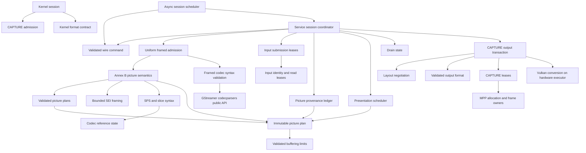

# Conformance contract

This matrix defines the supported stateful decoder contract. A passing sample is
not evidence for another transition or codec rule. Tests use module public APIs,
the service process protocol, V4L2 ioctls, or Chromium. No test may accept a wrong
pixel hash, skip a supported case, or substitute software decoding for MPP.

## Authorities

- [V4L2 stateful decoder](https://docs.kernel.org/userspace-api/media/v4l/dev-decoder.html): initialization, decoding, dynamic resolution change, drain, seek.
- [V4L2 buffers](https://docs.kernel.org/userspace-api/media/v4l/buffer.html): capacity, ownership, timestamps, sequence and field metadata.
- [H.264](https://www.itu.int/rec/T-REC-H.264): 3.36–3.37 complementary fields; 7.3/7.4 syntax; 8.2.5 reference marking; C.4 output order; E.2 buffering restrictions.
- [H.265](https://www.itu.int/rec/T-REC-H.265): 7.3/7.4 syntax and temporal limits; 8.3 reference derivation; C.5 decoded picture buffering.
- [VP8 (RFC 6386)](https://www.rfc-editor.org/rfc/rfc6386.html): uncompressed frame tag, compressed header and coefficient partitions.
- [VP9 bitstream specification](https://www.webmproject.org/vp9/#draft-vp9-bitstream-and-decoding-process-specification): uncompressed/compressed headers, tiles and superframe index.
- [AV1 specification](https://aomediacodec.github.io/av1-spec/av1-spec.pdf): frame/header/tile-group OBUs and tile group semantics (FRAME requires an implicit complete group).
- Linux DMA-BUF CPU access and reservation fences; Vulkan external-memory ownership and synchronization.
- `kernel/bridge_uapi.h`: the sole bridge wire contract; no older protocol is accepted.

Annex B metadata extraction follows H.264 B.1 and H.265 B.2: start-code
framing (`zero_byte`, `trailing_zero_8bits`) is separate from a retained
parameter NAL. A seek must not convert that framing into growing configuration
payload. Original coded submissions retain their complete bytes for MPP.

The bridge also decodes deployed AVC streams whose disposable B pictures reuse
the preceding reference's `frame_num` (observed on Bilibili). This numbering
departs from the constraint in 7.4.3, but does not identify retained reference
storage: disposable pictures receive distinct serial identities and leave the
reference DPB unchanged. Repeated reference-frame numbers still reject unless
they form a valid complementary field pair. The synthetic
`h264-disposable-frame-num.h264` fixture was encoded from FFmpeg testsrc2 at
128x96/30, 16 frames, x264 medium with
`bframes=3:b-adapt=0:b-pyramid=normal:ref=3:keyint=16:scenecut=0`; only seven
disposable slices' four-bit `frame_num` fields were changed to the preceding
reference number. FFmpeg decodes the original and changed streams identically.
`browser-h264-disposable-frame-num.mp4` uses the same testsrc2 pattern, encoder
parameters and marking change at 1920x1080 in MP4, preserving the encoder's
B-picture PTS/DTS at 30 fps.
Module admission, process pixel comparison and composed Chromium playback all
exercise this case. Neither fixture contains downloaded video content.

Level/profile declarations likewise do not replace checked allocation limits.
H.264 admission accepts an understated or unknown level when actual dimensions,
reference count and explicit VUI buffering fit implementation bounds. Level-based
inference remains useful when consistent; an unknown or contradictory hint uses
the bounded sixteen-picture inference instead. Explicit reorder/buffering
requirements must still be consistent and fit the same actual limits. The
`service/test_input_errors.py` advertised-level cases preserve every reference
pixel and completion, both initially and in an established stream.

While seeking, H.264 pictures without an IDR or recovery point are ineligible
before their reference marking or POC derivation runs. Missing references from
before the seek are expected; skipped pictures cannot seed state for pictures
that were never decoded. The leading-dependent-picture process case exercises
an MMCO against such an absent reference before a complete IDR-led sequence.

## Normative behavior and verification matrix

| ID | Contract / invariant | Required partitions | Verification owner |
|---|---|---|---|
| K01 | Format negotiation does not invalidate allocated queues | TRY/SET/GET, supported/unknown codec, empty/allocated queue, extent limits | kernel/test_formats.py |
| K02 | QBUF storage covers the committed layout | initial/changed layout, equal/larger/smaller pool, before/after CAPTURE STREAMOFF | kernel/test_buffers.py, kernel/test_reconfigure.py |
| K03 | Each queue submission completes at most once; storage reuse cannot authorize an older completion | OUTPUT and CAPTURE slot reuse, replay before/after requeue, zero/wrong token, valid/stale/duplicate/error frame, index and payload boundaries | kernel/test_input_order.py, kernel/test_frame_reply.py, src/backend/capture_tests.rs, src/backend_tests.rs, service/test_decode.py |
| K04 | OUTPUT completion preserves enqueue order and has a monotonic sequence | reversed indices, recycling, deferred input, OUTPUT restart | kernel/test_input_order.py, kernel/test_metadata.py |
| K05 | Frame metadata preserves field, timestamp, source, crop and color | frames/fields, odd crop, same-size metadata change, allocation-size change; color enums reject out-of-domain wire values before narrowing to V4L2 fields | kernel/test_metadata.py, kernel/test_layout_reply.py, kernel/test_colorimetry.py, service/test_metadata.py, src/backend/output/format_tests.rs (all field-arrangement transitions, including TOP/BOTTOM parity) |
| K06 | Source change separates old output from new-layout admission | LAST, blocked DQBUF, sufficient pool reuse, undersized pool rejection, replacement; stale layout generations cannot roll back the format or publish another event | kernel/test_reconfigure.py, kernel/test_layout_reply.py, service/test_reconfigure.py |
| K07 | Drain completes preceding input only; START preserves decoder references | explicit/natural EOS, deferred input, repeated START/STOP, empty stream; EOS requires drain, exactly one completion, no frames until resume, same/later batch | src/backend/flow_tests.rs, kernel/test_commands.py, service/test_continuation.py, service/test_bitstream.py |
| K08 | CAPTURE stop preserves OUTPUT; OUTPUT seek reconstructs retained CAPTURE ownership in its new epoch | running/draining/reconfiguring, acknowledgement/disconnect/timeout, CAPTURE QBUF before OUTPUT starts, held images, seek without CAPTURE streamoff for every codec/depth | kernel/test_lifecycle.py, kernel/test_stop_serialization.py, kernel/test_capture_ownership.py, kernel/test_decode_lifecycle.py, service/test_lifecycle.py |
| K09 | Blocking calls do not prevent progress or mutate each other's transaction | event wait, DQBUF wait, concurrent stop and mutations | kernel/test_blocking_events.py, kernel/test_stop_serialization.py |
| K10 | Failure ends one decoding incarnation; complete teardown permits same-fd initialization | close/disconnect, fd exhaustion, fatal reply; every reply after FAILED in the same/later batch rejects mutation; START/STOP/S_FMT/STREAMON reject before both queues are stopped and freed; replacement service endpoint cannot share ownership with the failed incarnation | kernel/test_sessions.py, kernel/test_reinitialize.py, service/test_concurrency.py, service/test_recovery.py |
| P01 | Wire validation precedes resource transfer or state mutation | version, batch/message reserved, every event including CLOSE, all undefined flags, validation before pool registration/state mutation, clean FAILED reply, count, epoch, generation, pool, slot, unsupported message | kernel/test_batch.py, kernel/test_reply_validation.py, kernel/test_pool.py, service/test_protocol.py, service/test_protocol_validation.py, service/test_registration.py |
| P02 | Registration publishes file ownership only after successful copyout | partial export, bad destination, repeated failure, concurrent fd observation during failed copyout; rollback releases uninstalled reservations | kernel/test_copyout_faults.py, service/test_registration.py |
| P03 | Bounded queues apply backpressure without losing ownership | full batch, 64 live sessions with the next offer deferred until close, many framed inputs, multi-frame AV1 TU/VP9 superframe, retained CAPTURE | service/test_admission.py, service/test_output_semantics.py, service/test_resources.py |
| C01 | Exp-Golomb parsing covers its declared integer domain | zero, 30/31/32 leading zeros, legal maximum, overflow, truncation, signed limits | crates/codec-parser/src/syntax/bits_tests.rs |
| C02 | One H.264 SPS parse supplies geometry and reference semantics | profiles, POC modes, field/frame, gaps, scaling lists, actual buffering limits, advisory understated/unknown level and intra-profile constraints | crates/codec-parser/src/syntax/h264_tests.rs, src/bitstream/h264/order_tests.rs, service/test_input_errors.py |
| C03 | Exactly one authority decides complementary picture identity | reference/non-reference, same/opposite parity, frame number, IDR, MMCO5 on first/second field, inferred frame_num=0, DPB occupancy, intervening picture | src/bitstream/h264/reference_tests.rs, src/backend/layout_tests.rs |
| C04 | MMCO operates on picture identity, not parity alone | operations 1–6, frame/paired/unpaired field, same/different pair, reused long index | src/bitstream/h264/reference_tests.rs |
| C05 | Allowed frame-number gaps execute non-existing reference marking | no gap, multiple gaps, wrap, reference/non-reference, IDR/MMCO5 reset, forbidden gap | src/bitstream/h264/reference_tests.rs, src/bitstream/h264/order_tests.rs |
| C06 | Presentation follows reference occupancy, output order and discard boundaries | capacity/reorder bounds, direct output, IDR/MMCO5, discard across DRC, hidden picture | src/backend/presentation_tests.rs, service/test_output_semantics.py, service/test_picture_order.py |
| C07 | HEVC temporal operating point, RPS and output latency are retained | sublayers, highest temporal ID, short/long refs, hidden picture, IRAP/RASL, latency extremes | src/bitstream/hevc_tests.rs, crates/codec-parser/src/syntax/hevc_tests.rs, service/test_output_semantics.py |
| C08 | Input framing does not change pictures or provenance | client-framed H.264/HEVC AU or metadata, VP8/VP9 frames, AV1 TU; independent task identities within multi-frame submissions, natural EOS continuation | service/test_bitstream.py, service/test_decode.py, service/test_output_semantics.py |
| C09 | Damaged input reports an error and permits defined recovery | initial damage, established stream, reference loss, recovery point after reserved SEI 128/383, extended headers, truncated payload/trailer, parameter reuse; H.264/HEVC unknown PPS in complete submissions, explicit/natural drain, slot reuse without error misattribution, exact recovered pixels | src/bitstream_tests.rs, src/backend/input_tests.rs, service/test_input_errors.py, service/test_framed_errors.py, service/test_framed_boundaries.py, service/test_bitstream.py, service/test_picture_order.py |
| C10 | POC is derived from normative syntax without a software decoder | H.264 types 0/1/2, LSB and frame number wrap, nonreference pictures, field deltas, MMCO5, overflow without state commit; HEVC prevTid0 selection, IRAP reset, excluded leading pictures | src/bitstream/h264/poc_tests.rs, src/bitstream/hevc/poc_tests.rs |
| C11 | Metadata and picture ownership remain bounded and distinct | separate H.264/HEVC configuration and SEI, AV1 sequence restoration, combined packet limit, frame-budget rejection cannot initialize prediction or commit parameters, shared read lease surviving original owner | src/frontend_tests.rs, crates/codec-parser/src/lib_tests.rs, crates/codec-parser/src/vp9_tests.rs, src/bitstream_tests.rs, crates/rkmpp/src/packet_tests.rs, service/test_metadata.py |
| C12 | Restoring Annex B configuration is byte-idempotent | three/four-byte start codes, trailing framing zeros, 0/1/2/64/4096 padding bytes, 64 H.264/HEVC seeks, all five codecs across 2/8 process-level decode epochs | src/bitstream/codec_tests.rs, src/bitstream_tests.rs, service/test_lifecycle.py |
| R01 | A returned CAPTURE slot cannot be written until QBUF | decoder frame, GPU copy, bufferless error, reuse including unqueued empty LAST, retained reference read | src/backend/capture_tests.rs, crates/rkmpp/src/reservation_tests.rs, crates/rkmpp/src/group_tests.rs, service/test_resources.py |
| R02 | Decoder and display leases jointly bound memory pressure | registered/unqueued slots, exhaustion/requeue, 18/32 capacity, aliased DMA storage rejection before import, reset and source change | crates/rkmpp/src/group_tests.rs, service/test_picture_order.py |
| R03 | DMA storage outlives every user and mappings remain coherent | MMAP/export, release/fork, CPU/device ownership, fd reuse, owned image metadata source | kernel/test_buffers.py, crates/dma-buf/src/memory_tests.rs, crates/dma-buf/src/memory/persistent_tests.rs, crates/dma-buf/src/image_tests.rs, service/test_resources.py |
| R04 | GPU completion precedes release and publication | success/error/timeout, import eviction, source/destination alias, short allocation, first write to untouched oversized DMA storage | src/quantize_tests.rs, src/hardware_tests.rs, src/quantize/context_tests.rs |
| R05 | Conversion preserves visible samples and signaled color | NV12 exact copy, NV15 dither, odd sizes, crop, 8/10-bit, HDR metadata; test pixel extraction borrows synchronized DMA storage and returns owned compact planes | src/quantize_tests.rs, support/dmabuf_tests.py, service/test_bitstream.py, browser/test_playback.py |
| B01 | Browser uses hardware decoding and displays the actual result | H.264/VP8/VP9/AV1, 8/10-bit, replay/pause/seek, source change, concurrent players | browser/test_playback.py, browser/test_sessions.py |
| B02 | Tests inherit the desktop without forcing a graphics backend | background window, default compositor, WebGL, cancellation | browser/test_graphics.py, browser/test_sessions.py |
| O01 | Process lifecycle and diagnostics are observable without privileges | startup failure, signals, identity, socket ownership, resource cleanup | service/test_cli.py, service/test_diagnostics.py, service/test_recovery.py |
| T01 | CPU averages preserve accounting intervals and exclude warmup without inventing subinterval load | unequal durations, crossing warmup, gaps, overlap, nonfinite/empty/reversed intervals; CPU sample distribution distinct from elapsed-time average | tools/performance/report_tests.py, tools/performance/telemetry_sampler_tests.py |

Paths beginning `src/` or `crates/` are relative to the repository; other test paths are
relative to `tests/`. Each owner must test normal, rejected and boundary behavior
through its public interface. A row is not complete merely because a file exists.

## Queue transition matrix

| State | Input QBUF | CAPTURE QBUF | STOP / EOS | CAPTURE STREAMOFF | OUTPUT STREAMOFF |
|---|---|---|---|---|---|
| Awaiting headers | submit in order | provisional allocation only | drain accepted input | preserve input | invalidate epoch and all input leases |
| Running | submit in order | validate active layout and transfer write ownership | stop submission at boundary | stop output, preserve references | reset codec and input provenance |
| Source change draining | preserve ordering | old allocation remains valid for old output | serialize with boundary | commit new required layout, retain allocation only if it fits | reset whole stream |
| Source change stopped | defer incompatible output | reject capacity below new requirement | retain boundary | idempotent stopped state | reset whole stream |
| Draining | defer after boundary | recycle to finish preceding pictures | repeated STOP cannot create another drain | abort drain, retain references for resume | reset whole stream |
| Drained | defer until START | LAST exactly once | START resumes without resetting references | allow restart | reset whole stream |
| Failed incarnation | reject | reject | reject | release safely | release safely |
| Failed, both queues stopped and freed | reinitialize first | reinitialize first | new incarnation only | already stopped | already stopped |
| Closed | reject | reject | reject | release safely | release safely |

Every applicable transition is crossed with stale epoch/generation, empty/full
queues, retained user buffers, and service failure. Old-generation DRC recycling
must not be confused with new-layout admission after STREAMOFF.

### Service transaction partitions

| Owner / initial state | Operation | Required observable result | Unit contract |
|---|---|---|---|
| Flow / running | explicit STOP or natural EOS | exactly one waiting drain; overlapping drain rejected | src/backend/flow_tests.rs |
| Flow / waiting | completion | exactly one notification; resume resets only natural sequence state | src/backend/flow_tests.rs |
| Flow / waiting | CAPTURE stop, then completion | no stale notification; explicit references survive, natural sequence resets | src/backend/flow_tests.rs |
| Flow / complete | stop or resume | return to running; no duplicate completion | src/backend/flow_tests.rs |
| Negotiation / active | changed layout with old pool | wait; old pool cannot acknowledge the new format | src/backend/output/negotiation_tests.rs |
| Negotiation / waiting | stop, register, start | pending MPP acknowledgement survives; activation requires enough registered slots | src/backend/output/negotiation_tests.rs |
| Negotiation / waiting | reuse | activate only after the explicit reuse transaction | src/backend/output/negotiation_tests.rs |
| CAPTURE / idle | prepare write | no writable target until QBUF | src/backend/capture_tests.rs |
| CAPTURE / queued | prepare, abort | ownership stays queued; no display completion | src/backend/capture_tests.rs |
| CAPTURE / queued | prepare, commit | owned display lease and the exact queue token survive until completion; recycle creates a new ownership instance | src/backend/capture_tests.rs |
| CAPTURE / imported | reuse | pin every imported slot before dropping old leases; release pins individually on QBUF | src/backend/capture_tests.rs, crates/rkmpp/src/group_tests.rs |
| Input / owned submission | damaged framed input | mark matching live origins; completion reports ERROR without attributing it to a reused slot or timestamp | src/backend/input_tests.rs, service/test_input_errors.py |
| Input / split into tasks | lease release | no writer until every task releases its read lease; no whole-payload copy for ordinary framed input | crates/rkmpp/src/packet_tests.rs, src/backend/input_tests.rs |
| Frontend / framed submission | admission | validate before submitting tasks; metadata-only input completes without borrowing the next picture timestamp; preserve configuration and SEI for MPP | src/frontend_tests.rs, src/bitstream_tests.rs, service/test_input_errors.py, service/test_metadata.py |

## Architecture contracts

The boundaries below hide decisions, not just functions. The worker admits every
wire event through protocol/command before registration, CLOSE or backend dispatch;
the backend accepts only Command. FAILED is constructed from routing metadata,
never by copying an invalid message. MMCO5 derives one stored frame number for
unpaired identity, reference entries and previous-reference tracking. No codec parser or
presentation scheduler decides CAPTURE allocation ownership, and no buffer ledger
infers codec reference identities.

| Module | Owns / hides | Public contract | Verification |
|---|---|---|---|
| kernel/session | V4L2 queue transactions, epochs and ordered completion | V4L2 ioctls and bridge UAPI | kernel integration group |
| kernel/session/capture | old draining capacity versus committed required capacity | update, stop, prepare, activate | K02, K06 |
| protocol/command | wire event admission before resource transfer or mutation | TryFrom<Message> → Command, typed kind and immutable wire view | src/protocol/command_tests.rs, service/test_protocol.py |
| bitstream/report | Annex B semantic results | validated geometry, picture plan, borrowed/owned payload and natural boundary | src/bitstream_tests.rs |
| frontend | codec-specific admission behind one task interface | admit, seek; all codecs return tasks and a boundary | src/frontend_tests.rs |
| submission | compressed input identity and storage lifetime | Origin; rkmpp::packet owns input-range/prefixed Payload | src/backend/input_tests.rs, crates/rkmpp/src/packet_tests.rs |
| codec-parser | all five codecs’ header state and framed packet bounds | new, validate; rejected input never reaches MPP; recover at keyframe | crates/codec-parser/src/*_tests.rs, service/test_framed_errors.py, service/test_framed_boundaries.py |
| backend/input | registered input leases and submission identity | prepare → Origin, damage → live match, complete → error status | src/backend/input_tests.rs, service/test_input_errors.py |
| bitstream/sei | SEI framing and RBSP termination independently of payload meaning | next → bounded message or end/error | src/bitstream/sei_tests.rs, service/test_picture_order.py |
| codec-parser::syntax/h264 and codec-parser::syntax/hevc | SPS syntax shared by geometry and reference interpretation | parse → Sequence | C02, C07 |
| bitstream/h264/reference | complementary identity, MMCO, missing references, sliding window | apply(Picture) → State | C03–C05 |
| codec-parser::limits | decoded-picture storage/reorder/latency bounds | new, capacity, reorder, latency | crates/codec-parser/src/limits_tests.rs |
| picture/plan | immutable semantic handoff | Plan construction, observation, checked pair completion | src/picture/plan_tests.rs |
| backend/layout | serial-to-picture provenance and explicit continuation association | push, peek, complete, finish, take | src/backend/layout_tests.rs |
| backend/presentation | reference occupancy and output scheduling | prepare, picture, take, drain, discard | C06–C07 |
| backend/flow | explicit versus natural drain semantics | begin, complete, abort, resume | K07–K08 |
| backend/output | entire CAPTURE transaction, fenced GPU completion and reply publication | register, start, stop, recycle, push, typed status | src/backend/output_tests.rs, service group |
| backend/output/format | validated decoded-to-CAPTURE format and change detection | new, changed, message | K05, R05 |
| backend/output/negotiation | layout acknowledgement and pool activation | announce, start, stop, commit | K06, K08 |
| backend/capture | per-slot state and display/write leases | prepare_write → borrowing Target, commit/drop, recycle | R01–R02 |
| rkmpp::decoder | synchronous execution and staged-input progress | packet → Blocked / Progress / Consumed; frame, idle, reset | crates/rkmpp/src/decoder_tests.rs, browser/test_playback.py |
| rkmpp::group and rkmpp::reservation | SDK group retention and buffer refcounts | import, pin, reserve; RAII release | R01–R03 |
| hardware and quantize | owned hardware execution and GPU visibility | bounded async requests → completed hardware operation | R04–R05 |

Tests observe each boundary through its public API. The service group replaces
the kernel with LD_PRELOAD but uses real MPP, DMA-BUF and Vulkan. The kernel group
replaces the service with a protocol peer. The browser group covers both together.
The distinction matters: a unit contract cannot substitute for hardware pixel
acceptance, and a passing playback cannot substitute for invalid-state testing.

## Resource invariants

1. Every input has one provenance record and one ordered completion.
2. Every picture identity is allocated by the codec semantic state machine.
   A field continuation names that identity explicitly; the metadata ledger never
   derives pairing from frame number or parity.
3. Non-existing H.264 references occupy the logical DPB but have no display image.
4. A CAPTURE slot is writable only while queued and while the corresponding MPP
   or GPU write lease is held. DQBUF may leave codec read references alive.
5. Every imported descriptor and image remains owned until all asynchronous work
   and display leases have completed, including error paths.
6. Format generation, allocation capacity and activation state are distinct.
   Every transition to active CAPTURE performs the same admission check.
7. No error handler silently converts an unsupported legal syntax value into
   successful end-of-stream. Damaged-input recovery must remain observable.
8. A submission identity is independent of timestamp and slot index. Each
   client-framed input is admitted synchronously before its tasks reach MPP.
   Rejected admission marks that live input ERROR; decoded bufferless error
   pictures use their task identity and an empty ERROR CAPTURE completion.
   Neither path may attribute damage to a reused slot or another timestamp.
9. Failure invalidates outstanding kernel reply ownership before poisoning both
   queues. No later reply may publish a layout, frame, completion or EOS, even
   in the batch containing FAILED. Only stopping both queues and releasing all buffers permits a new incarnation. Its endpoint, format and ownership are fresh; stale endpoints cannot read, write, register or poison it.

Service test observations retain INPUT_DONE flags and empty ERROR CAPTURE
notifications separately from pixel-bearing frames. Recoverable parser errors
must be asserted through these replies, not inferred from stderr messages.

## Validation and known external failure

Native SDK declarations are compiler inputs. MPP functions, dispatch-table and
buffer-info layouts, codec values and control constants come from the selected
headers. `support/mpp_sdk_tests.py` removes an SDK operation in an isolated header
fixture and requires Cargo to reject the consumer. MPP and GStreamer share the
same native-sdk discovery and invalidation contract, also exercised through
`support/build_configuration_tests.py`.

Run formatting, static checks, Rust tests, preload tests, kernel build, the full
Python integration suite and v4l2-compliance. Do not filter out failed cases.
The existing `h264-mmco5.h264` pixel assertion remains strict: direct MPP also
reproduces its nine mismatching frames. It is an unresolved external-path result,
not permission to weaken any row or mark the full suite as passing.

The installed FFmpeg V4L2 client is not an acceptance substitute. An ioctl trace
of `h264-yuv420p.h264` shows it allocating 49152-byte CAPTURE storage, then reading
a 65536-byte `sizeimage` at unchanged 256x128 dimensions. It sends START without
reallocation, ignores EINVAL and consumes the empty LAST as an image before EPIPE.
Its `v4l2_resolution_changed` compares only width/height; `v4l2_handle_event` ignores
the return from `v4l2_start_decode` on that path. V4L2 Capture Setup explicitly
requires the new `sizeimage` to fit the allocated buffers before immediate reuse.
K02/K06's `size_only` cases require rejection followed by proper reallocation;
they must not be relaxed to accommodate this client. FFmpeg also reproduces its
`ffmpeg_dec.c:753` packet assertion with the short Main10/VP9 resize samples.
These client failures remain visible alongside the MPP pixel failure.

VP9 repeated presentation remains a strict external failure. A keyframe followed
by three `show_existing_frame` packets must yield four identical images with four
presentation timestamps. `service/test_repeated_picture.py` and the direct MPP
regression `test_packet_repeated_reference_publishes_each_presentation` retain
this requirement. Rockchip MPP 1.1.0 publishes only the first image: its VP9 parser
enqueues an existing reference into `QUEUE_DISPLAY` without a hardware task,
while the synchronous decoder's invalid/no-output-task path does not publish
that queue without EOS. These failures must not become skips or expected failures.

AV1 6.2.2 and 6.2.3 require decoders to ignore `obu_reserved_1bit` and
`extension_header_reserved_3bits`. The bridge no longer rejects the former,
but the installed GStreamer codecparsers dependency rejects both. Calling
`gst_av1_parser_identify_one_obu` directly, without this project, accepts temporal
delimiter bytes `12 00` (status 0, consumed 2) but rejects `13 00` and `16 07 00`
(BITSTREAM_ERROR, consumed 0). The two reserved-bit acceptance cases in
`crates/codec-parser/src/av1_tests.rs` explain and retain these external failures.
Original media bytes are not rewritten to conceal the dependency's rejection.

MPP 1.1.0 also consumes an H.264 IDR with an unknown `level_idc=255` without
publishing its image. `test_packet_unknown_h264_level_preserves_bounded_picture_output`
uses the public MPP adapter directly with two otherwise identical IDRs: levels
11 and 10 publish timestamps `[0, 1]`, whereas level 255 followed by level 11
publishes only `[1]`. This bypasses bridge parsing and presentation entirely.
The corresponding four unknown-level process partitions retain their exact
pixel/completion assertions and fail on the missing picture obligation at drain.
The understated-level partitions pass with the same hardware. Neither the SPS
nor the native dependency is patched to make these cases green.

## Whole-project audit, 2026-10-24

The audit covered the kernel queue/endpoint/memory contracts, service scheduling
and cancellation, codec admission and picture ordering, MPP object ownership,
DMA-BUF alias exclusion, Vulkan imports/submission/retirement, generated UAPI,
native SDK discovery, Python support code and performance instrumentation.
The confirmed inventory is **nine defects: three fixed in this repository and
six external failures retained**. This counts defects rather than parametrized
test failures. External dependencies were not modified.

| ID | Failure and root cause | Architectural cause? | Disposition and regression |
| --- | --- | --- | --- |
| R1 | H.264 sequence termination set `seeking` but retained the previous DPB, POC and frame-number history. A recovery point could retain old references or fail the forbidden-gap check against the previous sequence. | Yes: seek and sequence termination maintained different, incomplete reset transactions. | Fixed: `H264::boundary` uses the complete seek transition while preserving picture serials. `test_boundary_recovery_starts_independent_reference_and_number_history` failed before the fix and now checks both retained-reference contamination and an independent frame-number origin. |
| R2 | HEVC picture equality compared unused native C fields: an SPS index alongside explicit RPS data, local long-term fields alongside SPS indices, absent MSB cycles, and prediction fields absent from IDR. The owned IDR header also copied an absent POC instead of inferring zero. | Yes: the representation allowed mutually exclusive syntax alternatives to coexist and confused C storage with syntax presence. | Fixed: `picture::references` owns typed short/long-term alternatives and optional MSB cycles; `picture` owns optional prediction state; IDR POC is normalized to zero. `picture_tests`, `picture/references_tests` and `test_own_idr_infers_zero_poc_without_prediction_syntax` cover ignored inactive storage, strict active-field consistency and count bounds. |
| R3 | Performance reports excluded warmup for utilization and presentation gaps but calculated the dropped-frame percentage from lifetime playback counters. The first 4K30 H.264 measurement reported 0.82%, without enough timestamped evidence to determine whether the drops occurred during warmup. | Yes: playback observations had no sampling time or explicit counter window, and collection mixed lifetime counters with steady-state summary policy. | Fixed: `performance::playback` owns timestamped observations and checked window summaries. Only differences between complete post-warmup observations contribute. Counter resets/inconsistent deltas reject; insufficient observations return ENODATA. Report schema v4 publishes the window and frame deltas; the ambiguous lifetime percentage field is removed. Twenty-two new cases in `performance/playback_tests.py` define this contract. |
| E1 | GStreamer's OBU identifier rejects AV1 `obu_reserved_1bit` instead of ignoring it. | External parser admission rule; no bridge architecture cause established. | Strict acceptance assertion and direct native reproduction documented in `crates/codec-parser/src/av1_tests.rs`. |
| E2 | GStreamer's OBU identifier rejects AV1 extension-header reserved bits. | External parser admission rule; no bridge architecture cause established. | Same file retains a separate strict extension-header acceptance assertion. |
| E3 | MPP consumes an otherwise decodable H.264 IDR with unknown level 255 without publishing its image. | External decode path; no bridge architecture cause established. | Direct `rkmpp::decoder_tests` reproduction plus four process partitions in `service/test_input_errors.py`. |
| E4 | MPP does not publish VP9 `show_existing_frame` images on the synchronous path without a hardware task. | External scheduling mismatch between the display queue and task completion. | Direct decoder regression plus three process partitions in `service/test_repeated_picture.py`; timestamps and pixels remain strict. |
| E5 | Nine MMCO5 conformance images differ from the independent software reference, including with direct MPP decoding. | Unresolved within the external MPP/vendor path: library, driver and hardware have not been distinguished. | Exact pixels retained in `service/test_picture_order.py`, with the existing reproduction/evidence comment. |
| E6 | The installed v4l2-compliance build stops codec classification at AV1 and then rejects the stateful decoder's required capture-minimum control. | External capability-classification logic; not a bridge architecture defect. | `kernel/test_compliance.py` documents the independent ioctl reproduction and retains the failing assertion. |

R2 follows the conditional syntax and inference rules in
[H.265 clauses 7.3.6.1 and 7.4.7.1](https://www.itu.int/rec/dologin_pub.asp?id=T-REC-H.265-201906-S%21%21PDF-E&lang=e&type=items).
R3 uses the cumulative-counter semantics of the
[Media Playback Quality specification](https://w3c.github.io/media-playback-quality/).

The new HEVC child module hides native optional-field representation and bounds;
it does not expose a second parser or a compatibility path. Dependencies are
`hevc -> picture -> picture::references -> ffi`, with no reverse edge. Both
picture modules forbid unsafe code. Later slice comparisons borrow the parsed
record and allocate no reference vectors. The audit did not confirm another
unnecessary or overly broad unsafe operation; native calls, descriptor adoption,
memory mappings and Vulkan submission still require their existing ownership
and lifetime proofs.

An authored-source inventory found no module exceeding the module-design public
operation/entity thresholds. A static local-use/qualified-path dependency scan of
121 Rust source modules found no cycles; its graph is recorded in
`target/review/20261024-audit/dependencies.json`. This source scan complements
compilation and public-interface tests; it does not analyze generated or foreign
implementation internals.

Validation evidence lives under `target/review/20261024-audit/`. Formatting,
workspace/all-target Clippy with `-D warnings`, `cargo build`, Ruff and
basedpyright pass; basedpyright reports zero errors and warnings. The complete
Rust suite runs 575 tests: **571 pass, four fail**, with no ignored tests. The
four failures are E1-E4 and match the original baseline; all seven added
regressions pass. A clean kernel rebuild with `W=1 KCFLAGS=-Werror` succeeds.
The external kernel build system still reports GCC 16 versus the kernel's GCC
14, a warning from its Perl `kernel-doc`, and unavailable `vmlinux` for BTF.
These messages were not suppressed or patched outside this repository.
The final complete Python suite reports **1179 passed, nine failed in 529.17 seconds**,
with no skips or expected failures. All 22 added playback-window cases pass.
Its failure set exactly matches the baseline:
one E6 compliance case, four E3 unknown-level cases, one E5 MMCO5 pixel case and
three E4 repeated-presentation cases. E1/E2 remain covered by the Rust suite.

### Performance observations

Measurements use the debug service, actual V4L2 hardware decoding and the current
desktop. Three v4 runs observed 4K30 playback for 12 seconds, excluding two seconds
of warmup. CPU percentages below use one core as 100%; GPU load is shared.

| Codec | Service CPU | Shared GPU | Post-warmup frames | Post-warmup drops |
| --- | --- | --- | --- | --- |
| H.264 | 8.16% | 22.91% | 299 | 0 / 0.00% |
| VP9 10-bit | 11.31% | 27.00% | 299 | 26 / 8.70% |
| AV1 10-bit | 12.36% | 45.27% | 297 | 0 / 0.00% |

H.264's lifetime counters contained three dropped frames while its post-warmup
window contained none, demonstrating why the two scopes must remain distinct.
Two further VP9 runs with the default GPU policy measured 1.36% and 0.00% drops.
Two 15-second VP9 controls with five seconds of warmup and an explicitly requested
1 GHz GPU minimum measured 0.00% in both runs. GNOME Shell CPU was 31.05% and
23.04% in those controls; service CPU was 10.57% and 10.55%. Every measurement
released its owned service and restored the original 200 MHz GPU minimum and
MPP sampling interval 0.

These observations identify variable presentation deadlines, not a proven
bridge CPU throughput ceiling. Shared composition load, warmup and frequency
policy were not held identical across all runs, so they do not establish a sole
governor, compositor, Chromium or bridge scheduling cause. No production frequency
policy was changed to conceal the variation. The VP9 service log records 371
quantized outputs without copy fallbacks or decode errors in the 8.70% run;
CAPTURE wait counts are bounded backpressure observations, not lost pictures.
Per-frame latency attribution across the bridge and compositor remains a limit
of this measurement. Complete evidence, including the anomalous run, is retained
in `performance-v4/`, `vp9-repeat/`, `vp9-frequency-control/` and
`performance-comparison.json` beneath the audit evidence directory.
